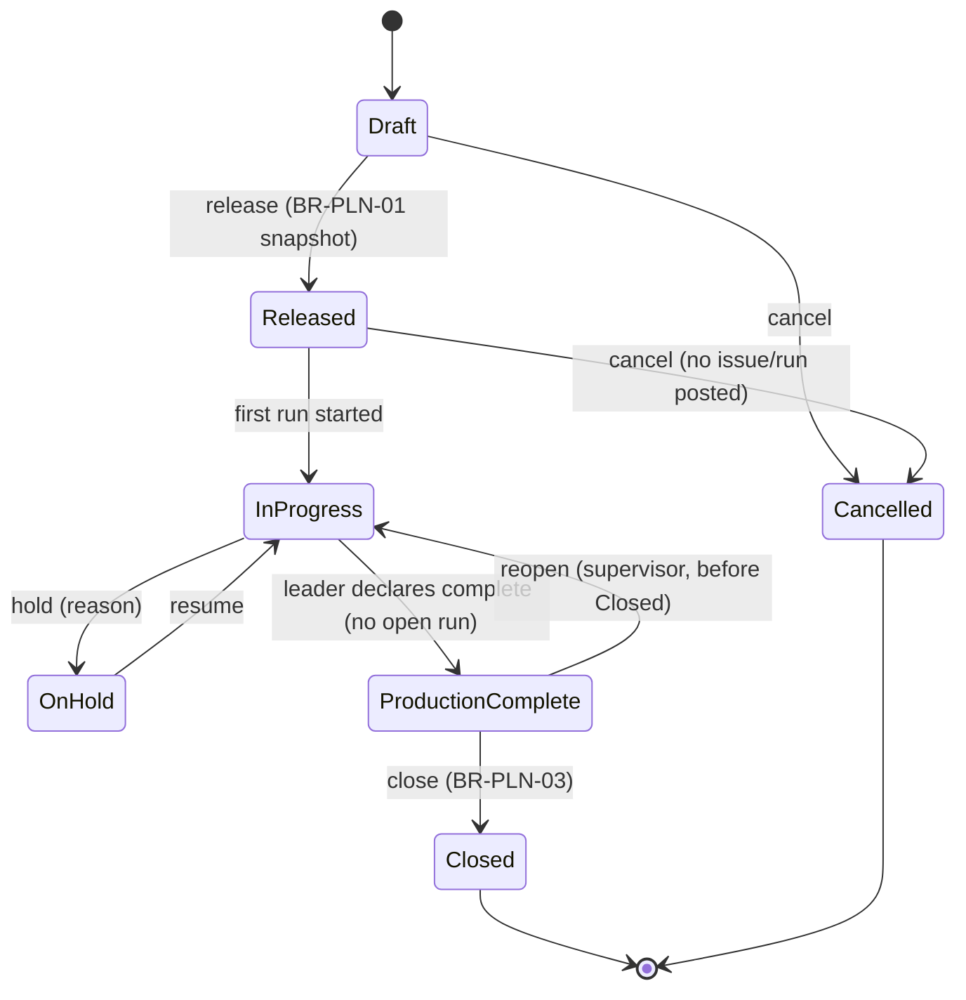
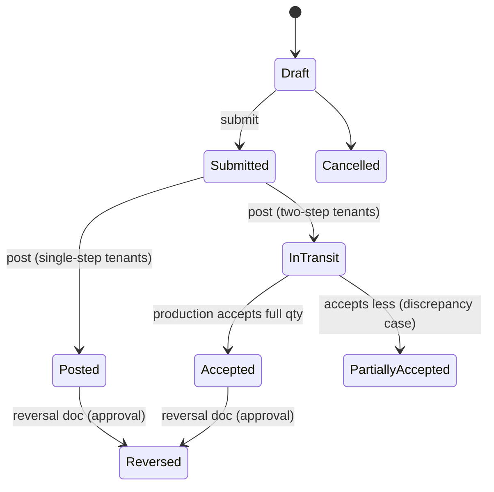
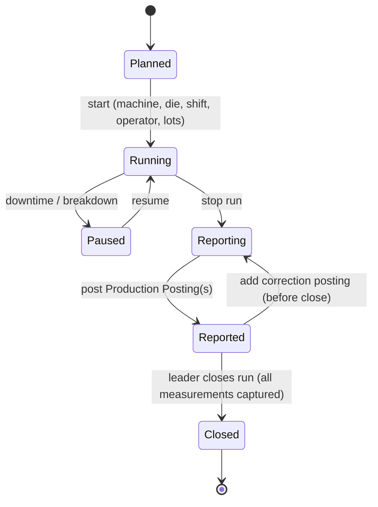
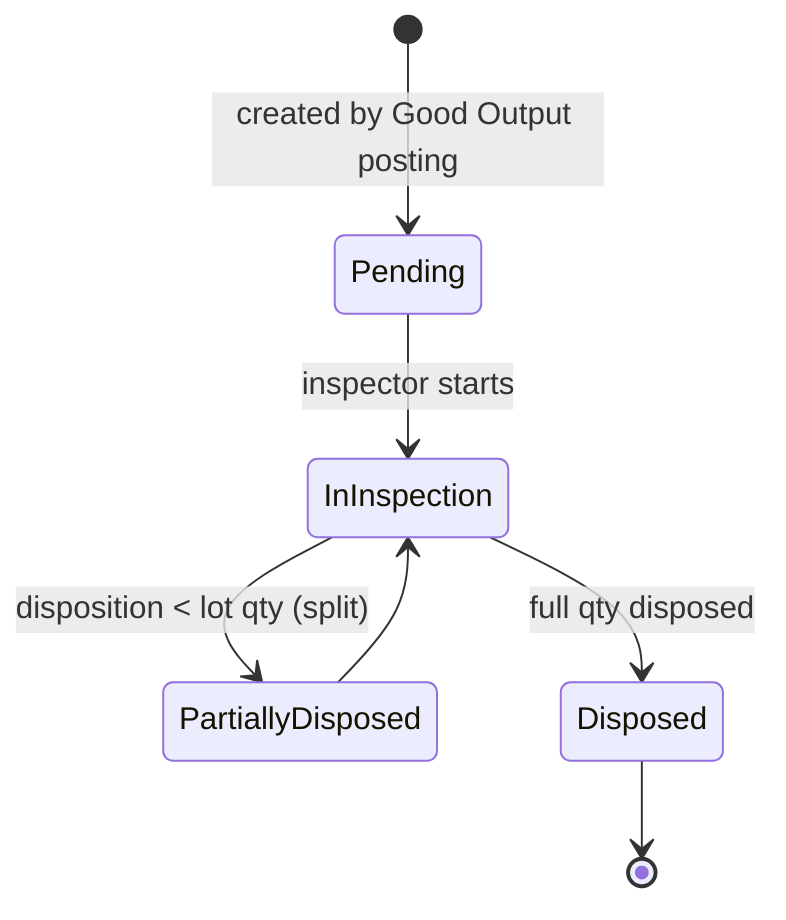
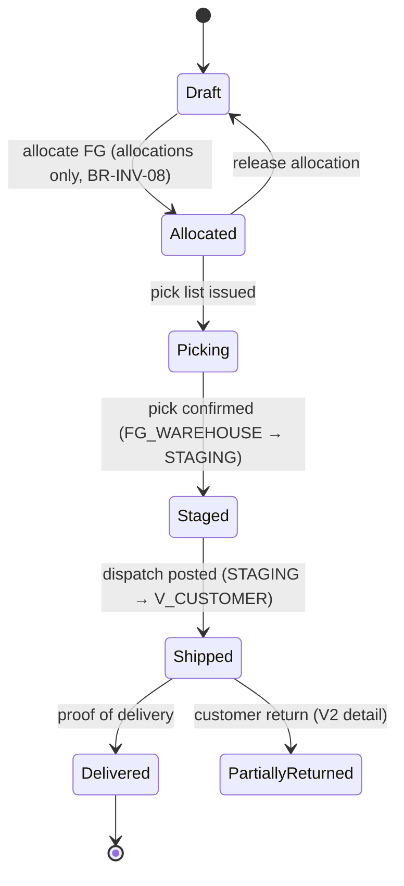
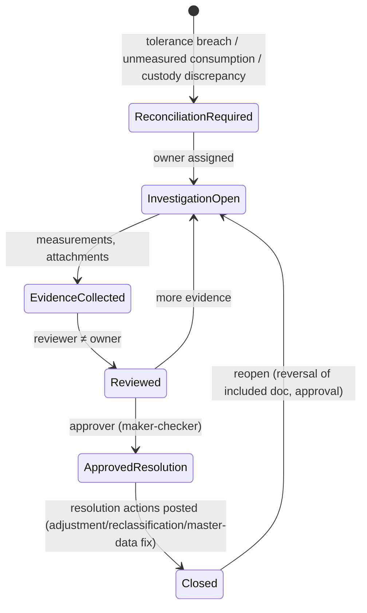
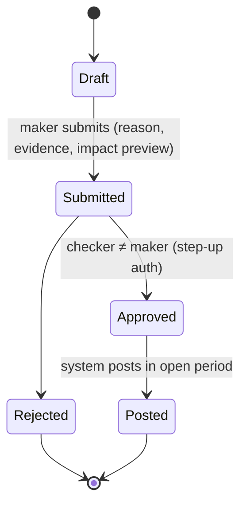

# 16 — State Machines for Critical Transactions

Conventions: document states (workflow) are separate from stock statuses (ADR-0002). Every transition = authorized command → validation → (ledger posting if any) → audit event → outbox event, inside one DB transaction. `Posted` documents are immutable; `Reversed` is reached only through a linked reversal document. Guards reference rules in doc 15.

## 1. Work Order

| Transition | Actor | Guard | Ledger | Event |
|---|---|---|---|---|
| release | PPIC | BOM/routing/CP/SY/NW versions effective; demand link valid | none | `wo.released` → Production, Materials |
| cancel from Released | PPIC | no posted issue/run for WO | allocations released | `wo.cancelled` |
| close | PPIC + (approver if exception) | no open runs; no WO allocation at MAT_AT_PROD; indicators FINAL or case open; no PENDING drafts | none | `wo.closed` |

## 2. Material Issue (with optional two-step custody)

| Transition | Ledger legs | Guard |
|---|---|---|
| post (single-step) | `RM_WAREHOUSE/UNRESTRICTED −q` → `MAT_AT_PROD(WC)/UNRESTRICTED +q`; allocation to WO | BR-ISS-04, BR-INV-04/06 |
| post (two-step) | `RM_WAREHOUSE −q` → `CUSTODY_TRANSIT +q` | same |
| accept | `CUSTODY_TRANSIT −a` → `MAT_AT_PROD +a`; if `a<q` remaining stays in transit and case `CUSTODY_DISCREPANCY` opens | acceptor ≠ issuer |

## 3. Production Run and Production Posting

Production Posting document: `Draft → Posted → (Reversed)`. Post = one atomic transformation (ADR-0004): consume legs (measured, BR-CON-01..03), produce legs Good/NG Rework/NG Rejected/Scrap. Lot Split (remnant) and Material Return are separate documents posted before measured remaining is recorded. Multi-shift run: one posting per shift (BR-PER-04). Event `production.output_posted` → Quality (if PENDING_QC), PPIC.

## 4. Inspection Lot (Quality)

Disposition lines (each is a status-change movement at `QC_AREA`/`NG_AREA`):
| Disposition | From → To stock status | Next |
|---|---|---|
| Accept | `PENDING_QC → QC_RELEASED` | FG Receipt (separate) |
| Hold | `PENDING_QC → HOLD` | later Accept/Reject (`HOLD → PENDING_QC` then dispose, or `HOLD → REJECTED`) |
| Rework | `PENDING_QC → REWORK` (move to NG_AREA) | Rework Order |
| Reject | `PENDING_QC → REJECTED` (move to NG_AREA) | Scrap Disposition |
Guards: BR-QC-01..03. Reversal of a disposition allowed only if no downstream document (FG Receipt, Rework Order, Scrap Disposition) is posted; otherwise reverse downstream first.

## 5. FG Receipt
`Draft → Posted → (Reversed)`. Post: `QC_AREA/QC_RELEASED −q` → `FG_WAREHOUSE(bin)/UNRESTRICTED +q`, handling unit assignment. Guard: q ≤ QC_RELEASED balance of that lot. Reversal blocked if FG quantity already allocated/picked beyond remaining. Event `fg.received` → PPIC, Delivery.

## 6. Delivery Order and Shipment

Partial shipment = multiple Shipment documents per Delivery Order. Over-shipment blocked (BR-FG-03).

## 7. Reconciliation Case

Resolution types: `MEASUREMENT_ERROR`, `UNREPORTED_OUTPUT` (late posting), `STANDARD_INCORRECT` (CP/SY/NW change via versioning, no retro edit), `PROCESS_LOSS_EXPLAINED` (reason code), `ACTUAL_MATERIAL_LOSS_CONFIRMED` (investigation proves physical loss — damage, spillage, missing material; requires evidence, independent approval and a stock adjustment with loss reason code; D-024), `PHYSICAL_DISCREPANCY_CONFIRMED` (requires approved stock count + adjustment). Indicators must be FINAL (BR-REC-04).

## 8. Stock Count
`Planned → SnapshotTaken → Counting → Counted → (Recount) → VarianceReview → Approved → Posted → Closed`. Snapshot freezes book quantity per location/lot at cut-off; later movements tracked as deltas. Counter ≠ approver. Posted adjustments: `location ±d ↔ V_ADJUSTMENT`.

## 9. Stock Adjustment / Reversal / Correction Request

Approval expiry: approved but unposted requests expire per tenant policy and must be resubmitted.

## 10. Inventory Period
`Open → Closing → Closed → (Reopened → Closing)`. `Closing` blocks new postings with effective date in period except by inventory controller; `Closed` blocks all; reopen per BR-PER-03.

## 11. Import Job (cross-cutting)
`Uploaded → Validating → Validated(with errors|clean) → AwaitingApproval → Committing → Committed | PartiallyCommitted | Failed`. Commit chunks are idempotent by `(job_id, row_key)`; retry never duplicates postings (doc 14 #15).

## 12. Sales Order line and Delivery Schedule Line (D-034, BR-DEM-05..11)
```mermaid
stateDiagram-v2
  [*] --> Draft
  Draft --> Firm: SO confirmed / schedule accepted (counts as firm demand)
  Firm --> PartiallyFulfilled: posted shipment, 0 < delivered < required
  PartiallyFulfilled --> Fulfilled: delivered ≥ required
  Firm --> Fulfilled: posted shipment, delivered ≥ required
  PartiallyFulfilled --> Firm: shipment reversal brings delivered to 0
  Fulfilled --> PartiallyFulfilled: shipment reversal
  Draft --> Cancelled
  Firm --> Cancelled: cancel (no delivered qty; allocations released)
  Firm --> Superseded: revision n+1 replaces line
  PartiallyFulfilled --> Superseded: revision n+1 (delivered stays here; only outstanding re-allocated)
  Superseded --> [*]
  Cancelled --> [*]
  Fulfilled --> [*]
```
| Transition | Guard | Effect |
|---|---|---|
| Draft → Firm | SO line mapped (BR-DEM-05); qty > 0; UOM = SO line UOM | enters firm demand (BR-DEM-07), consumes forecast (BR-DEM-08) |
| → PartiallyFulfilled / Fulfilled | posted shipment line referencing this schedule line (BR-DEM-09) | outstanding recomputed (BR-DEM-10); allocation consumed by shipment |
| → Superseded | revision posted with unambiguous or user-confirmed mapping (BR-DEM-11, D-038) | outstanding counts zero; posted shipments keep this line as reference; outstanding re-allocated via `schedule_reallocations`; ambiguous mapping → `REVISION_MAPPING_AMBIGUOUS` exception, line stays active until resolved; pegged WO/MPS/allocation → PPIC notification |
| → Cancelled | delivered = 0 | allocations released; pegged records notified |
SO **line** status is derived: `OPEN` (any Firm/PartiallyFulfilled), `FULFILLED` (all active lines Fulfilled), `CANCELLED` (all Cancelled), `CLOSED` (manual short-close with reason and approval, outstanding written off as demand only — no inventory effect).

## Concurrency notes (all machines)
- Commands carry `If-Match` (document version) and `Idempotency-Key`.
- Transitions that post ledger legs lock balance rows in key order (BR-INV-05).
- Stale offline PWA drafts are revalidated on submit; conflict returns `409` with server state; UI shows conflict view (doc 14 #16).
