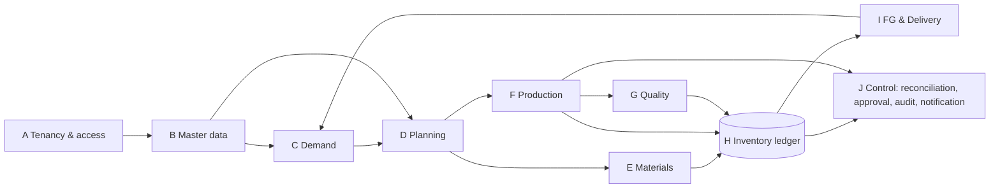

# 17 — Conceptual ERD and Logical Data Model

Logical model only — **not a migration**. Physical types, indexes and partitioning are finalized at Foundation after approval. All tenant-owned tables follow ADR-0001: `id` (UUIDv7/ULID) PK, `tenant_id NOT NULL`, `UNIQUE (tenant_id, id)`, composite FKs `(tenant_id, x_id)`, RLS enabled and forced, audit columns `created_at, created_by, updated_at, updated_by, version`.

## 1. Conceptual ERD (domains)
```mermaid
erDiagram
  TENANT ||--o{ COMPANY : owns
  COMPANY ||--o{ PLANT : operates
  PLANT ||--o{ WAREHOUSE : has
  WAREHOUSE ||--o{ LOCATION : has
  PLANT ||--o{ WORK_CENTER : has
  WORK_CENTER ||--|| LOCATION : "MAT_AT_PROD location"
  TENANT ||--o{ MEMBERSHIP : grants
  USER ||--o{ MEMBERSHIP : holds
  MEMBERSHIP ||--o{ ROLE_ASSIGNMENT : scoped
  CUSTOMER ||--o{ CUSTOMER_PO : issues
  CUSTOMER_PO ||--o{ CUSTOMER_PO_LINE : contains
  CUSTOMER_PO_LINE ||--|| SO_LINE : "mapped to (D-034)"
  SALES_ORDER ||--o{ SO_LINE : contains
  SO_LINE ||--o{ DELIVERY_SCHEDULE_LINE : "scheduled / called off by"
  FORECAST ||--o{ DEMAND_CONSUMPTION : "consumed by"
  DELIVERY_SCHEDULE_LINE ||--o{ DEMAND_CONSUMPTION : consumes
  ITEM ||--o{ BOM_VERSION : has
  ITEM ||--o{ ROUTING_VERSION : has
  ITEM ||--o{ CONVERSION_PROFILE : has
  WORK_ORDER }o--|| ITEM : produces
  WORK_ORDER ||--o{ WO_DEMAND_LINK : fulfils
  WORK_ORDER ||--o{ PRODUCTION_RUN : "executed by"
  ITEM ||--o{ LOT : "tracked as"
  LOT ||--o{ LOT : "split into (remnant)"
  INVENTORY_DOCUMENT ||--|{ INVENTORY_MOVEMENT : "has legs"
  INVENTORY_MOVEMENT }o--|| LOT : moves
  INVENTORY_MOVEMENT }o--|| LOCATION : at
  STOCK_BALANCE }o--|| LOT : projects
  STOCK_ALLOCATION }o--|| STOCK_BALANCE : reserves
  PRODUCTION_RUN ||--o{ INVENTORY_DOCUMENT : "posts (issue/posting/return)"
  INVENTORY_DOCUMENT ||--o{ GENEALOGY_EDGE : creates
  GENEALOGY_EDGE }o--|| LOT : from
  GENEALOGY_EDGE }o--|| LOT : to
  INSPECTION_LOT }o--|| LOT : inspects
  INSPECTION_LOT ||--o{ QC_DISPOSITION : has
  SHIPMENT ||--|{ SHIPMENT_LINE : contains
  SHIPMENT_LINE }o--|| DELIVERY_SCHEDULE_LINE : fulfils
  RECON_SCOPE ||--o{ VARIANCE_RESULT : calculates
  VARIANCE_RESULT ||--o| RECON_CASE : triggers
  RECON_CASE ||--o{ APPROVAL_REQUEST : needs
  INVENTORY_DOCUMENT ||--o{ OUTBOX_EVENT : emits
  OUTBOX_EVENT ||--o{ INBOX_NOTIFICATION : "fans out to"
```

## 2. Logical tables by domain

### Core / tenancy / security
| Table | Key columns | Notes |
|---|---|---|
| `tenants` | id, code, status, plan, timezone (default Asia/Jakarta), data_region | **not** RLS-scoped; platform table |
| `companies` | tenant_id, id, legal_name | |
| `plants` | tenant_id, id, company_id, code, timezone, shift_calendar_id | |
| `warehouses`, `locations` | tenant_id, id, plant_id, `location_type` (ADR-0002 §3), work_center_id nullable | virtual locations seeded per plant — **implemented M2 step 1 (migration `000900`)**: `warehouses.warehouse_type` RAW_MATERIAL/FINISHED_GOODS/GENERAL, status; locations of a warehouse share its plant (composite FK); `V_*` = code, no warehouse, always active, created by an AFTER INSERT trigger on `plants`; codes immutable |
| `work_centers`, `machines`, `dies` | tenant_id, id, plant_id, die stroke counters | **implemented M2 step 1b (migration `001000`)**: `work_centers.work_center_type` (tenant code), `available_hours_per_shift` (NULL = not configured, D-046 warning-only); one `MAT_AT_PROD` location per work center (`locations.work_center_id`, trigger, code `MAP-<wc>`) instead of a `mat_at_prod_location_id` column; machines in one work center of the same plant (composite FK), `stroke_counter`; dies DIE/JIG/FIXTURE, `UNIQUE (tenant_id, code)`, cavities, `stroke_life`, `current_strokes`, status ACTIVE/INACTIVE/MAINTENANCE |
| `users` | id, display_name, locale, email_display | global profile only; login identity (normalized email, account status) and credentials live in `auth.identities`, reachable only through reviewed definer functions — never by the business runtime role (doc 25 §2.1–§2.2, proposed) |
| `memberships` | tenant_id, id, user_id, status | user ↔ tenant |
| `roles`, `permissions`, `role_permissions` | tenant_id (roles), permission key | permission catalogue global; + `role_templates`, `role_template_permissions` (global, read-only) — M1 step 5 |
| `role_assignments` | tenant_id, membership_id, role_id, scope_type (`TENANT/COMPANY/PLANT` in B1; `warehouse/work_center` with B2), typed scope columns `company_id`, `plant_id` (D-B1-02, composite FKs), valid_from, valid_until, granted_by, grant_reason, revoked_at, revoked_by, revoke_reason | data scope (doc 18); revocation keeps the row |
| `approval_policies`, `approval_requests`, `approval_steps` | tenant_id, entity_type, action, threshold, approver_role, sod_rule | |
| `audit_events` | tenant_id, id, occurred_at, actor, action, entity_type, entity_id, plant_id, before_hash, after_hash, detail (jsonb, ids/codes only, ≤ 4 KB), correlation_id, ip_hash, user_agent_hash | append-only; actor/time stamped by the database from the signed context (M1 step 7a) |
| `inventory_periods` | tenant_id, plant_id, period, status | |
| `shift_calendars`, `shifts` | tenant_id, start/end local time, crosses_midnight | `production_date` rule |

### Master data
`items (type: RAW, SEMI_FINISHED, FINISHED, SCRAP, CONSUMABLE; base_uom; lot_controlled; inspection_required)`, `uoms`, `uom_conversions (item-specific, versioned)`, `material_specs (grade, thickness_mm, width_mm, density_g_cm3, nominal)`, `bom_versions/lines`, `routing_versions/operations (standard_yield SY, version, effective_from)`, `item_weights (NW, version)`, `conversion_profiles (item_id, input_form SHEET|COIL, inputs JSONB validated by formula_code schema, status DRAFT|VALIDATED|RETIRED, version, effective_from, validated_by)`, `customers`, `customer_items (customer part ↔ item)`.
**Implemented M2 step 2a (migration `001100`):** `uoms` per tenant (class, decimals fixed; starter KG 3 dp, PCS 0, SHEET 0 per tenant), `items` (M2-D4 code, base unit fixed, `incoming_release_required` D-062, drawing no/rev, status ACTIVE/INACTIVE/OBSOLETE, prefix + trigram indexes), `material_specs` (one per item), `uom_conversions` (item-specific, one factor per unordered unit pair per day, inclusive ranges + `btree_gist` exclusion, closed once, never back-dated), `die_items` (parts per stroke, status).

### Demand
`sales_order_headers (customer, status, revision)`, `sales_order_lines (demand_id, item, ordered_qty, uom, status derived, revision)`, `po_so_links (customer_po_line → so_line, UNIQUE per po_line)` — D-030/D-034 (logical only; no migration).
`delivery_schedule_lines (so_line, schedule_type CUSTOMER_SCHEDULE|KANBAN_RELEASE|MANUAL, source_document_type, source_document_no, source_line_ref, requirement_date, required_qty, uom, revision, status, superseded_by)` — UNIQUE (so_line, source_document_no, source_line_ref, revision); replaces the former `demand_releases → po_line` (D-034). Fulfilment via `shipment_lines.schedule_line_id` (immutable after posting, D-038); allocation via `stock_allocations.demand_type = SCHEDULE_LINE`. `schedule_reallocations (from_line, to_line, qty, uom, reason, actor, created_at, revision)` — audited mapping of outstanding only (D-038). `demand_exceptions (type REVISION_MAPPING_AMBIGUOUS|FORECAST_MATCH_UNCERTAIN|BLANKET_EXCEEDED, refs, status, owner)`. Blanket SO line keeps `blanket_qty` with revision history (D-039). `business_calendars (plant, timezone, week_start, shift calendar)` drives buckets (D-041). All logical only; no migration.
`customer_po_headers (revision)`, `customer_po_lines (qty, due_date, status, revision)` — source documents only, never netted. `forecasts (item, bucket_start, qty, version)`, `demand_consumptions (forecast_id ↔ schedule_line_id, qty)` — BR-DEM-08.

### Planning / Production
`mps_versions (plant, horizon, bucket, status DRAFT|SUBMITTED|APPROVED|SUPERSEDED)`, `mps_lines (item, bucket, demand, available, scheduled_supply, net_requirement)`, `mps_requirement_pegs (mps_line → schedule_line | forecast line, qty; UNIQUE per mps_version+item+bucket+pegged line, BR-DEM-12)`, `planned_orders (mps_line, qty, due, status)`, `material_requirements (planned_order, material item, qty material UOM)` — added by D-031 (logical only; no migration).
`work_orders (item, qty, status, snapshot ids: bom_version, routing_version, conversion_profile_version, sy_version, nw_version)`, `wo_demand_links`, `production_runs (wo, work_center, machine, die, shift_id, production_date, operator, status, strokes_start/end)`, `run_measurements (run, lot, method, scale_id, gross, tare, net, counted_qty, evidence_file)`.

### Inventory ledger (authoritative)
| Table | Columns | Constraints |
|---|---|---|
| `lots` | tenant_id, id, item_id, lot_no, parent_lot_id, origin (`RECEIPT/OUTPUT/SPLIT`), actual properties JSONB (mill cert thickness/width/weight), status flags | `UNIQUE (tenant_id, item_id, lot_no)` |
| `inventory_documents` | tenant_id, id, doc_type (`RM_RECEIPT, MAT_ISSUE, CUSTODY_ACCEPT, MAT_RETURN, LOT_SPLIT, PRODUCTION_POSTING, QC_DISPOSITION, FG_RECEIPT, PICK, SHIPMENT, SCRAP_DISPOSITION, REWORK_POSTING, STOCK_ADJUSTMENT, REVERSAL`), doc_no, status, plant_id, effective_date, production_date, shift_id, posted_at, posted_by, idempotency_key, reverses_document_id, correction_of_document_id, source_ref (type,id) | `UNIQUE (tenant_id, idempotency_key)`, `UNIQUE (tenant_id, doc_type, doc_no)` |
| `inventory_movements` | tenant_id, id, document_id, leg_no, plant_id, location_id, item_id, lot_id, stock_status, ownership, uom_id, qty_signed NUMERIC(20,6), measurement_method, run_id, wo_id | append-only (no UPDATE/DELETE grant); partition by month (when volume justifies) |
| `stock_balances` | tenant_id, plant_id, location_id, item_id, lot_id, stock_status, ownership, uom_id, qty, version | PK = balance key; `CHECK (qty >= 0)`; physical locations only |
| `stock_allocations` | tenant_id, id, balance key, demand_type (`WO`,`SCHEDULE_LINE`), demand_id, qty, status | Σ active ≤ on-hand (service-enforced under lock) |
| `genealogy_edges` | tenant_id, id, from_lot_id, to_lot_id, document_id, run_id, qty_from, uom_from, qty_to, uom_to | multi-lot, multi-WO |
| `stock_counts`, `stock_count_lines` | snapshot qty, counted qty, blind flag | |

### Quality / Warehouse / Delivery
`inspection_lots (lot_id, qty, status)`, `inspection_results (inspection_lot_id, characteristic, measured_value, result)`, `qc_dispositions (inspection_lot_id, outcome, qty, defect_code, document_id)`, `quality_holds (lot_id, reason, raised_by, released_by)`, `handling_units (fg lot, qty, label_no)`, `pick_lists/pick_lines`, `packing_records`, `delivery_orders/lines (schedule_line_id)`, `shipments`, `shipment_lines (schedule_line_id, schedule_revision, lot_id, qty, uom, document_id)` — **corrected 2026-10-09**: the former `po_line_id, release_id` columns contradicted D-034; fulfilment references the Delivery Schedule Line and its revision only (D-038), `delivery_confirmations (shipment_id, pod_at, received_qty, signer, evidence_file)` — POD is a document fact, not a ledger movement.

### Production reconciliation
| Table | Columns | Notes |
|---|---|---|
| `recon_scopes` | tenant_id, id, scope_type (`RUN, WO, LOT`), scope_id, status | |
| `variance_results` | tenant_id, id, scope_id, indicator (`GYV, PVS, UMV`), calc_version, status (`NOT_CALCULABLE, PROVISIONAL, FINAL`), value NUMERIC(20,6), value_pct, unit, inputs_snapshot JSONB (C, T unrounded, G, NR, NJ, O, S, D, CP/SY/NW versions), missing_inputs[], tolerance_applied, breach, calculated_at | append new version, never update value in place |
| `recon_cases` | tenant_id, id, case_type (`VARIANCE_BREACH, UNMEASURED_CONSUMPTION, CUSTODY_DISCREPANCY, COUNT_VARIANCE`), scope_id, status (doc 16 §7), owner, due_date, cause_code, resolution_type | |
| `recon_case_evidence` | case_id, file_id, measurement refs | |

### Eventing / exchange
`outbox_events (tenant_id, id, source, event_type, aggregate_type, aggregate_id, payload, occurred_at, status PENDING|CLAIMED|DONE|DEAD, claim_token, claimed_until, attempts, max_attempts, next_attempt_at, last_error_code, dispatched_at, dead_at)` (M1 step 7b), `processed_events (consumer, event_id)`, `inbox_notifications (tenant_id, user_id, event_id, severity, action_required, deep_link, read_at, UNIQUE(user_id,event_id))`, `push_subscriptions`, `import_jobs/import_rows`, `export_jobs`, `documents/files (storage_key tenant-prefixed, sha256)`.

### Read models (rebuildable, Analytics-owned)
`rm_conversion_view (per lot: on-hand, CP status, est pcs range)`, `pending_qc_aging`, `daily_fg_receipt (production_date, shift)`, `daily_delivery_outstanding`, `material_variance_summary`, `flow_strip_snapshot (scope, stage, qty, uom, as_of)`. Each row carries `as_of` and source high-water mark (last ledger movement id).

> **2026-10-09 (D-053, review status):** B1 tenancy/identity refinements are in doc 25 (architecture review); B2 master-data and routing additions — `routings` header, `process_types`, operation machines/tools/inspections, `die_items`, effective ranges, BOM–routing map per version pair, and the B6 `consumption_line_allocations` entity (one consume leg per lot per posting allocated to several WO material lines; BR-OUT-01 unchanged; owner-approved direction) — are in doc 26 (planning only). Both are PROPOSED and not part of the approved logical model until the owner approves them.

## 3. Tenant isolation checklist (per table)
1. `tenant_id NOT NULL`, leading column of every index used by queries.
2. Composite FK to every tenant parent.
3. `ENABLE` + `FORCE ROW LEVEL SECURITY` with `tenant_id = (SELECT c.tenant FROM ctx_api.context() c)` for USING and WITH CHECK — signed tenant context (ADR-0001 Amendment 2, D-055); invalid, unset or reset context → NULL → no rows. The GUC form of Amendment 1 is only the documented rollback body.
4. Application role: no table ownership, no BYPASSRLS; ledger tables without UPDATE/DELETE.
5. Included in automated isolation suite (ADR-0001 T-ISO-01..05).

## 4. Genealogy traversal
Backward trace (shipment → material): `shipment_lines.document_id` → movements(lot) → `genealogy_edges` (to_lot = FG lot) recursively → RM lot → receipt document → supplier ref. Forward trace inverse. Implemented as recursive CTE with depth limit and tenant filter; materialized closure table only if performance tests (doc 20 W-09) require.

## 5. Open physical questions (carry from doc 04)
Serial tracking (V2), semi-finished part numbering (decided D-059: Option M default, `<PART>-<STAGE>`), customer-owned/consignment (O-005), retention and data residency (O-008).

## 6. Phase 3.5 — domain coverage, data dictionary, indexing (2026-10-09)
### 6.1 Conceptual domain map (A–J of the Phase 3.5 brief)

Rule: only **H Inventory** writes ledger/balances/allocations; E, F, G, I submit posting commands (doc 04 §posting specification). C owns demand identity; D owns plans and WOs; J owns cases, approvals, audit, notifications.

### 6.2 Entity catalogue (logical; ✓ = already in §2, + = added in Phase 3.5)
| Domain | Entities |
|---|---|
| A Tenancy | ✓ tenants, companies, plants, warehouses, locations, users, memberships, roles, permissions, role_assignments (plant/warehouse/work-center scope); + `departments (tenant_id, plant_id, code)`; + `business_calendars (tenant_id, plant_id NULL = tenant default, timezone, week_start ISO_MONDAY, production_day_starts_at, effective_from)` and `calendar_exceptions (holiday/non-working days)` (D-044) |
| B Master | ✓ items, uoms, uom_conversions, material_specs, bom_versions/lines, routing_versions/operations, item_weights, conversion_profiles, customers, customer_items, machines, dies, shifts; + `suppliers`, + `bom_lines.gross_qty_per (material UOM, O-026)`, + `routing_operations.std_cycle_seconds`, + `work_center_capacity (O-028)`, + `storage_bins` (FG bins under `locations`) |
| C Demand | ✓ customer_po_headers/lines, sales_order_headers/lines (+ `blanket_qty`, `shipping_plant_id`), po_so_links, delivery_schedule_lines (customer release = schedule_type KANBAN_RELEASE), schedule_reallocations, demand_exceptions, forecasts, demand_consumptions; + `demand_requirements` is **not** a table — requirement records are `mps_requirement_pegs` (derived, BR-DEM-12); fulfilment allocation = `stock_allocations` (H) |
| D Planning | ✓ mps_versions/lines/requirement_pegs, planned_orders, material_requirements, work_orders, wo_demand_links; + `wo_operations (wo, routing_operation, work_center, planned_qty, status)` |
| E Materials | lots (coil identity = lot with form COIL and measured properties; sheet stock = lot with form SHEET), material reservation = `stock_allocations(demand_type WO)`, issue/transfer/return/split = inventory documents, Material at Production = balances at `MAT_AT_PROD` locations (no separate table), consumption = consume legs, remnant = child lot via `LOT_SPLIT`; + `substitution_approvals (item, substitute, scope customer/WO, valid_to, approved_by)` |
| F Production | ✓ production_runs, run_measurements; output categories are produce legs (Good / NG Reworkable / NG Rejected / Process Scrap) — no separate quantity tables; + `downtime_events (run, reason_code, started_at, ended_at)`, + `rework_orders` |
| G Quality | ✓ inspection_lots, qc_dispositions; + inspection_results, quality_holds (Pending QC and QC Release are **statuses** in the ledger, not tables) |
| H Inventory | ✓ inventory_documents, inventory_movements, stock_balances, stock_allocations, genealogy_edges, stock_counts/lines, inventory_periods; stock adjustment = document type; period closing = `inventory_periods` + `period_close_runs (checks, snapshot hash)` |
| I FG & Delivery | FG receipt = `FG_RECEIPT` document; FG lot = lot of FINISHED item; handling_units, pick_lists, packing_records, delivery_orders, shipments, shipment_lines (corrected), delivery_confirmations |
| J Control | ✓ recon_scopes, variance_results, recon_cases, recon_case_evidence, approval_policies/requests/steps, audit_events, outbox_events, processed_events, inbox_notifications; + `correction_requests (target document, type REVERSAL|CLOSED_PERIOD_CORRECTION|MASTER_DATA, reason, status, approval_request_id)`; + `idempotency_records (tenant_id, key, request_hash, response, expires_at)` |
No module keeps its own mutable stock total (D-003): every quantity screen reads `stock_balances` / read models derived from the ledger.

### 6.3 Data dictionary — core tables (types are proposals for Foundation)
| Table.column | Type | Null | Constraint / meaning |
|---|---|---|---|
| *all tenant tables*.id | `uuid` (UUIDv7) | no | PK; `UNIQUE (tenant_id, id)` for composite FKs |
| *all*.tenant_id | `uuid` | no | RLS key; leading column of every index |
| *all*.version | `integer` | no | optimistic concurrency (`If-Match`) on mutable rows |
| inventory_documents.doc_type | `text` + CHECK | no | catalogue ADR-0002 (+ `MAT_TRANSFER`, O-031) |
| inventory_documents.doc_no | `text` | no | `UNIQUE (tenant_id, plant_id, doc_type, doc_no)`; counter per tenant/plant/type/year (O-032) |
| inventory_documents.status | `text` + CHECK | no | DRAFT, POSTED, REVERSED (REVERSED only via reversal document) |
| inventory_documents.idempotency_key | `text` | no | `UNIQUE (tenant_id, idempotency_key)` |
| inventory_documents.posted_at | `timestamptz` | yes | UTC instant (Transaction Timestamp) |
| inventory_documents.production_date / calendar_date / shift_id / shift_date | `date` / `date` / `uuid` / `date` | posting: no | D-044 time model |
| inventory_documents.reverses_document_id, correction_of_document_id | `uuid` | yes | composite FK to same table |
| inventory_movements.qty_signed | `numeric(20,6)` | no | ≠ 0; discrete UOMs integer-valued (CHECK via uom scale) |
| inventory_movements.stock_status | `text` + CHECK | no | DD-01 catalogue |
| inventory_movements.measurement_method | `text` + CHECK | consume legs: no | ADR-0003 |
| stock_balances.(balance key) | composite | no | PK `(tenant_id, plant_id, location_id, item_id, lot_id, stock_status, ownership, uom_id)`; `CHECK (qty >= 0)` |
| stock_allocations.qty / status | `numeric(20,6)` / text | no | ACTIVE, CONSUMED, RELEASED; Σ ACTIVE ≤ on-hand (service, under balance lock) |
| delivery_schedule_lines.required_qty | `numeric(20,6)` | no | > 0; UOM = SO line UOM |
| delivery_schedule_lines.requirement_date | `date` | no | plant calendar, daily (D-041) |
| sales_order_lines.blanket_qty | `numeric(20,6)` | yes | BR-DEM-14; history in `sales_order_line_revisions` |
| mps_lines.(demand, opening_pab, projected_supply, net_requirement) | `numeric(20,6)` | no | pcs; snapshot ids + `as_of` |
| variance_results.value / value_pct | `numeric(20,6)` / `numeric(9,4)` | yes when NOT_CALCULABLE | ADR-0005 rounding at display |
| outbox_events.payload | `jsonb` | no | IDs + minimal data; no PII beyond need |

### 6.4 Relationship analysis (cardinalities that carry rules)
SO line 1—n schedule lines (D-034); Customer PO line 1—1 SO line (unique mapping); schedule line 1—n shipment lines (partial shipments), shipment line n—1 schedule line **revision** (D-038); forecast line n—n schedule lines via demand_consumptions (same bucket, customer + part + plant, D-040); WO n—n demand via wo_demand_links / pegs; lot 1—n child lots (remnant split); lot n—n lots via genealogy_edges (multi-lot, multi-WO); document 1—n legs; balance 1—n allocations; run 1—n variance_results (versioned) 0..1 active case.

### 6.5 Indexing strategy (apply with EXPLAIN evidence; Postgres best-practice review)
- Every FK column indexed with `tenant_id` leading (Postgres does not index FKs automatically).
- Ledger: `inventory_movements (tenant_id, lot_id, id)`, `(tenant_id, document_id)`, `(tenant_id, plant_id, location_id, item_id)`; BRIN on `created_at` once monthly partitioning is enabled (doc 20).
- Balances: PK covers lookups; partial index `stock_balances (tenant_id, plant_id, item_id) WHERE qty > 0` for availability screens.
- Allocations: partial `stock_allocations (tenant_id, demand_type, demand_id) WHERE status = 'ACTIVE'`.
- Demand: `delivery_schedule_lines (tenant_id, plant_id, requirement_date) WHERE status IN ('FIRM','PARTIALLY_FULFILLED')`; `(tenant_id, so_line_id, revision)`.
- Outbox: partial `outbox_events (created_at) WHERE dispatched_at IS NULL` (relay with `FOR UPDATE SKIP LOCKED`).
- Inbox: `inbox_notifications (tenant_id, user_id, read_at, created_at DESC)`.
- Keyset pagination indexes match each QueryDefinition default sort (e.g. `(tenant_id, plant_id, requirement_date, id)`); OFFSET only for small master data (ADR-0008 §4).
- RLS columns indexed; policy uses `(SELECT c.tenant FROM ctx_api.context() c)` so the verifier runs once per RLS table reference (InitPlan) and an invalid or reset context fails closed (ADR-0001 Amendment 2).

### 6.6 Tenant isolation strategy (summary; normative ADR-0001)
Shared DB, `tenant_id` + composite FKs on **every** tenant table (audit of §2/§6.2: all listed tenant tables comply; platform tables without tenant_id: `tenants`, `users`, `permissions` catalogue); RLS enabled + forced, fail-closed when context unset; transaction-local context (`set_config(..., true)`) compatible with transaction pooling; plant/warehouse scope enforced in the application policy layer (not RLS) to keep policies simple and fast; isolation suite T-ISO-01..05 mandatory in CI.

