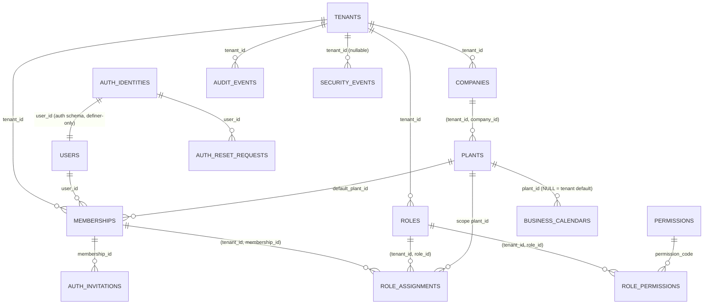

# 25 — B1 Multi-Tenancy & Security: Architecture Review

**Status:** ARCHITECTURE REVIEW v18 (2026-10-11): owner decisions recorded — D-B1-24 **APPROVED** (Option B-opt, D-055, §5.5 rewritten), PoC findings adopted (D-056), all §17 decisions approved as recommended (D-057), O-007 decided (D-060). **Implementation is milestone M1** and needs the M1 scope approval (D-054); no code or migrations before that.
**v17 status (history):** ARCHITECTURE REVIEW v17 (2026-10-10; PR #2 closeout — throttle serialization). Owner approved the **direction** as the basis for final documentation review (D-053). **Implementation NOT authorized**: no code, migrations, authentication, tenant isolation, RBAC or RLS until explicit owner approval of B1 and of the decisions in §17.
**Basis (unchanged):** ADR-0001 (+ Amendment 1, D-053), ADR-0006, ADR-0007, ADR-0012, ADR-0013; docs 05, 17, 18, 24; doc 11 B1 slice (exit: T-ISO-01..05 green).
**Starting point:** B0 COMPLETED — PR #1 merged as `c19be09`, post-merge CI run 37942703992 green.
**Priority:** tenant isolation > authorization scope > authentication/session > audit > convenience.

## 0. Review log
| # | Version | Finding | Resolution |
|---|---|---|---|
| R-1 | v2 | `tenants` called "no RLS" and also given a policy | RLS enabled **and forced**; SELECT policy for `eora_app`; INSERT/status UPDATE only for `eora_provisioner` (§2.3) |
| R-2 | v2 | after `set_config(…, true)` + commit the GUC is `''` (verified on PostgreSQL 18.6) → `::uuid` errors on reused/pooled connections | all policies use `(SELECT NULLIF(current_setting(…, true), '')::uuid)`; ADR-0001 Amendment 1, doc 17 aligned |
| R-3 | v2 | memberships self-select OR-ed with the tenant policy leaked other-tenant memberships | self-select only without tenant context |
| R-4 | v2 | Compose/CI use the superuser → RLS bypassed → false-positive tests | runtime + groups B/C use non-superuser roles; bootstrap assertion |
| R-5 | v3 | outer test transaction hides boundary bugs | B/C tests without outer transaction; unique tenants per test |
| R-6 | v3 | `users` fully readable by `eora_app` | profile vs credentials split (§2.2) |
| R-7 | v3 | provisioning via owner | `eora_provisioner` under forced RLS (§2.5) |
| R-8 | v3 | session user loaded before any context | request transaction sets context from the server session before auth (§6) |
| **R-9** | v4 (Codex P1-01) | `auth_api.login_lookup` ran as a definer that owns only `auth`, but read email/status from `public.users`, which has **forced RLS requiring a context that login does not have** → zero rows/permission error → login impossible | login-relevant identity (normalized email, account status, credentials) moved into `auth.identities`; login reads **only** the `auth` schema; `public.users` keeps profile data and is never needed before login (§2.2) |
| **R-10** | v4 (Codex P1-02) | `provision_admin_user` stored only the invitation hash and returned `user_id`; external I/O is banned in the transaction → the raw secret reached nobody → first admin could never log in | provisioning only records the invitation **request** + outbox event; an after-commit **delivery worker** with its own role issues the secret, stores its hash and sends it; raw secret exists only in worker memory and the message to the owner of the address (§2.4) |
| **R-11** | v4 (Codex P1-03, **critical**) | `eora_app` had `EXECUTE` on `issue_password_reset` (returns the raw token) and `consume_password_reset` → any SQL injection as `eora_app` could mint and consume a reset token for a privileged email → account takeover | `eora_app` has **no** privilege on any auth function or table; token **issuance** is possible only for the delivery role (which cannot consume); **consumption** only for the web auth role (which cannot issue or read tokens); the web path can only *request* a reset (no token returned) (§2.3) |
| **R-13** | v5 (owner gate A) | `set_own_password` authorized "only for `ctx_user`", but any role can call `set_config('app.user_id', <victim>, true)` — custom settings are caller-controlled → an SQL injection in an auth route could set any user's password | **removed from B1**; password change = email-confirmed reset flow (§2.3) until a DB-verifiable step-up exists (D-B1-23); rule: **no `auth_api` function accepts `app.*` settings or caller-supplied ids as proof of identity** (§2.8) |
| **R-14** | v5 (owner gate B) | `record_login_result(user_id, success)` let the caller report "success" and reset lockout counters | replaced by `record_login_failure(user_id)` only (append to `auth.login_failures`); lockout = failures in a sliding window, cleared **only** by expiry or by consuming a reset secret; nothing a caller can report lowers it; locked accounts get no hash from `login_lookup` (§2.2) |
| **R-15** | v5 (owner gate C) | `issue_invitation_secret(tenant_id, membership_id, user_id)` and `issue_reset_secret` trusted caller-supplied targets | issuance takes **only** the id of a request recorded by an authorized path and derives target identity, email, tenant and membership from stored rows; validates status, expiry, identity state, membership `INVITED` + tenant/user match, per-target caps (§2.3, §2.4, §2.8) |
| **R-16** | v5 | `pending_activations(user_id)` returned another user's tenant/membership ids to any web caller | removed; activation completes in the acceptance request, failures surface to the inviting admin (§2.4) |
| **R-17** | v5 | general: `app.*` settings are writable by every role, so GUC-based RLS stops application **bugs**, not arbitrary SQL; v4 also recommended PDO emulated prepares (client-side interpolation, multi-statement simple-query protocol) | stated explicitly (§5.2, §14); D-B1-09 revised to native prepared statements with PgBouncer `max_prepared_statements`; optional signed tenant context proposed (D-B1-24) |
| **R-18** | v6 (Codex P1) | a tenant admin inviting a never-registered email: `ensure_identity` created only `auth.identities`; `eora_app` cannot INSERT `users`, and `memberships.user_id` references `users` → the `INVITED` membership insert fails | identity **and** profile are created together inside the definer (`invite_identity` / `provision_identity`); `eora_auth_definer` gets an INSERT-only column grant + INSERT policy on `users` (§2.4, §5.3) |
| **R-19** | v6 (Codex P1) | `record_security_event` runs as `eora_auth_definer`, which had no INSERT path into forced-RLS `security_events` → auth events lost | INSERT-only column grant + `FOR INSERT TO eora_auth_definer WITH CHECK (source IN ('auth_web','auth_delivery'))` policy; no SELECT/UPDATE/DELETE; tenant id is never a caller parameter (§8) |
| **R-20** | v6 (Codex P2) | caller-chosen `candidate_id` in `ensure_identity` let a caller detect whether an email already existed (account enumeration); UUIDv7 creation time would leak it too | function split into `invite_identity(email)` (web) and `provision_identity(email)` (provisioner); the id is generated inside the definer as a **random UUIDv4** (user ids only — D-B1-10 amendment) so the returned id carries no creation-time signal |
| **R-21** | v6 (Codex P2) | `claim_delivery` had no lease: a worker crash after claim, after issuance or after sending stranded the delivery (incl. the first admin's invitation) | claim lease with expiry, atomic reclaim with secret rotation, claim token checked by `mark_delivery_result`, bounded retries → `DEAD` + alert + resend path (§2.9) |
| **R-22** | v6 (owner consistency check A) | D-B1-24 policies called `auth_api.ctx_tenant()` although `eora_app` has no privilege on `auth_api` → every query would fail | signed context moved to separate schemas `ctx` (key table) and `ctx_api` (verification functions) owned by NOLOGIN `eora_ctx_verifier`; `EXECUTE` for runtime roles only; `auth` stays closed (§5.5) |
| **R-23** | v6 (owner consistency check B) | `ensure_identity` had two grantees, contradicting "one grantee per function" | split into two functions (R-20); the rule stays absolute and is enforced by the schema guard |
| **R-24** | v7 (Codex P2) | re-running provisioning could not find the tenant it had created (forced-RLS `tenants` hides it without context/membership) | provisioning registry `prov.provisioning_requests` with a deterministic request key, reachable only through `prov_api` definer functions executable by `eora_provisioner` (§2.5) |
| **R-25** | v7 (Codex P2) | orphan cleanup had no permission to delete the profile → FK error or orphan profile | `auth_api.cleanup_orphan_identities()` with atomic recheck; DELETE on `users` only for the definer, guarded by `ON DELETE RESTRICT` from `memberships` (§2.4) |
| **R-26** | v7 (Codex P2) | no role could decide "privileged" or find recipients for the privileged-reset notification | consuming function stages one trusted tenant-scoped outbox event per active membership; an `eora_app` worker in that tenant's context checks role assignments and notifies that tenant's administrators (§2.3) |
| **R-27** | v7 (Codex P2) | claim SQL did not exclude exhausted rows → unlimited retries | claim requires `attempts < max_attempts`; locked transition of exhausted rows to `DEAD` with a durable event (§2.9) |
| **R-28** | v7 (owner check A) | §2.3/§2.4 still showed old delivery signatures | all calls use `claim_delivery(worker_id)`, `issue_*_secret(delivery_id, claim_token)`, `mark_delivery_result(delivery_id, claim_token, ok, error_code)` |
| **R-29** | v7 (owner check B) | `security_events` listed no `source` column although policies used it; the `eora_app` policy did not restrict `source` | `source` (`app|auth_web|auth_delivery`, NOT NULL, CHECK) added; `eora_app` policy requires `source = 'app'` and a valid context (§8) |
| **R-30** | v8 (Codex P1) | the outbox relay ran as `eora_app`; `outbox_events` is tenant-owned with forced RLS, so a poll without tenant context saw no rows and stranded events could never be recovered | global claim through `outbox_api` definer functions owned by NOLOGIN `eora_outbox_definer`, executable only by a dedicated LOGIN role `eora_relay`; the claim returns only `(event_id, tenant_id, claim_token)`; handlers then read the event as `eora_app` under the claimed tenant's context (§6.4) |
| **R-31** | v8 (Codex P2) | `eora_app` could insert `event_type = 'auth.password_reset_consumed'` with `source = 'app'`, which the notifier treated as trusted | DB CHECK binds every reserved `auth.*` event type to an auth source (`(event_type LIKE 'auth.%') = (source IN ('auth_web','auth_delivery'))`); consumers re-verify `source`; same binding for `security_events` actions `auth.*` (§8) — **superseded by R-35: the binding is one-way** |
| **R-32** | v8 (Codex P2) | §2.3 step 1 still created a reset request + delivery row for unknown emails (contradicting §2.8) → unclaimable queue work and an unbounded flooding path | unknown email → no request, no delivery, no token; uniform response with minimum response time; global and per-identity caps (§2.3) |
| **R-33** | v9 (Codex P1) | `eora_outbox_definer` had SELECT only on claim-state columns, but `claim_events` reads `id`, `tenant_id`, `max_attempts` (filter, order, return); the definer does not own the table → permission error, no dispatch | column-level audit of every statement (§6.4 table); SELECT on exactly the key/filter/return columns, UPDATE on state columns only; never payload, type or source |
| **R-34** | v9 (Codex P2) | orphan cleanup's `DELETE … WHERE id = $1` needs SELECT on `users.id` (and under forced RLS a SELECT policy), which the definer lacked | SELECT on `users(id)` only, with a SELECT policy limited to profiles without membership; DELETE policy unchanged (§2.1, §2.4) |
| **R-35** | v10 (Codex P1) | the R-31 binding was bidirectional — `(action LIKE 'auth.%') = (source IN ('auth_web','auth_delivery'))` — so legitimate auth-sourced events outside the `auth.*` namespace (`delivery.dead`, `invitation.accepted`) violated it; the `DEAD` transition in `claim_delivery` rolled back and every later claim failed (global stall of invitations and resets) | one-way reserved-namespace binding: `auth.*` requires an auth source; auth sources may also write other actions/types (§8) |
| **R-36** | v11 (Codex P2) | one `users` policy served SELECT and UPDATE, so every co-member in the active tenant could update another user's **global** profile (visible in all that user's tenants) | command-specific policies: SELECT for self + members of the active tenant; UPDATE only for `id = ctx_user` with matching USING/WITH CHECK (§2.2) |
| **R-37** | v12 (Codex P2) | the registry moved to `TENANT_CREATED` in a separate step after the tenant transaction committed; a crash in between left `STARTED`, so retries collided with the existing tenant forever | the request row is locked and set to `TENANT_CREATED` **inside** the tenant transaction (§2.5) |
| **R-38** | v12 (Codex P2) | recipients were only members holding tenant administration, so a user privileged only through approval/reversal permissions was not informed of their own reset | recipients = tenant administrators ∪ the reset account owner, deduplicated (§2.3) |
| **R-39** | v13 (Codex P1) | sessions were said to carry `password_changed_at` "checked per request", but the business runtime cannot read `auth.identities`, so a stolen session survived a password reset | non-secret `users.credential_version`, incremented only by definer functions on every credential change; the request transaction compares it with the version stored in the session and kills mismatching sessions (§4) |
| **R-40** | v13 (Codex P1) | the `membership.invited` handler committed `processed_events` and only afterwards published a Redis job for the delivery worker; a crash in between stranded the invitation forever | no Redis hop: the inviting transaction itself writes a durable `invitation_dispatch_requests` row; the delivery worker converts pending rows into `auth.delivery_queue` atomically inside the DB (§2.4); rule for all handlers: hand-offs to another process are DB rows written in the same transaction (§6.4) |
| **R-41** | v14 (Codex P2) | R-39 widened the definer's SELECT on `users` to `USING (true)` while the matrix and T-ORPH-08 still claimed orphan-only visibility | boundary restated: the NOLOGIN definer may read `id, credential_version` of **all** profiles (no other column); the orphan-only guarantee is on **DELETE** (policy + FK `RESTRICT`), which is what cleanup safety needs; T-ORPH-08 revised (§2.1) |
| **R-42** | v15 (Codex P1) | consumption required the reset/invitation record to be `SENT`, but only `auth.delivery_queue` became `SENT`; issuing could not set it either (retries require the pre-send state) | secret-record state machine (§2.10): issuance sets `ISSUED` (rotatable, unusable), `mark_delivery_result(ok = true)` sets delivery **and** secret record `SENT` atomically; failures keep `ISSUED`, exhaustion sets `DELIVERY_FAILED` |
| **R-43** | v15 (Codex P1) | the provisioning transaction still relied on the `membership.invited` outbox row for delivery although that event has no delivery handler | provisioning writes `invitation_dispatch_requests (reason INITIAL)` in the same transaction; `membership.invited` is a business event only (§2.4, §2.5, §6.4) |
| **R-44** | v15 (Codex P2) | the D-B1-25 decision row still limited recipients to tenant administrators | row aligned with §2.3: privileged = effective sensitive permissions; recipients = tenant administrators ∪ ACTIVE reset account owner, deduplicated (§17) |
| **R-45** | v15 (consistency audit; also: reset issuance window was 15 min although the retry backoff spans 81 min → now 2 h) | stale text: §2.1 credential-storage row still claimed "SELECT only ids of orphan profiles" and "no UPDATE"; `cleanup_orphan_identities()` lacked its parameter; reset consumption bumped `password_changed_at` but not `credential_version`; §2.8 table columns shifted; §6.4 listed "invitation resend" as outbox scope; migration order missed `invitation_dispatch_requests` and `auth.login_failures` | corrected in place |
| **R-46** | v16 (Codex P2) | every known ACTIVE identity could request a reset, including passwordless orphans (identity created, tenant transaction failed); the reset would set a first password and exempt the orphan from cleanup | resets only for ACTIVE identities that already have a `password_hash`; first passwords only through invitation acceptance (§2.3) |
| **R-47** | v16 (Codex P2) | several pending dispatch requests for one membership became several deliveries that rotated the same invitation secret against each other | one active invitation delivery per membership: invitation row lock + partial unique index + `current_delivery_id`; duplicate INITIAL collapsed, RESEND atomically cancels and replaces (§2.4) |
| **R-48** | v17 (Codex P2) | the per-identity and platform-wide reset limits were check-then-insert: concurrent requests could all see the count below the limit and all insert | per-identity check under a row lock on the identity; platform-wide cap via an atomic conditional counter upsert — both in the same transaction as the inserts (§2.3) |
| **R-12** | v4 (Codex P1-04) | denied-access audits were written in the request transaction, which is rolled back on every non-2xx → `access.not_found` lost, T-ISO-01 impossible | security events are buffered in memory and flushed **after** commit/rollback in an independent short transaction to an append-only `security_events` table, with log fallback (§8) |

## 1. Tenant, company and plant data model
- `tenants` (platform root, no `tenant_id` column): `id uuid`, `code` unique, `name`, `status` (`PROVISIONING|ACTIVE|SUSPENDED|OFFBOARDING`), `timezone` (default `Asia/Jakarta`, D-044), `data_region`, timestamps.
- `companies`, `plants` (composite FK to company), business calendars (`business_calendars` with `plant_id` NULL = tenant default, `calendar_exceptions`, `shift_calendars`, `shifts`; ADR-0012).
- Warehouses, locations, work centers are **B2**; B1 scope types `TENANT`, `COMPANY`, `PLANT` (D-B1-02).
- Every tenant-owned table: PK `id uuid` (UUIDv7, D-B1-10; **exception:** global user ids are random UUIDv4, R-20), `tenant_id uuid NOT NULL`, `UNIQUE (tenant_id, id)`, composite FKs only, audit columns + `version`, `tenant_id`-leading indexes, RLS **enabled and forced** in its creating migration.

## 2. Identity, credentials, invitation, reset, provisioning
### 2.1 Privilege domains (the boundary that contains SQL injection)
| Domain | DB role (connection) | Can touch | Cannot touch | Used by |
|---|---|---|---|---|
| Business | `eora_app` (`pgsql`) | public tenant tables under forced RLS; `users` profile per policy; `security_events` and `outbox_events` INSERT with `source = 'app'` only | **anything in `auth` / `auth_api`** | all business HTTP routes, workers |
| Web authentication | `eora_auth_web` (`pgsql_auth`) | `EXECUTE` on `auth_api.login_lookup`, `record_login_failure`, `request_password_reset`, `consume_password_reset`, `consume_invitation`, `invite_identity`, `record_security_event` (§2.8) | business tables; token issuance; any `auth` table directly | only `App\Platform\Auth` code on `/auth/*` routes and the invite command handler's identity step (arch test) |
| Secret delivery | `eora_auth_delivery` (`pgsql_delivery`) | `EXECUTE` on `auth_api.claim_delivery(worker_id)`, `claim_invitation_dispatch(worker_id, batch_limit)`, `issue_invitation_secret(delivery_id, claim_token)`, `issue_reset_secret(delivery_id, claim_token)`, `mark_delivery_result(delivery_id, claim_token, ok, error_code)`, `cleanup_orphan_identities(batch_limit)` (§2.4, §2.8, §2.9, §2.10) | consumption functions; business tables; any `auth` table directly | dedicated delivery worker (separate queue + process, own credentials) |
| Credential storage | `eora_auth_definer` (NOLOGIN) | owns `auth` schema tables and the `SECURITY DEFINER` functions; **read-only** column grant on `memberships (tenant_id, id, user_id, status, invited_at)` with a SELECT policy `TO eora_auth_definer` (validate invitations, cleanup); column SELECT (`id, tenant_id, membership_id, reason, status, created_at`) and UPDATE (`status, converted_delivery_id, rejected_reason`) on `invitation_dispatch_requests` through policies `TO eora_auth_definer` (R-40); **INSERT** column grant on `users (id, display_name, email_display, locale)` with `FOR INSERT TO eora_auth_definer WITH CHECK (true)` (profile creation, R-18) and **DELETE** on `users` with `FOR DELETE TO eora_auth_definer USING (NOT EXISTS (SELECT 1 FROM public.memberships m WHERE m.user_id = users.id))` plus **SELECT on `users (id, credential_version)`** with `FOR SELECT TO eora_auth_definer USING (true)` (ids and version numbers only — no profile data). **Actual boundary (R-41):** this read is global by design; it is acceptable because `eora_auth_definer` is NOLOGIN (only the reviewed `auth_api` function bodies run with it, callers never get a query surface), the columns are random UUIDv4 ids and integer counters, and no function returns another user's id or version to a caller. The **orphan-only** guarantee applies to deletion: the DELETE policy below plus `memberships.user_id … ON DELETE RESTRICT` make it impossible for cleanup to remove a profile that has a membership. And **UPDATE on `users (credential_version)`** with `FOR UPDATE TO eora_auth_definer USING (true) WITH CHECK (true)` (R-39). The `id` read also satisfies the column privilege PostgreSQL needs for the targeted `DELETE … WHERE id = $1` (R-34). **INSERT-only** column grants on `security_events` and `outbox_events` with the policies of §8 / §2.3 (R-19, R-26) | everything else in `public`; on `users` nothing beyond the grants listed (no profile-column SELECT, no UPDATE except `credential_version`, DELETE only of orphan profiles); no SELECT/UPDATE/DELETE on `security_events` or `outbox_events` | — |
| Provisioning | `eora_provisioner` | member of `eora_app` + tenant insert + `auth_api.provision_identity` + `prov_api.begin_provisioning`, `prov_api.lock_request`, `prov_api.mark_tenant_created`, `prov_api.provision_lookup` (§2.5) | token issuance/consumption; any provisioning record of another request | provisioning command only |
| Outbox relay | `eora_relay` (`pgsql_relay`) | `EXECUTE` on `outbox_api.claim_events`, `complete_event`, `fail_event` (returns ids and tenant ids only) | payloads, business tables, `auth` | relay process; handlers use `eora_app` (§6.4) |
| Provisioning registry | `eora_prov_definer` (NOLOGIN) | owns schema `prov` (`provisioning_requests`) and `prov_api` functions | everything in `public` and `auth` | — |
A SQL injection in a business route runs as `eora_app` and **cannot reach the auth domain at all** — neither tables nor functions. A SQL injection in an auth route (small, reviewed, fixed-statement surface) can call only the web functions listed, none of which returns a usable secret. The delivery worker can issue secrets but cannot consume them and runs in its own process with its own credentials.

### 2.2 Global identity (D-B1-03, final)
| Object | Content | Access |
|---|---|---|
| `auth.identities` | `user_id`, `email_normalized` (citext unique), `status` (`ACTIVE|DISABLED`), `password_hash` (nullable until invitation accepted), `password_changed_at`, `lockout_cleared_at`, `mfa_secret_enc`, `recovery_codes_hash` | definer functions only |
| `auth.login_failures` | `user_id`, `occurred_at`, `ip_hash` (append-only) | definer functions only |
| `public.users` (profile) | `id` (= `user_id`), `display_name`, `locale`, `email_display` (copy kept in sync **only** by definer functions), `credential_version` (integer, not secret; incremented **only** by definer functions on password set/reset/change and MFA reset, R-39), timestamps — no status, no secret | `eora_app`, forced RLS with **command-specific** policies (R-36): `FOR SELECT USING (id = ctx_user OR id IN (SELECT user_id FROM public.memberships))` (memberships is itself tenant-filtered, so: self + members of the active tenant; plant scope stays in the application layer); `FOR UPDATE USING (id = ctx_user) WITH CHECK (id = ctx_user)` — only the own profile; no INSERT/DELETE policy. Column grants `SELECT (id, display_name, locale, email_display, credential_version)`, `UPDATE (display_name, locale)` — `credential_version` is never writable by `eora_app`. No administrative path edits another user's global profile in B1. **Dependency:** under the arbitrary-SQL threat model `ctx_user` is forgeable (R-17) until a trustworthy actor context exists (D-B1-24, pending PoC); the policy then uses `ctx_api.user_id()` |
**Login (`POST /auth/login`, no context needed):** `auth_api.login_lookup(email text) RETURNS TABLE(user_id uuid, password_hash text, status text, locked_until timestamptz)` — `SECURITY DEFINER`, owner `eora_auth_definer`, `SET search_path = ''`, every reference schema-qualified (`auth.identities`, `pg_catalog.lower`), exact match on normalized email, `STABLE`, at most one row, no profile, no tenant data. **Locked** identities (failures in the window ≥ threshold, counted after `lockout_cleared_at`) and DISABLED identities are returned with status only and `password_hash = NULL`. The app (via `pgsql_auth`) verifies the hash with argon2id in PHP; if no row/hash, it verifies against a fixed dummy hash (constant work) and returns the same `401 UNAUTHENTICATED` body. On a failed verification it calls `record_login_failure(user_id, ip_hash)` (append-only). There is **no** "login succeeded" function: a successful verification changes nothing in `auth` (last login is a `security_events` row), so no caller can forge success or lower a lockout. Then session regeneration, and the tenant picker runs on `eora_app` with `ctx_user` only.
**Residual risk (accepted, documented):** a compromised auth route could call `login_lookup` for a *known* email and obtain that one hash for offline cracking. Mitigations: argon2id parameters (D-B1-07), no wildcard/listing, no dynamic SQL in auth code (arch test), MFA for privileged roles (D-B1-04), DB-side lockout that callers can raise but never lower (R-14). Alternative removing even this residual (DB-side bcrypt verification via `pgcrypto`, no hash ever returned) is evaluated in D-B1-23b.

### 2.3 Password reset (fix for R-11)
1. `POST /auth/password/forgot` → `auth_api.request_password_reset(email)` (web role), returns **nothing** in every case:
   - **unknown email**, **DISABLED** identity, or **passwordless** identity (`password_hash IS NULL` — e.g. an invited user who never accepted, or an orphan left by a failed provisioning): **no** `auth.reset_requests` row, **no** delivery row, no secret — the function only performs the same indexed lookup (R-46); a first password can only be set by consuming an invitation;
   - **known ACTIVE identity with a password**: in **one transaction** (R-48): (1) `SELECT … FROM auth.identities WHERE user_id = $id FOR UPDATE` — concurrent requests for the same identity serialize here; (2) count requests **created** for that identity in the last hour, must be < 3; (3) platform-wide cap through an atomic counter `INSERT INTO auth.rate_buckets (bucket_key, window_start, count) VALUES ('reset_delivery', date_trunc('minute', now()), 1) ON CONFLICT (bucket_key, window_start) DO UPDATE SET count = auth.rate_buckets.count + 1 WHERE auth.rate_buckets.count < $cap RETURNING count` — no row returned means the cap is reached (the conditional upsert serializes on the bucket row, so concurrent callers cannot exceed it); only if (2) and (3) pass, inserts `auth.reset_requests (id, user_id, status REQUESTED, requested_at, ip_hash)` and `auth.delivery_queue (kind RESET, request_id)`, and cancels older open requests of the same identity (`CANCELLED`, their deliveries `CANCELLED`) (no `NOTIFY`, pooler-safe); otherwise inserts nothing and writes `auth.reset_throttled` (`source = auth_web`, no tenant).
   - **Uniform response:** the HTTP handler always answers `202` with the same body after a fixed minimum duration (recommended 400 ms, D-B1-21) regardless of branch, so the extra insert of the known branch is not observable; HTTP limits per IP and per `email_hmac` (D-B1-06) stop queue flooding before the DB; unknown emails never reach the queue, known ones are bounded per identity and globally.
2. Delivery worker (`eora_auth_delivery`) calls `auth_api.claim_delivery(worker_id)` (atomic claim with lease, §2.9; returns `delivery_id`, `claim_token`, kind, and the **recipient address taken from `auth.identities`** — never from the caller), then `issue_reset_secret(delivery_id, claim_token)`, which re-validates (§2.8) and → generates 256-bit random secret, stores **SHA-256 hash** + `expires_at` on the reset request, sets it `ISSUED` (not yet usable), returns the raw secret to the worker only, commits; then sends the email **outside** any transaction; then `mark_delivery_result(delivery_id, claim_token, ok, error_code)` — on `ok = true` the delivery **and** the reset request become `SENT` in one transaction (only now is the secret usable, R-42). On send failure: retry with backoff (§2.9); each issuance **rotates** the secret (old hash invalidated) so at most one secret is valid. State machine: §2.10.
3. `POST /auth/password/reset` → `auth_api.consume_password_reset(secret text, new_hash text)` (web role): hashes the secret, `UPDATE … SET status = 'CONSUMED' WHERE hash = $1 AND status = 'SENT' AND expires_at > now() RETURNING user_id` (atomic single use), sets the new password hash, sets `lockout_cleared_at = now()` (email ownership proven), cancels every other open reset request of that identity, bumps `password_changed_at` and increments `public.users.credential_version` in the same transaction (all existing sessions rejected on their next request, §4, R-39), records the event. Returns only success/failure (uniform failure for invalid, expired, replayed).
4. Privileged accounts: when MFA is enrolled (B1.1), a reset does **not** remove MFA; the next login still requires the second factor. Without MFA (B1), a reset of an account holding privileged roles notifies that tenant's administrators (R-26):
   - **Audit vs delivery are separate:** `consume_password_reset` writes, in the same transaction, (a) one `security_events` row per tenant in which the user has an ACTIVE membership (`action = auth.password_reset_consumed`, `source = auth_web`, tenant and user taken from the stored reset request and `memberships` — never from the caller) — the **audit record**; and (b) one `outbox_events` row per such tenant (`event_type = auth.password_reset_consumed`, payload `{user_id}`, `source = auth_web`, deterministic `id = uuid5(reset_request_id, tenant_id)`) — the **delivery mechanism**. Both through the definer's INSERT-only grants; `eora_app` cannot insert outbox or event rows with an auth source (policy `source = 'app'`).
   - **Business worker** (`eora_app`, `PrivilegedResetNotifier`): the outbox relay (§6.4) claims the event globally and hands `(event_id, tenant_id)` to the handler, which opens a tenant transaction with that context and re-reads the event under RLS; it processes it **only if** `source = 'auth_web'` and `event_type = 'auth.password_reset_consumed'` (otherwise: no action + `security_events` `outbox.untrusted_event`); the handler checks whether the user holds **effective sensitive permissions in that tenant** (D-B1-25) through RLS-scoped `role_assignments` → `role_permissions`; if not → mark processed, nothing sent; if yes → recipients = **(ACTIVE members of that tenant holding the tenant-administration permission) ∪ (the reset account owner, re-checked as an ACTIVE member of that tenant)**, deduplicated by `user_id` (R-38) — the owner is always informed even when privileged only through approval/reversal permissions → `inbox_notifications` rows (`UNIQUE (user_id, event_id)` makes retries idempotent) and optional email through the normal notification pipeline. No auth table or secret is read; no other tenant is touched; `processed_events (consumer, event_id)` prevents duplicate handling.
   - A user with memberships in several tenants produces one event per tenant; each is evaluated in its own tenant context with its own recipients.
Neither `eora_app` nor `eora_auth_web` can ever read a raw secret; the delivery role can read a raw secret only at issuance and cannot consume it.

### 2.4 Invitations and first administrator (fix for R-10)
- Provisioning or a tenant admin invites a user: in the tenant transaction (`eora_app`/`eora_provisioner`) → membership `INVITED` + `invitation_dispatch_requests` row (durable hand-off below) + optional business event `membership.invited (tenant_id, membership_id, user_id)` — the event is **not** the delivery trigger (R-43); the identity is resolved beforehand on the auth connection: `auth_api.invite_identity(email)` (`eora_auth_web`, tenant admin's invite) or `auth_api.provision_identity(email)` (`eora_provisioner`). In **one definer transaction** the function looks up the normalized email; if absent it generates a random UUIDv4, inserts `auth.identities` (no password, status ACTIVE) **and** the `public.users` profile (`display_name` = local part of the email until the user sets it, `email_display`), then returns the `user_id`. Existing email → the existing id, no change. Because the id is server-generated and random, and both branches return one id, the caller cannot tell new from existing (R-20); identity and profile can never exist without each other. Then the tenant transaction inserts the membership with that `user_id` under forced RLS.
  - **Orphans cannot gain access:** an identity without a membership has no password (it is set only by consuming an invitation secret, which is bound to a membership) and no tenant to enter.
  - **Orphan cleanup (R-25):** `auth_api.cleanup_orphan_identities(batch_limit)` (definer; `EXECUTE` only for `eora_auth_delivery`, run by the delivery worker's scheduler). Per candidate, in one transaction: `SELECT … FROM auth.identities … FOR UPDATE SKIP LOCKED`, then re-check **all** conditions — `created_at` and `last_invited_at` older than 7 days, `password_hash IS NULL`, no membership in `public.memberships`, no `auth.delivery_queue` row in `PENDING`/`CLAIMED` and no unexpired `SENT` invitation; delete dependent `auth` rows (expired invitations, reset requests, finished deliveries), then `auth.identities`, then `public.users`. **Race guard:** `invite_identity`/`provision_identity` set `last_invited_at = now()` on every call (so a just-invited old identity is not a candidate), and `memberships.user_id → users.id` is `ON DELETE RESTRICT`: if a membership commits first, the profile delete fails, the function rolls back that candidate and skips it; if the cleanup commits first, the membership insert fails its FK and the invite flow retries (`invite_identity` recreates identity + profile). No DELETE for `eora_app` or `eora_auth_web`; the DELETE policy on `users` re-checks "no membership" even inside the definer.
  - **Abuse impact** (SQL injection in an auth route): password-less identities without memberships (cleaned up); no disclosure of existence.
- **One active delivery per membership (R-47):** `auth.invitations` has `UNIQUE (membership_id)`, `current_delivery_id` and `secret_generation`; `auth.delivery_queue` has a partial unique index `UNIQUE (membership_id) WHERE kind = 'INVITATION' AND status IN ('PENDING','CLAIMED')`. `claim_invitation_dispatch` processes each request under `SELECT … FROM auth.invitations WHERE membership_id = $m FOR UPDATE` (created first if absent), so all requests of one membership serialize:
  - **INITIAL** when the invitation already exists in any non-terminal state → request `DUPLICATE` (no new delivery; idempotent);
  - **RESEND/CONSOLE** → within the cap: the open delivery (if any) → `CANCELLED` (claim token cleared) and the replacement delivery inserted and set as `current_delivery_id` — in the same transaction, so there is always at most one active delivery and never none while the membership is `INVITED` and under cap; over the cap → request `REJECTED`;
  - `issue_invitation_secret` locks the invitation row and requires `delivery_id = current_delivery_id`; `mark_delivery_result` requires the current claim **and** that the invitation's `secret_generation` equals the one issued under that claim — a cancelled or stale delivery can neither rotate nor validate a secret.
- **Durable hand-off (R-40):** the inviting tenant transaction (admin invite, resend, or provisioning step 2) also inserts `invitation_dispatch_requests (tenant_id, id, membership_id, reason INITIAL|RESEND|CONSOLE, status PENDING, created_at)` (tenant-owned, forced RLS, composite FK to the membership; `eora_app` INSERT only with `tenant_id = ctx_tenant`). Nothing goes through Redis. The delivery worker periodically calls `auth_api.claim_invitation_dispatch(worker_id, batch_limit)` → in **one** DB transaction the definer locks pending requests (`FOR UPDATE SKIP LOCKED`), reads the membership (read-only grant), and for each request records `auth.delivery_queue (kind INVITATION, membership_id, tenant_id, user_id)` and the invitation record `auth.invitations (membership_id, status PENDING)` (created once per membership, reused by resends) and marks the request `CONVERTED` (or `REJECTED` with a reason) **only if** the membership exists, is `INVITED`, was invited ≤ 30 days ago, its identity is not DISABLED and the per-membership cap (≤ 5 sends/24 h) holds; the worker then claims it with `claim_delivery(worker_id)` and calls `issue_invitation_secret(delivery_id, claim_token)` → stores hash + `expires_at` (recommended 72 h) on the invitation record, sets it `ISSUED` (not yet usable; a previously `SENT` link of the same membership becomes invalid — only the latest link works), returns the raw secret to the worker only → sends the invitation link **outside** any transaction → `mark_delivery_result(delivery_id, claim_token, ok, error_code)` (on success delivery and invitation `SENT` atomically, R-42). Failure → retry with rotation (§2.9); when attempts are exhausted the delivery is `DEAD` and the inviter sees `DELIVERY_FAILED` and can resend.
- Acceptance (`POST /auth/invitations/accept`, web role): `auth_api.consume_invitation(secret, password_hash)` → atomic single use (`SENT` + not expired → `ACCEPTED`), sets the password hash if none (and then increments `users.credential_version`), returns `(user_id, tenant_id, membership_id)` to the acceptance request only. The app then opens a tenant transaction on `eora_app` with that context and sets the membership `ACTIVE` under RLS (retried once). If activation still fails, an `invitation.activation_failed` security event and an inbox notification reach the inviting admin, who re-activates or re-invites; there is **no** function that lets a web caller list another user's pending memberships (R-16).
- Membership activation policy (accept → ACTIVE immediately vs. admin confirmation) is D-B1-19; recommendation: ACTIVE on acceptance for invitations created by an admin.
- Operator fallback for the very first tenant administrator when no mail transport exists yet (dev/pilot setup): `eora:tenant:provision --deliver=console` writes the INITIAL dispatch request with reason `CONSOLE`, and the **delivery worker logic** run in the operator's terminal prints the one-time link to the operator's terminal (never to logs), audited as `invitation.delivered_console` — D-B1-18.

### 2.5 Tenant provisioning without bypassing RLS (corrected)
Order (three independent steps, each idempotent; no external I/O inside a transaction):
1. **Identity** (`pgsql_provisioner` → `auth_api.provision_identity(email)`): creates identity + profile atomically when new; returns the `user_id` (new or existing).
2. **Tenant transaction** (`eora_provisioner`, forced RLS, one transaction): `prov_api.lock_request(request_key)` (definer: `SELECT … FOR UPDATE` on the registry row; validates the key and requires `status = 'STARTED'`, otherwise raises `ALREADY_CREATED` and the caller rolls back and continues with the resend path) → `INSERT tenants (PROVISIONING)` with the registry's `tenant_id` → signed context for (`new_id`, system actor) via the same sequence as §6.2 (`set_config('app.ctx', $1, true)`, bound token) → `companies`, `plants`, default `business_calendars`, bootstrap roles (D-B1-16), `memberships (INVITED)`, `invitation_dispatch_requests (reason INITIAL or CONSOLE)` for that membership, `role_assignments (TENANT_ADMIN, tenant scope)`, `audit_events (tenant.provisioned)`, optional business event `membership.invited` → `UPDATE tenants SET status = 'ACTIVE'` → `prov_api.mark_tenant_created(request_key, admin_user_id, admin_membership_id)` (same transaction; registry → `TENANT_CREATED`) → COMMIT. Any error → full rollback **including the registry status** (tenant, company, plant, membership, dispatch request, assignment, audit, outbox all absent; registry still `STARTED`). No external I/O inside; after commit the delivery worker converts the INITIAL dispatch request (§2.4) — the first-admin invitation is durable from the moment of commit (R-43).
3. **Delivery** (after commit, by the delivery worker, not by the provisioning command): §2.4 / §2.10.
**Idempotency and retries (R-24):**
- **Registry:** `prov.provisioning_requests` (`request_key` PK, `tenant_code` UNIQUE, `tenant_id`, `admin_email_hmac`, `admin_user_id`, `admin_membership_id`, `status` `STARTED|TENANT_CREATED|FAILED`, timestamps), owned by NOLOGIN `eora_prov_definer`; no login role has `USAGE` on `prov`. `request_key = HMAC(D-B1-22 key, tenant_code ‖ normalized admin email)` — deterministic, so a re-run with the same inputs presents the same key without the operator storing anything.
- **Step 0** — `prov_api.begin_provisioning(request_key, tenant_code, admin_email_hmac)` (`EXECUTE` only `eora_provisioner`): `INSERT … ON CONFLICT (tenant_code) DO NOTHING`, then `SELECT … FOR UPDATE` on the row. Same `request_key` → returns `(tenant_id, status)` of the original request (a new `tenant_id` is generated only on first insert); different `request_key` for the same code (other admin email, or another operator's request) → `TENANT_CODE_TAKEN`, nothing else disclosed. Concurrent runs with the same code serialize on the unique index and row lock; the loser sees the winner's state.
- Registry statuses: `STARTED → TENANT_CREATED` (`FAILED` only by an explicit operator action). Steps 1–3 run with the returned `tenant_id`; step 2 is skipped when the status is `TENANT_CREATED`. Because the transition happens in the tenant transaction, every crash point resolves cleanly: crash **before** COMMIT → everything rolled back, status `STARTED`, retry re-runs step 2 with the same `tenant_id`; crash **after** COMMIT → status `TENANT_CREATED`, retry goes straight to the resend path; two concurrent runs → the second blocks on the registry row lock (and on the unique tenant code) and then sees `TENANT_CREATED`. The runtime role has no access to `prov` or `prov_api`.
- **Lookup** — `prov_api.provision_lookup(tenant_code, request_key)` returns `tenant_id`, `status`, `admin_membership_id` **only if both match** one row; otherwise nothing. It never lists tenants and never returns an email; the administrator is the one bound to the original request.
- **Resend:** a re-run in state `TENANT_CREATED` re-triggers delivery for the stored `admin_membership_id` only (a tenant transaction as `eora_provisioner` inserts an `invitation_dispatch_requests` row with reason `RESEND`; delivery goes to the invitee's own address, cap 5/24 h). A different admin email cannot be introduced by re-running (different key → `TENANT_CODE_TAKEN`); changing the first admin is an explicit, audited admin action.
- An identity created in step 1 for a run whose step 2 then failed has no membership — it cannot log in; the orphan cleanup removes it after 7 days (§2.4).

### 2.6 Memberships and tenants (unchanged from v3)
| Table | RLS | Policies for `eora_app` |
|---|---|---|
| `memberships` | enable + force | P1 all: `tenant_id = ctx_tenant`; P2 SELECT: `ctx_tenant IS NULL AND user_id = ctx_user` |
| `tenants` | enable + force | SELECT: `id = ctx_tenant` or (`ctx_tenant IS NULL` and member via `memberships`); INSERT/status UPDATE only `TO eora_provisioner` |
`ctx_tenant` / `ctx_user` = `(SELECT c.tenant | c.actor FROM ctx_api.context() c)` — signed context (§5.5, D-055); a tenant-less picker token yields `ctx_tenant` NULL with `ctx_user` set. *(v17 and earlier: GUC form `(SELECT NULLIF(current_setting('app.tenant_id' | 'app.user_id', true), '')::uuid)`, now the rollback body only.)*

### 2.7 Definer-function rules
Owner `eora_auth_definer` (NOLOGIN, owns only `auth` objects); `SECURITY DEFINER` + `SET search_path = ''`; all identifiers schema-qualified incl. `pg_catalog`; `REVOKE ALL ON FUNCTION … FROM PUBLIC` then `GRANT EXECUTE` to exactly one role each (table in §2.1); no dynamic SQL; inputs length-checked; functions return no more than documented; every function covered by abuse-case tests (§12); allowlist enforced by the schema guard (§5.4).

### 2.8 Auth function catalogue — authorization rules (final gate)
Global rule: **no `auth_api` function treats `app.user_id`, `app.tenant_id` or any caller-supplied user/tenant id as proof of identity or ownership.** Proof is one of: knowledge of the account password (verified by the app, outcome cannot lower lockout), possession of a one-time secret delivered to the account's address, or a record created earlier by an authorized path and re-validated at use.
| Function | Grantee | Input | Validation inside the function | Returns | Abuse impact if called directly |
|---|---|---|---|---|---|
| `login_lookup(email)` | `eora_auth_web` | email (≤ 254 chars) | exact normalized match; lockout/disabled → no hash | `user_id, password_hash | NULL, status` | hash of one *known*, non-locked email (residual, §2.2) |
| `record_login_failure(user_id, ip_hash)` | `eora_auth_web` | id | identity exists | — | can only **add** failures (lock a victim = same as HTTP brute force; rate-capped per IP hash in the function) |
| `request_password_reset(email)` | `eora_auth_web` | email | unknown/DISABLED/passwordless → no row of any kind (R-46); known → ≤ 3 requests created/identity/hour (checked under the identity row lock) and a platform-wide per-minute cap (atomic conditional counter), same transaction as the inserts (R-48) | nothing | reset email goes to the **real owner**; flooding bounded per identity and globally; no queue work for unknown emails |
| `consume_password_reset(secret, new_hash)` | `eora_auth_web` | secret, argon2id hash (format-checked) | secret hash matches a `SENT`, unexpired, single-use row | success flag | needs the delivered secret |
| `consume_invitation(secret, new_hash)` | `eora_auth_web` | secret, hash | `SENT`, unexpired, single-use; sets password only if none | `user_id, tenant_id, membership_id` | needs the delivered secret |
| `invite_identity(email)` | `eora_auth_web` only | email | normalized exact match; when new: random UUIDv4 + identity + profile in one transaction; no password, no membership; platform-wide cap on newly created identities per hour (DB counter; above it the function refuses and writes `identity.creation_capped`) — the DB cannot tell inviters apart, so per-inviter limits stay at the HTTP layer | `user_id` | password-less identities without membership (cleanup job); no existence disclosure |
| `provision_identity(email)` | `eora_provisioner` only | email | same as `invite_identity` | `user_id` | as above |
| `record_security_event(action, detail_code, email_hmac, ip_hash, ua_hash, correlation_id)` | `eora_auth_web` | validated enum/fields — **no tenant/user id parameter** | field allowlist, length limits, writes `tenant_id = NULL`, `source = 'auth_web'`; tenant-scoped auth events (invitation accepted, reset consumed) are written **inside** the consuming function from stored rows, never from caller input | — | noise events (rate-capped), cannot alter or read events |
| `claim_delivery(worker_id)` | `eora_auth_delivery` | worker label | moves exhausted rows to `DEAD`, then claims one due `PENDING` or lease-expired `CLAIMED` row with `attempts < max_attempts`, atomically (§2.9) | `delivery_id, claim_token, kind, recipient` (from identity) | none beyond doing the worker's job |
| `claim_invitation_dispatch(worker_id, batch_limit)` | `eora_auth_delivery` | — (reads stored dispatch requests) | per request, under the invitation row lock: membership exists, `INVITED`, ≤ 30 days old, identity not DISABLED, ≤ 5 sends/24 h; INITIAL duplicate → `DUPLICATE`; RESEND cancels the open delivery and inserts its replacement atomically (R-47); request → `CONVERTED`/`DUPLICATE`/`REJECTED` atomically with the delivery rows | number converted | sends only to **legitimate invitees** of recorded requests; capped |
| `issue_invitation_secret(delivery_id, claim_token)` | `eora_auth_delivery` | delivery id + current claim token | invitation row locked, `delivery_id = current_delivery_id` (R-47), delivery row claimed by this token and lease not expired, kind INVITATION, membership still `INVITED` and matches stored tenant/user, identity not DISABLED, invitation record `PENDING`/`ISSUED`/`SENT` (not `ACCEPTED`/`CANCELLED`); rotates any previous secret, record → `ISSUED` | raw secret (once) | secret only for a real invitation; sent to the invitee's own address |
| `issue_reset_secret(delivery_id, claim_token)` | `eora_auth_delivery` | delivery id + current claim token | delivery row claimed by this token and lease not expired, kind RESET, reset request `REQUESTED` or `ISSUED` (retry) and requested ≤ 2 h ago (covers the full backoff schedule of §2.9; the secret's own TTL stays 30 min from issuance, D-B1-21), identity ACTIVE **with a password** (re-checked); rotates previous secret, request → `ISSUED` | raw secret (once) | secret only for a recorded request; sent to the owner's address |
| `mark_delivery_result(delivery_id, claim_token, ok, error_code)` | `eora_auth_delivery` | id, token, enum | row `CLAIMED`, token equal to the **current** claim and lease not expired — otherwise rejected (no stale acknowledgement); `ok = true` → delivery and its secret record `SENT` atomically; `ok = false` → delivery `PENDING` with backoff, secret stays `ISSUED` | — | can mark a delivery failed (resend possible); cannot make an unsent secret usable without the current claim |
| `cleanup_orphan_identities(batch_limit)` | `eora_auth_delivery` | limit (≤ 500) | atomic per-candidate recheck §2.4 | count removed | removes only identities that meet every orphan condition |
Delivery-worker compromise (credentials + process): attacker can mint secrets for genuinely pending requests and read them before sending — mitigated by separate process/credentials (D-B1-18), short TTLs, per-target caps, `security_events` for every issuance, and alerting on issuance without a matching send.

### 2.9 Delivery queue: lease, recovery, bounded retries (R-21, R-27)
`auth.delivery_queue`: `id`, `kind` (`INVITATION|RESET`), target refs, `status`, `claim_token` (random per claim), `claimed_by`, `claim_expires_at`, `attempts`, `max_attempts` (default 5), `next_attempt_at`, `secret_generation`, `last_error_code`, `dead_at`, timestamps.
**State machine**
| From | Event | To | Guard |
|---|---|---|---|
| — | enqueue (`claim_invitation_dispatch` converting a dispatch request / `request_password_reset`) | `PENDING` | caps per target |
| `PENDING` (due) | `claim_delivery` | `CLAIMED` (`attempts + 1`, new `claim_token`, lease) | `attempts < max_attempts` |
| `CLAIMED` (lease expired) | `claim_delivery` (reclaim) | `CLAIMED` (`attempts + 1`, new token, new lease) | `attempts < max_attempts` |
| `CLAIMED` | `mark_delivery_result(ok = true)` | `SENT` | token current, lease not expired |
| `CLAIMED` | `mark_delivery_result(ok = false)` | `PENDING` (`next_attempt_at` = backoff) | token current, lease not expired |
| `PENDING` or lease-expired `CLAIMED` | exhausted check in `claim_delivery` | `DEAD` (its secret record → `DELIVERY_FAILED`, same transaction) | `attempts >= max_attempts` |
| `PENDING`/`CLAIMED` | target no longer valid (membership revoked, newer reset request, identity disabled) | `CANCELLED` (secret record `CANCELLED`) | inside the functions that change the target |
| `PENDING`/`CLAIMED` (INVITATION) | replaced by an explicit RESEND (R-47) | `CANCELLED` (invitation record stays; the replacement becomes `current_delivery_id`) | inside `claim_invitation_dispatch`, same transaction as the replacement insert |
`SENT`, `DEAD`, `CANCELLED` are terminal; a resend always creates a **new** row (attempts start at 0).
**`claim_delivery(worker_id)` — one transaction inside the definer:**
```sql
-- 1. exhausted rows: locked transition to DEAD + durable event (same transaction)
WITH exhausted AS (
  SELECT id FROM auth.delivery_queue
  WHERE attempts >= max_attempts
    AND (status = 'PENDING' OR (status = 'CLAIMED' AND claim_expires_at < now()))
  FOR UPDATE SKIP LOCKED
), dead AS (
  UPDATE auth.delivery_queue d SET status = 'DEAD', dead_at = now(), claim_token = NULL
  FROM exhausted e WHERE d.id = e.id
  RETURNING d.id, d.kind, d.tenant_id
)
INSERT INTO public.security_events (id, occurred_at, tenant_id, action, source, detail_code)
SELECT gen_random_uuid(), now(), tenant_id, 'delivery.dead', 'auth_delivery', kind FROM dead;
-- (same transaction) the reset request / invitation of each dead delivery → 'DELIVERY_FAILED' (§2.10)

-- 2. claim exactly one eligible row
UPDATE auth.delivery_queue d
SET status = 'CLAIMED', claim_token = gen_random_uuid(), claimed_by = $1,
    claim_expires_at = now() + interval '2 minutes', attempts = d.attempts + 1
WHERE d.id = (
  SELECT id FROM auth.delivery_queue
  WHERE attempts < max_attempts
    AND ((status = 'PENDING' AND next_attempt_at <= now())
      OR (status = 'CLAIMED' AND claim_expires_at < now()))
  ORDER BY next_attempt_at, id
  FOR UPDATE SKIP LOCKED
  LIMIT 1)
RETURNING d.id, d.claim_token, d.kind, /* recipient from auth.identities */ …;
```
- With `max_attempts = 5` a row can be claimed at most five times; the sixth selection finds `attempts = 5` and the row becomes `DEAD` instead.
- **Lease:** 2 min (longer than one send incl. provider timeout); expired claims are reclaimed by any worker — no manual unlock.
- **Secret rotation:** every `issue_*_secret(delivery_id, claim_token)` generates a new secret, increments `secret_generation`, invalidates the previous hash.
- **No stale acknowledgement:** `issue_*_secret` and `mark_delivery_result(delivery_id, claim_token, ok, error_code)` require `status = 'CLAIMED'`, the **current** `claim_token` and `claim_expires_at >= now()`; a worker whose lease expired is rejected and must not send.
- **Duplicate delivery:** a crash after sending but before acknowledgement leads to a reclaim with a new secret; the recipient may hold two messages, only the newest works (message text says so).
- **DEAD:** the same transaction sets the delivery's secret record to `DELIVERY_FAILED` (§2.10) and writes a durable `security_events` row, plus a log line/metric for alerting; the inviter sees `DELIVERY_FAILED`.
- **Explicit resend only:** tenant admin action (new `invitation_dispatch_requests` row in the admin's transaction → `claim_invitation_dispatch` → new delivery row, cap 5/24 h) or, for the first administrator, operator `eora:tenant:resend-invitation --deliver=console` (new row, console channel, audited). Nothing retries forever.

### 2.10 Secret-record state machine (R-42)
Applies to `auth.reset_requests` (one per reset request) and `auth.invitations` (one per membership). A secret is usable **only** in `SENT`.
| From | Event (function) | To | Notes |
|---|---|---|---|
| — | `request_password_reset` / `claim_invitation_dispatch` (first time for the membership) | `REQUESTED` (reset) / `PENDING` (invitation) | no secret yet |
| `REQUESTED`/`PENDING`/`ISSUED` (and, for an invitation resend, `SENT` or `DELIVERY_FAILED`) | `issue_*_secret(delivery_id, claim_token)` | `ISSUED` | new hash + `expires_at`, `secret_generation + 1`; any previous secret invalid; not usable |
| `ISSUED` | `mark_delivery_result(ok = true)` (same transaction as delivery `SENT`; checks `secret_generation` issued under this claim) | `SENT` | usable from now on |
| `ISSUED` | `mark_delivery_result(ok = false)` | `ISSUED` | still unusable; next claim re-issues (rotation) |
| `ISSUED` | delivery exhausted → `DEAD` | `DELIVERY_FAILED` | terminal for this request; reset: user requests again; invitation: admin resend → `ISSUED` again |
| `SENT` | `consume_password_reset` / `consume_invitation` with matching hash, before `expires_at` | `CONSUMED` (reset) / `ACCEPTED` (invitation) | single use; reset also increments `credential_version` |
| `SENT`/`ISSUED` | `expires_at` passed (checked at consume; swept by the cleanup job) | `EXPIRED` | uniform failure on consume |
| any non-terminal | newer reset request, successful reset, membership revoked, identity disabled | `CANCELLED` | open deliveries `CANCELLED` too |
Terminal: `CONSUMED`, `ACCEPTED`, `EXPIRED`, `CANCELLED`, and `DELIVERY_FAILED` for a reset request (an invitation in `DELIVERY_FAILED` can be re-issued by an explicit admin resend).

## 3. Role and permission architecture
- Global: `permissions`, `role_templates`, `role_template_permissions` — template content = doc 18 §1 (D-060); only the bootstrap administrator role is needed for provisioning (D-B1-16).
- Tenant: `roles`, `role_permissions`, `role_assignments` (scope columns + CHECK + composite FKs, `valid_from/valid_until`, `granted_by`, `grant_reason`).
- Evaluation (doc 18 §5); responses `403 FORBIDDEN`, `403 SCOPE_FORBIDDEN`, `404 NOT_FOUND` for foreign/out-of-scope ids. No `Gate::before` shortcut; Platform Super Admin has no tenant path (O-007).

## 4. Session, CSRF and cookie security (ADR-0006)
Password **change** for a signed-in user in B1 = the same email-confirmed reset flow (no `set_own_password`, R-13; D-B1-23). Sanctum stateful SPA; `__Host-` session cookie (`Secure`, `HttpOnly`, `Path=/`, no `Domain`, `SameSite=Lax`); `XSRF-TOKEN`; CSRF + `Origin` check on non-GET; session regenerated on login/tenant/plant/privilege change; logout invalidates server session; password set, reset or change invalidates all sessions of the user (R-39): at login the session stores `users.credential_version`; every request transaction already loads the user row under RLS (`id = ctx_user`) and compares the version — a mismatch rolls back, destroys the session and answers `401 SESSION_EXPIRED`; definer functions that change credentials (`consume_password_reset`, `consume_invitation`) increment the version in the same transaction as the credential change. Additionally the web auth path deletes the user's Redis sessions right after a successful reset (fast path; the version check is the guarantee); lifetimes D-B1-05. Endpoints: `/auth/login`, `/auth/logout`, `/auth/me`, `/auth/tenant`, `/auth/plant`, `/auth/password/forgot`, `/auth/password/reset`, `/auth/invitations/accept`.

## 5. PostgreSQL roles and RLS
### 5.1 Roles (D-B1-01)
| Role | Login | Owns | Notes |
|---|---|---|---|
| bootstrap superuser | yes | — | creates roles/DBs/extensions only (script in dev/CI, infra in prod) |
| `eora_owner` | yes | public schema objects | migrations, group A tests |
| `eora_auth_definer` | **no** | `auth` schema + `auth_api` functions | owner only |
| `eora_app` | yes | nothing | NOSUPERUSER, NOBYPASSRLS; no `auth`/`auth_api` privilege |
| `eora_auth_web` | yes | nothing | EXECUTE on web functions only; no table privilege |
| `eora_auth_delivery` | yes | nothing | EXECUTE on delivery functions only; separate process |
| `eora_provisioner` | yes | nothing | member of `eora_app` + tenant insert + `provision_identity`; NOBYPASSRLS |
| `eora_prov_definer` | **no** | schemas `prov`, `prov_api` | owner only (provisioning registry) |
| `eora_outbox_definer` | **no** | `outbox_api` functions; column grants on `outbox_events` per §6.4 (SELECT: `id, tenant_id, status, claim_token, claimed_until, attempts, max_attempts, next_attempt_at`; UPDATE: `status, claim_token, claimed_until, attempts, next_attempt_at, last_error_code, dispatched_at, dead_at`) through policies `TO eora_outbox_definer` | owner only (outbox claim, R-30, R-33) |
| `eora_relay` | yes | nothing | `EXECUTE` on `outbox_api.claim_events`, `complete_event`, `fail_event` only; no table privilege | outbox relay process (also holds `eora_app` credentials for handlers) |
| `eora_ctx_verifier` | **no** | schemas `ctx` (key table) and `ctx_api` (verification functions) | owner only — signed tenant context, D-B1-24 approved (D-055) |
No role is a member of `eora_owner` or `eora_auth_definer`; `REVOKE ALL ON SCHEMA public, auth, auth_api FROM PUBLIC`.

### 5.2 Tenant-owned tables
```sql
ALTER TABLE plants ENABLE ROW LEVEL SECURITY;
ALTER TABLE plants FORCE ROW LEVEL SECURITY;
CREATE POLICY tenant_isolation ON plants
  USING      (tenant_id = (SELECT c.tenant FROM ctx_api.context() c))
  WITH CHECK (tenant_id = (SELECT c.tenant FROM ctx_api.context() c));
-- v17 and earlier: (SELECT NULLIF(current_setting('app.tenant_id', true), '')::uuid) — ADR-0001 Amendment 1, now the rollback body only
```

**Threat-model note (R-17):** `app.tenant_id` / `app.user_id` are ordinary custom settings — any session can set them. Context-based RLS therefore contains **application bugs** (a missing filter, a wrong join, an unscoped job), not an attacker who can run arbitrary SQL. SQL-injection defence is: parameterized statements only (native prepared statements, D-B1-09), static/arch checks banning raw SQL with input, least-privilege roles (§2.1) so injected SQL cannot reach credentials, and the signed context of D-B1-24 (approved 2026-10-11, D-055), which removes the forgery path described here.

### 5.5 Signed tenant context (D-B1-24: APPROVED 2026-10-11, D-055 — Option B-opt; normative ADR-0001 Amendment 2)
Approved after the security PoC (`poc/d-b1-24-signed-context` @ `c806f57`) and its optimization phase (`poc/d-b1-24-optimization` @ `34949ba`, report `poc/ctx/evidence/opt/REPORT-OPTIMIZATION.md`). Implemented in milestone M1 after its scope approval. Rollback to GUC semantics happens only by explicit owner decision, never automatically.
| Aspect | Design |
|---|---|
| Threat model | Attacker executes SQL as `eora_app` inside a request/job transaction (SQL injection) or the app has a scoping bug. Option A (GUC + RLS) contains bugs only; Option B prevents forging another tenant's context. Out of scope: compromise of the PHP process or its secrets (it holds the key), DB superuser/owner compromise. |
| Trust boundary | PHP runtime (web + workers) **signs**; PostgreSQL **verifies**; injected SQL can read the current token but has no key. |
| Schemas & roles | `ctx` (table `ctx.keys(kid, key bytea, not_after)`) and `ctx_api` (functions) owned by NOLOGIN `eora_ctx_verifier`; `REVOKE ALL ON SCHEMA ctx FROM PUBLIC` (no login role has `USAGE`); `ctx_api`: the table-owning role gets `USAGE` only (needed to create policies, no `EXECUTE`; D-056 P-02); `USAGE` + `EXECUTE` only for `eora_app` (inherited by `eora_provisioner`) and for `eora_lifecycle_definer` (its definer functions call `ctx_api.user_id()`/`tenant_id()` while running as that role; doc 26 §2.4a); auth roles need none. `auth` / `auth_api` untouched (R-22). |
| Key ownership | 256-bit HMAC key from the secrets manager (D-B1-22), injected into app/worker env; the same key loaded into `ctx.keys` by the deployment job (owner credentials); `kid` in every token; two keys valid during rotation; rotation = add new kid → deploy app signing with it → remove old kid after max token lifetime. |
| Transaction binding | `BEGIN` and the binding read (`pg_backend_pid()`, transaction start in µs) travel as **one** constant simple-protocol statement (no parameters, nothing secret; dedicated method of the custom connection, never a general emulation switch), so context setup costs the same round trips as Option A. Token payload: `kid, tenant_id, user_id, pid, xact_ts, exp`; signature `HMAC-SHA256(key, payload)`; set via bound parameter `set_config('app.ctx', $1, true)`. |
| Verification | One PL/pgSQL function `ctx_api.context()` → `(tenant, actor)` (PoC name `ctx_v2`): `SECURITY DEFINER`, `STABLE`, **`PARALLEL RESTRICTED` (mandatory, D-056 P-01: a SAFE wrapper evaluated in a parallel worker sees the worker pid)**, no arguments, `SET search_path = ''`, schema-qualified `pgcrypto` calls. Order: shape check (length, `.` before 64 lowercase hex) → active key by `kid` → HMAC over the raw payload → only an authentic payload is parsed → `pid = pg_backend_pid()`, `xact_us` = transaction start, `exp > now()`. Any failure → NULLs. A tenant-less picker token yields tenant NULL with the actor. No separate `tenant_id()`/`user_id()` wrappers (each would add a definer call). |
| Fail-closed | Policies `tenant_id = (SELECT c.tenant FROM ctx_api.context() c)`; actor-bound checks `(tenant_id, actor) = (SELECT c.tenant, c.actor FROM ctx_api.context() c)`. NULL → no rows, inserts violate WITH CHECK. A bad token never widens access. |
| Replay & expiry | Token valid only in the same backend **and** the same transaction (pid + start timestamp); `exp` ≤ maximum request/job duration (D-B1-11). Reuse in a later transaction or another connection → NULL. |
| Tenant switching | Context is rebuilt from the server session for every transaction; switching tenant regenerates the session (§4); no token outlives its transaction. |
| Queue workers | Job middleware signs with the job's tenant/actor; workers hold the key; context flushed per job (§6.3). |
| PgBouncer | Token is transaction-local and the pid is stable within a transaction in transaction-pooling mode; a later transaction on another server connection carries no token. |
| SQL-injection limits | Injected SQL can still read/write the **current** tenant's data (inherent); it can read the current token (no gain); it must not see other sessions' tokens: bound parameters keep tokens out of `pg_stat_activity.query` text (native prepares, D-B1-09); `log_parameter_max_length = 0` and `log_parameter_max_length_on_error = 0` for the runtime roles (D-056 P-03; PoC-CTX-03 proved a role without it logs the token). Native prepares need libpq ≥ 17 (D-056 P-05). |
| Performance | **Budget (D-055, replaces the PoC target p95 < 2 %):** ≤ 0.3 ms p95 per transaction and ≤ 15 µs per RLS table reference at the database level; CI regression gate (D-067: 15 µs on reference hardware, 25 µs ceiling on shared CI runners). Measured (optimization phase): verifier 10.6 µs/evaluation (original 66.6), +17.3 vs 5.3 µs per RLS table reference (A), context setup +28 µs via PgBouncer, W-01/W-02 p95 +0.16–0.27 ms, W-03 within noise. Verifier evaluated once per RLS table reference (InitPlan). |
| Statistics | `ctx.keys` holds a few rows, so autovacuum never analyzes it; without statistics the key lookup cost the verifier ~18 µs instead of ~10 µs (measured 2026-10-11). The bootstrap runs `ANALYZE ctx.keys` after every key load (M1 step 2). |
| Rollback | Policies reference only `ctx_api.context()`; replacing its body with GUC semantics is a single migration (rehearsed, PoC-CTX-12) — **executed only by explicit owner decision**, never automatically. |
**Verification plan PoC-CTX-01..13 (+05b, +14)** — executed 2026-10-10/11 on isolated PoC environments; all security tests PASS on the optimized variant; PoC-CTX-11 replaced by the absolute budget (D-055). In M1 these become the T-CTX suite:
| ID | Verification | Pass criterion |
|---|---|---|
| PoC-CTX-01 | forged/random token via `set_config('app.ctx', …, true)` | 0 rows; inserts rejected |
| PoC-CTX-02 | own valid token reused in a later transaction on the same connection | NULL → 0 rows |
| PoC-CTX-03 | token visible to another session of the same role (`pg_stat_activity`, logs, `pg_stat_statements`) | not visible anywhere |
| PoC-CTX-04 | runtime roles read `ctx.keys` or call any `ctx`/`ctx_api` object other than the two verifiers | permission denied |
| PoC-CTX-05 | verifier functions accept no arguments; catalogue check of owner, `search_path`, grants | pass |
| PoC-CTX-06 | unset, empty, malformed, expired token, unknown kid | 0 rows, no error leak |
| PoC-CTX-07 | key rotation with two kids active; old kid removed after max lifetime | continuous service; old tokens rejected after removal |
| PoC-CTX-08 | interleaved tenant A/B transactions through PgBouncer from parallel workers | zero cross reads |
| PoC-CTX-09 | worker processes job B then job A | A never sees B |
| PoC-CTX-10 | `EXPLAIN (ANALYZE)` of representative queries | verifier evaluated once per statement (initplan) |
| PoC-CTX-11 | benchmark W-01..W-03 vs Option A baseline | p95 overhead < 2 % (else report, no automatic change) |
| PoC-CTX-12 | rollback migration rehearsal in a throw-away database | isolation suite green after rollback; rehearsal only |
| PoC-CTX-13 | Laravel PDO native prepares through PgBouncer ≥ 1.21 (`max_prepared_statements`) | all suites green, no prepared-statement errors (libpq ≥ 17; libpq 15 fails — D-056 P-05) |
| PoC-CTX-05b | forced parallel query with the verifier | full tenant count (RESTRICTED) |
| PoC-CTX-14 | valid token, row naming another actor or tenant in an actor-bound WITH CHECK | only own tenant + own actor accepted |

### 5.3 Platform tables
`tenants`, `memberships` §2.6; `users` §2.2; `permissions`, `role_templates*` SELECT; `security_events` §8; `auth.*` definer-only.

### 5.4 Schema guard (group A)
Fails if: a `tenant_id` table lacks forced RLS + policy; any LOGIN role owns objects or has `rolsuper`/`rolbypassrls`; a `SECURITY DEFINER` function is off the allowlist, lacks `search_path=''`, is owned by anyone but `eora_auth_definer` (auth), `eora_prov_definer` (prov), `eora_outbox_definer` (outbox_api), `eora_lifecycle_definer` (B2 routing lifecycle, doc 26 §2.4a — unblocked by D-055) or `eora_ctx_verifier` (ctx/ctx_api, D-055), or is executable by `PUBLIC` or by a role other than the one listed in §2.1; `eora_app` has any privilege on `auth`/`auth_api`; `security_events`/`audit_events` updatable or deletable by a runtime role; grants differ from the approved matrix.

## 6. Request lifecycle and TenantTransaction
### 6.1 Middleware order
1 `AssignCorrelationId` → 2 cookies/`StartSession` (Redis) → 3 `PreventRequestForgery` → 4 `throttle` (Redis) → 5 **`TenantTransaction`** (+ security-event flush in its `finally`, §8) → 6 `auth:sanctum` → 7 `EnsureActiveMembership` → 8 `SubstituteBindings` (inside the transaction via middleware priority) → 9 controller → response built → COMMIT/ROLLBACK → flush security events. Steps 1–4 never touch PostgreSQL. `/auth/*` routes use the auth connection instead of steps 5–8 (except picker/me on `eora_app`).

### 6.2 TenantTransaction contract
- Context from the **server session** (user id, active tenant/plant); signed-context sequence (§5.5, ADR-0001 Amendment 2, D-055): `BEGIN; SELECT pg_backend_pid(), <transaction start µs>` as **one** constant simple-protocol statement → sign `v1.<kid>.<tenant>.<actor>.<pid>.<xact_us>.<exp>` with the active HMAC key → `set_config('app.ctx', $1, true)` with the token as a **bound parameter** (never interpolated) → `SET LOCAL statement_timeout/lock_timeout` → next. `app.tenant_id` / `app.user_id` are **not** set (policies read only `ctx_api.context()`; the GUC form is the rollback body only) → COMMIT on 2xx/3xx, ROLLBACK otherwise → security-event flush (independent transaction).
- Exceptions inside the pipeline are converted to problem+json **inside** step 5 (Laravel converts per pipeline stage); the renderer **only buffers** security events in memory (no DB call), TenantTransaction then rolls back and flushes.
- GET → `READ ONLY`; sensitive-read audits via the post-commit flush path (D-B1-17 merged into §8).
- Nested: only TenantTransaction/job middleware opens the outer transaction; inner `DB::transaction()` = savepoint; arch test bans `beginTransaction/commit/rollBack` outside `App\Platform`; retry (`40001`, `40P01`) only at the outer level for idempotent commands.
- No external I/O inside (HTTP, mail, storage writes, PDF, push); outbox + `afterCommit` jobs; downloads via signed URLs on routes outside TenantTransaction after a short authorization transaction; no streamed responses on transactional routes.

### 6.3 Queue workers and pooling
`TenantJobMiddleware` asserts `DB::transactionLevel() === 0` (else rollback + reconnect + report), opens the transaction with the job's signed context (same sequence as §6.2, actor = initiating user or system), `finally` rollback; `TenantContext` is `scoped` (flushed between jobs). PgBouncer transaction mode; banned: `set_config(…, false)`, plain `SET app.*`, setting `app.ctx` anywhere except the TenantTransaction/job middleware, session advisory locks, `LISTEN`, temp tables, `DB::unprepared` outside migrations; prepared statements per D-B1-09 (native server-side prepares through PgBouncer `max_prepared_statements`; no emulated prepares). Auth and delivery connections use the same rules (no session state).

### 6.4 Outbox relay — global claim without global runtime read (R-30)
- `outbox_events` (tenant-owned, forced RLS) gains claim columns: `status` (`PENDING|CLAIMED|DONE|DEAD`), `claim_token`, `claimed_until`, `attempts`, `max_attempts` (default 10), `next_attempt_at`, `last_error_code`, `dead_at` (`dispatched_at` already exists, doc 17).
- `outbox_api.claim_events(worker_id, batch_limit)` — `SECURITY DEFINER`, owner NOLOGIN `eora_outbox_definer`, `SET search_path = ''`, `EXECUTE` **only** for `eora_relay`. In one transaction: exhausted rows (`attempts >= max_attempts`, pending or lease-expired) → `DEAD` (+ log/metric alert); then `UPDATE … SET status = 'CLAIMED', claim_token = gen_random_uuid(), claimed_until = now() + interval '2 minutes', attempts = attempts + 1 WHERE id IN (SELECT id … WHERE attempts < max_attempts AND ((status = 'PENDING' AND next_attempt_at <= now()) OR (status = 'CLAIMED' AND claimed_until < now())) ORDER BY next_attempt_at, id FOR UPDATE SKIP LOCKED LIMIT batch_limit)`; returns **only** `event_id, tenant_id, claim_token` — never payloads.
- **Column audit of the definer's statements (R-33):**
  | Statement | Reads (SELECT / WHERE / ORDER BY / RETURNING / SET expressions) | Writes (SET) |
  |---|---|---|
  | `claim_events` — exhausted → `DEAD` | `id`, `status`, `attempts`, `max_attempts`, `claimed_until` | `status`, `claim_token`, `dead_at` |
  | `claim_events` — claim | `id`, `tenant_id` (RETURNING), `status`, `attempts`, `max_attempts`, `next_attempt_at`, `claimed_until`, `claim_token` (RETURNING) | `status`, `claim_token`, `claimed_until`, `attempts` |
  | `complete_event(event_id, claim_token)` | `id`, `status`, `claim_token`, `claimed_until` | `status`, `claim_token`, `claimed_until`, `dispatched_at` |
  | `fail_event(event_id, claim_token, error_code)` | `id`, `status`, `claim_token`, `claimed_until`, `attempts` (backoff) | `status`, `claim_token`, `claimed_until`, `next_attempt_at`, `last_error_code` |
  - **Grants:** `GRANT SELECT (id, tenant_id, status, claim_token, claimed_until, attempts, max_attempts, next_attempt_at)` and `GRANT UPDATE (status, claim_token, claimed_until, attempts, next_attempt_at, last_error_code, dispatched_at, dead_at) ON public.outbox_events TO eora_outbox_definer`; **no** SELECT on `payload`, `event_type`, `source`, `aggregate_*`; no INSERT/DELETE.
  - **Policies:** `FOR SELECT TO eora_outbox_definer USING (true)` and `FOR UPDATE TO eora_outbox_definer USING (true) WITH CHECK (true)` — global by design (the claim must see every tenant), confined by the column grants above.
  - `eora_relay`: `EXECUTE` on the three functions only; no table privilege. `eora_app`: unchanged (tenant policy, no global SELECT, no `BYPASSRLS`).
- **Hand-off:** for each claimed event the relay process opens a **tenant transaction on `eora_app`** with `tenant_id` from the claim (a trusted DB value, never request input), re-reads the event by id under RLS (a mismatch returns no row → error, nothing processed), verifies `source`/`event_type` where the consumer requires it, inserts `processed_events (consumer, event_id)` `ON CONFLICT DO NOTHING` (conflict → already handled, skip), runs the handler, commits.
- **Hand-off rule (R-40):** a handler never performs an external publish (Redis, HTTP, mail) after its tenant transaction has committed `processed_events`; any work for another process is written as a durable DB row in the **same** transaction (as `invitation_dispatch_requests`), so a crash can only leave the event reclaimable, never "processed but lost". `membership.invited` therefore needs no delivery handler.
- **Completion:** after the tenant transaction commits, `outbox_api.complete_event(event_id, claim_token)` (token current, lease not expired) → `DONE`; on handler failure `fail_event(event_id, claim_token, error_code)` → `PENDING` with backoff.
- **Crash recovery & idempotency:** a crash anywhere leaves the row `CLAIMED`; after the lease it is reclaimed; `processed_events` makes the handler run at most once per consumer; stale workers cannot complete (token check).
- **Why a separate role:** `eora_app` keeps no global SELECT and no `BYPASSRLS`; `eora_relay` sees only ids and tenant ids of claimable events and cannot read payloads, business tables or auth objects; the relay process takes no user input.
- The B1 outbox scope stays minimal: `auth.password_reset_consumed` (consumed by `PrivilegedResetNotifier`) and `membership.invited` as a pure business event (no delivery consumer; invitation delivery uses `invitation_dispatch_requests`, R-43); B9 read-model projectors reuse the same claim path.

## 7. Connection pooling
Pooler in Compose + CI docker job; pool sizing from cores (`(cores × 2) + 1` start, measured in doc 20); migrations, provisioning and the delivery worker may connect directly.

## 8. Audit and durable security events (fix for R-12)
- **Business audit** (`audit_events`, tenant, append-only): written **inside** the command transaction — it must disappear when the business change rolls back.
- **Security events** (`security_events`, append-only): `id`, `occurred_at`, `tenant_id` (nullable), `user_id` (nullable), `membership_id`, `source` (`app|auth_web|auth_delivery`, NOT NULL, CHECK), `action` (`access.not_found`, `access.forbidden`, `access.scope_forbidden`, `auth.failed`, `auth.locked`, `auth.password_reset_requested`, `auth.password_reset_consumed`, `invitation.accepted`, `export.downloaded`, …), `resource`, `requested_id` (≤ 64 chars, validated charset), `route`, `http_status`, `correlation_id`, `ip_hash`, `user_agent_hash`, `email_hmac` (for auth events; HMAC with a server pepper, never the email), `detail_code`. **Never** request bodies, passwords, tokens, secrets, cookies or other tenants' data.
- **Path:** events are collected in a request-scoped in-memory buffer (renderer, policies, auth code) → after TenantTransaction commits **or rolls back**, a separate short transaction on `eora_app` sets the same context and inserts the buffered rows. Policy for `eora_app`: forced RLS; `INSERT WITH CHECK (source = 'app' AND (tenant_id = ctx_tenant OR (tenant_id IS NULL AND ctx_tenant IS NULL AND ctx_user IS NOT NULL)))` — a valid context is required and `eora_app` can never write an auth source; `SELECT USING (tenant_id = ctx_tenant)` (tenant admins/auditors with `core.audit`); no UPDATE/DELETE grant + trigger. Auth events are written by `eora_auth_definer` functions (R-19): INSERT-only column grant on `security_events` + policy `FOR INSERT TO eora_auth_definer WITH CHECK (source IN ('auth_web','auth_delivery'))`; no SELECT/UPDATE/DELETE grant for the definer. The `source` value is a constant inside each function (web functions write `auth_web`, delivery functions `auth_delivery`) — never a parameter; caller-facing `record_security_event` accepts neither source nor tenant/user id and writes `tenant_id = NULL`; tenant/user references of auth events come only from stored rows (reset request, invitation, memberships). `outbox_events` follows the same pattern: `source` column with the same CHECK; `eora_app` policy `WITH CHECK (source = 'app' AND tenant_id = ctx_tenant)`; definer policy `FOR INSERT TO eora_auth_definer WITH CHECK (source = 'auth_web' AND event_type = 'auth.password_reset_consumed')`. **Reserved namespace (R-31, corrected one-way by R-35):** `security_events`: `action`, `source` NOT NULL, `CHECK (source IN ('app','auth_web','auth_delivery'))`, `CHECK (action NOT LIKE 'auth.%' OR source IN ('auth_web','auth_delivery'))`; `outbox_events`: `event_type`, `source` NOT NULL, same source CHECK, `CHECK (event_type NOT LIKE 'auth.%' OR source IN ('auth_web','auth_delivery'))`. Effect: an `auth.*` action/type can only come from an auth source, while auth sources may still write other names (`delivery.dead`, `invitation.accepted`). Unchanged: `eora_app` may insert only `source = 'app'` (policy), so it can write neither an auth source nor an `auth.*` name; definer functions use fixed source constants, never input; consumers of `auth.*` events re-verify `event_type` and `source`; forced RLS everywhere; no runtime `BYPASSRLS`.
- **Failure handling:** the event is first written synchronously to the JSON log (correlation id, no secrets); if the DB flush fails, the response is unchanged, a `security_event_flush_failed` metric increments and a retry job is queued with the event payload (Redis, `tenant_id` included); the business transaction is never reopened or altered. Residual: a process crash between response and flush loses the DB row but not the log line.
- Workspace switches (D-070): `workspace.tenant_selected`, `workspace.plant_selected` and `workspace.plant_denied` are written by the `/auth/tenant` and `/auth/plant` controllers in a tenant transaction **before** the session changes (no record, no switch); the plant list in `/auth/me` and the plant switch are limited to plants covered by the user's current assignments. When exactly one plant is in scope, `/auth/tenant` also makes it the active plant and records `workspace.plant_selected` with detail `SOLE_PLANT` in the same transaction (D-071).
- `access.not_found` is recorded for every 404 on an id-addressed route (the app cannot distinguish "other tenant" from "absent"); probing shows up as a pattern (T-ISO-01).
- Retention/partitioning D-B1-12.

## 9. Migration dependency order (B1 only)
| # | Object | Depends on | RLS |
|---|---|---|---|
| 0 | roles (§5.1), databases, schemas `auth`/`auth_api`, base privileges (D-B1-01) | cluster | — |
| 1 | `tenants` | 0 | forced |
| 2 | `auth.identities`, `auth.login_failures`, `auth.rate_buckets`, `auth.reset_requests`, `auth.invitations`, `auth.delivery_queue` + `auth_api` functions | 0 | definer-only |
| 3 | `users` profile | 2 | forced |
| 4 | `permissions`, `role_templates`, `role_template_permissions` | 0 | read-only |
| 5 | `companies` → 6 `plants` | 1 | forced |
| 7 | `memberships` | 1, 3, 6 | forced + picker |
| 8 | `roles`, `role_permissions` | 1, 4 | forced |
| 9 | `role_assignments` | 5, 6, 7, 8 | forced |
| 10 | business calendars | 6 | forced |
| 11 | `audit_events` + trigger | 1 | forced |
| 12 | `security_events` + trigger | 1 | forced (insert/select policies §8) |
| 12b | `invitation_dispatch_requests` (+ definer column grants/policies) | 7 (memberships) | forced |
| 13 | outbox (minimal: `membership.invited` business event, `auth.password_reset_consumed`; `source` column + reserved-type CHECK; claim columns) + `processed_events` + `inbox_notifications` + `outbox_api` functions (`eora_outbox_definer`, `eora_relay`) | 1 | forced (+ claim policy for the definer) |
| 13b | schema `prov` + `prov_api` functions (provisioning registry) | 0 | definer-only |
| 14 | grants matrix + schema guard | all | — |



## 10. Rollback plan and destructive-command hardening
Every migration reversible; group A runs migrate → rollback → migrate as `eora_owner` (+ the definer objects via the bootstrap script). No production deployment in B1 → forward-fix only after the first pilot tenant. RLS never disabled as rollback. Hardening (B1 code dependencies): `TestDatabaseGuard` host allowlist (`EORA_TEST_DB_HOST_ALLOW` override); `DB::prohibitDestructiveCommands($app->isProduction())`; runtime roles cannot DROP/TRUNCATE; owner credentials only in the migration job secret scope; production DB names never end in `_test`.

## 11. Test harness — three groups
| Group | Role(s) | Harness |
|---|---|---|
| **A — Schema/Migration** | `eora_owner` + catalog reads | empty `eora_test` each run; migrate → rollback → migrate; schema guard; grants matrix; definer allowlist |
| **B — Runtime authorization** | HTTP → `eora_app`, `eora_auth_web`; fixtures via provisioning (`eora_provisioner`) and a test delivery worker (`eora_auth_delivery`) with a capturing mail transport | no outer test transaction; unique tenants per test |
| **C — Isolation/RLS/privilege** | `eora_app`, `eora_auth_web`, `eora_auth_delivery` **directly** (raw SQL, incl. through PgBouncer) | explicit `BEGIN`/`set_config`; parallel processes; abuse cases call functions directly |
Bootstrap of B and C: for every connection, `rolsuper = false AND rolbypassrls = false` and `current_user` is the expected role; otherwise abort. No RLS or privilege test runs as superuser or owner.

## 12. Security test matrix
| ID | Grp | Test | Expected |
|---|---|---|---|
| T-RLS-GUARD / T-MIG-01 / T-GRANT-01 | A | §5.4; round-trip; grants | pass |
| **Login & identity (P1-01)** | | | |
| T-LOGIN-01 | B | valid login with no prior context (fresh pooled connection) | 200, session regenerated |
| T-LOGIN-02 | B | unknown email vs wrong password vs locked vs disabled | identical status/body; timing within bound |
| T-LOGIN-03 | C | `eora_app` calls `auth_api.login_lookup` / selects `auth.identities` | permission denied |
| T-LOGIN-04 | C | `eora_auth_web` calls `login_lookup('%')`, `login_lookup('a@x.com'' OR 1=1 --')`, empty, 1 MB string | 0 rows / 0 rows / 0 rows / rejected (length) |
| T-LOGIN-05 | C | `eora_auth_web` selects `public.users`, `memberships`, `auth.identities` directly | permission denied |
| T-LOGIN-06 | C | `eora_app` with A context reads `users` | only A members + self; no email of non-members |
| T-LOGIN-07 | B | N failed logins on one account from many IPs | lockout enforced in the DB (`login_failures` window), not only HTTP; locked account gets no hash |
| **Invitation & first admin (P1-02)** | | | |
| T-INV-01 | B | provision → delivery worker → captured message contains link → accept → login | membership ACTIVE; admin sees only the new tenant |
| T-INV-02 | B | accept after expiry | uniform failure; membership stays INVITED |
| T-INV-03 | B | accept twice (replay) | second attempt fails; no second password set |
| T-INV-04 | B | random/garbled/other tenant's secret | uniform failure |
| T-INV-05 | B | mail transport fails 2×, then succeeds | retries rotate the secret; only the last secret works; status visible to inviter |
| T-SECST-01 | C | secret issued (`ISSUED`) but `mark_delivery_result(ok = true)` not yet called; consume with that secret | uniform failure (not `SENT`) |
| T-SECST-02 | C | after `mark_delivery_result(ok = true)` | delivery and secret record both `SENT` in one transaction; consume succeeds once |
| T-SECST-03 | C | `mark_delivery_result(ok = false)`, then reclaim and re-issue | record stays `ISSUED` after failure, new secret after re-issue, old secret never usable |
| T-SECST-04 | C | delivery exhausted | delivery `DEAD`, secret record `DELIVERY_FAILED`, both in the same transaction |
| T-SECST-05 | C | newer reset request while the older one is `SENT`; membership revoked during invitation delivery | older request/invitation and their deliveries `CANCELLED`; old secrets fail |
| T-SECST-06 | C | secret consumed after `expires_at` | uniform failure; record `EXPIRED` |
| T-SECST-07 | B | first-admin provisioning end to end with the real roles | INITIAL dispatch request committed with the tenant; converted, issued, sent, acknowledged (`SENT`), accepted; no dependency on `membership.invited` |
| T-INV-06 | C | failure injected inside the provisioning tenant transaction | no tenant/company/plant/membership/dispatch-request/assignment/outbox rows; registry `STARTED`; identity without membership cannot log in |
| T-INV-07 | C | `eora_app`/`eora_auth_web` call `issue_invitation_secret` or read `auth.invitations` | permission denied |
| T-INV-08 | B | acceptance succeeds but membership activation fails twice | `invitation.activation_failed` event + admin notification; no web function exposes pending memberships |
| T-SES-01 | B | session A open; password reset via the email secret; session A sends a request | `401 SESSION_EXPIRED`, session destroyed; new login works |
| T-SES-02 | B | Redis session deletion after reset fails (forced) | version check still rejects session A |
| T-SES-03 | C | `eora_app` updates `users.credential_version` | permission denied |
| T-SES-04 | B | invitation accepted (password set) for an identity that already had sessions | old sessions rejected |
| T-SES-05 | C | `consume_password_reset` rolls back after incrementing the version (forced error) | version unchanged; existing sessions unaffected; no partial state |
| T-DSP-01 | C | crash right after the inviting transaction commits | `invitation_dispatch_requests` row `PENDING`; next `claim_invitation_dispatch` converts it; invitation delivered |
| T-DSP-02 | C | crash inside `claim_invitation_dispatch` after inserting the delivery row, before COMMIT | both rolled back; request still `PENDING`; converted exactly once later |
| T-DSP-03 | C | two delivery workers claim concurrently | each request converted once (`SKIP LOCKED`) |
| T-DSP-04 | C | request for a REVOKED membership or over the cap | `REJECTED` with reason; no delivery row |
| T-DSP-05 | C | `eora_app` inserts a dispatch request for another tenant's membership; `eora_auth_web` calls `claim_invitation_dispatch` | WITH CHECK/FK violation; permission denied |
| T-DSP-06 | B | first-admin provisioning with the delivery worker down for an hour | request stays `PENDING`, delivered when the worker returns; nothing stranded |
| T-DSP-07 | C | two INITIAL requests for the same membership (retried provisioning/admin double click) processed concurrently | one delivery; second request `DUPLICATE`; one secret lineage |
| T-DSP-08 | C | RESEND while the first delivery is `CLAIMED` by worker W1 | first delivery `CANCELLED` and replacement inserted in one transaction; W1's `issue_invitation_secret` / `mark_delivery_result` rejected; only the replacement's secret becomes `SENT` |
| T-DSP-09 | C | RESEND after the first link was delivered (`SENT`) | replacement issued; old link invalid after rotation ("only the latest link works"); never two valid links |
| T-DSP-10 | C | crash inside `claim_invitation_dispatch` between cancelling the old delivery and inserting the replacement | both rolled back; old delivery still active; nothing lost |
| T-DSP-11 | C | attempt to insert a second active INVITATION delivery for one membership (any path) | partial unique index violation |
| T-DSP-12 | C | 6th RESEND within 24 h | request `REJECTED`; current delivery untouched |
| T-INV-09 | C | `eora_auth_web` calls `invite_identity` twice for a new and twice for an existing email | same id per email; returned ids random (UUIDv4); no password or membership created; responses indistinguishable |
| T-IDN-01 | B | tenant admin invites a **never-registered** email | identity + profile created atomically; membership `INVITED` inserted under RLS; invitation delivered; acceptance sets password; login works |
| T-IDN-02 | B | tenant admin invites an email that already has an identity (member of another tenant) | no new identity/profile; membership `INVITED` in this tenant; invitation delivered; acceptance does **not** change the existing password; user now sees both tenants in the picker |
| T-IDN-03 | C | `eora_auth_web` calls `provision_identity`; `eora_provisioner` calls `invite_identity`; `eora_app` calls either | permission denied (one grantee each) |
| T-IDN-04 | C | definer path: identity insert succeeds but profile insert fails (forced) | both rolled back — never one without the other |
| T-IDN-05 | C | identity without membership tries login / password reset | login fails uniformly (no password); reset delivers nothing usable until a membership invitation exists; cleanup removes it after 7 days |
| T-USR-04 | B/C | user updates own `display_name`/`locale` | 1 row updated |
| T-USR-05 | C | as `eora_app` in tenant A: `UPDATE users SET display_name = …` for a co-member of A | 0 rows (UPDATE policy `id = ctx_user`); co-member's profile unchanged in every tenant |
| T-USR-06 | C | as `eora_app` in tenant A: update a member of tenant B only | 0 rows |
| T-USR-07 | C | update `id`, `email_display` or any other non-granted column of the own profile | permission denied (column grant) |
| T-USR-08 | C | injected `set_config('app.user_id', <co-member>, true)` then UPDATE (documents R-17) | without D-B1-24: succeeds for that one profile (known residual, test lives in the threat-model suite); with D-B1-24 (`ctx_api.context()`, approved D-055): 0 rows — runs in the T-CTX suite |
| T-SEVA-01 | C | `eora_auth_web` calls `record_security_event` trying to set a tenant id or spoofed source | impossible (no parameter) / rejected |
| T-SEVA-02 | C | `eora_auth_definer`-owned functions: catalogue shows INSERT-only on `security_events`; any SELECT/UPDATE/DELETE path from `eora_auth_web`/`eora_auth_delivery` | none exists |
| T-SEVA-03 | C | `eora_app` inserts an event with `source = 'auth_web'` | WITH CHECK violation |
| T-SEVA-04 | B | invitation accepted / reset consumed | event with tenant from stored rows; no secret, no email, no password in the row |
| T-SEVA-05 | C | `eora_app` inserts `security_events` with `source = 'auth_web'` / `'auth_delivery'` | WITH CHECK violation |
| T-SEVA-06 | C | `eora_app` inserts `source = 'app'` with another tenant's id, or with no context at all | WITH CHECK violation |
| T-SEVA-07 | C | definer-path insert with `source = 'app'` or an unknown source | rejected (policy + CHECK) |
| T-SEVA-08 | A | `security_events.source` and `outbox_events.source` are NOT NULL with the CHECK allowlist | pass |
| T-ORPH-01 | C | identity ≥ 7 days, no membership, no password, no active delivery | identity, dependent auth rows and profile removed in one transaction |
| T-ORPH-02 | C | identity with a membership / with a password / with a `PENDING` or `CLAIMED` delivery / with an unexpired `SENT` invitation / invited < 7 days ago | not removed |
| T-ORPH-03 | C | cleanup and a membership insert for the same identity race | either the membership commits and cleanup skips (FK RESTRICT) or cleanup commits and the invite retries — never a membership pointing to a deleted user |
| T-ORPH-04 | C | `eora_app`, `eora_auth_web` try `DELETE` on `users` or call `cleanup_orphan_identities` | permission denied |
| T-ORPH-05 | C | profile delete fails inside the function (forced) | identity and auth rows roll back too |
| T-ORPH-06 | A | `eora_auth_definer` privileges on `users`: SELECT only on `id, credential_version`, UPDATE only on `credential_version`, DELETE with the membership-recheck policy, INSERT on profile columns | exact match |
| T-ORPH-07 | C | cleanup executed with the real roles (`eora_auth_delivery` → definer) for a genuine orphan | succeeds end-to-end (no permission error); identity, auth rows and profile gone |
| T-ORPH-08 | C | in a test session with the definer's privileges (role switched by the test harness, never by runtime roles): `SELECT display_name`/`locale`/`email_display FROM users`; `SELECT id, credential_version` of a profile with membership; `DELETE FROM users WHERE id = <profile with membership>` | column permission denied; the id/version row **is** visible (documented global read, R-41); DELETE affects 0 rows (policy) and would also fail on the FK (`RESTRICT`) |
| T-ORPH-10 | C | `cleanup_orphan_identities` run as `eora_auth_delivery` (real non-superuser roles) over a mix of orphan and member profiles | only orphans removed; every profile with a membership untouched |
| T-ORPH-09 | C | `eora_app`, `eora_auth_web`, `eora_auth_delivery` issue `DELETE FROM users` directly | permission denied |
| T-PROV-01 | B | `eora:tenant:provision` with valid input (M1 step 6; IDs 01–07 written 2026-10-13, v3 listed only the IDs) | tenant ACTIVE, one company, one plant, tenant-default business calendar, roles from templates, INVITED membership with `TENANT_ADMIN` at tenant scope stamped by the system actor, one INITIAL dispatch request; worker mail → accept → login → picker → `core/roles` works |
| T-PROV-02 | B | `--deliver=console` | link printed in the operator's terminal only (CONSOLE delivery channel, never claimed by the e-mail worker), `invitation.delivered_console` security event; link activates the admin; after acceptance nothing more is issued |
| T-PROV-03 | B | invalid tenant code, e-mail, production-day start, company code, time zone or delivery mode | command fails before any database call; no registry row |
| T-PROV-04 | B | first administrator already has an identity in another tenant | membership created; existing password unchanged |
| T-PROV-08 | C | re-run provisioning with the same code and admin email after success | `begin_provisioning` returns the original tenant; no second tenant, company, plant or membership |
| T-PROV-09 | C | two concurrent runs with the same code | one creates; the other waits and receives the same state; exactly one tenant |
| T-PROV-10 | C | re-run with the same code but a different admin email | `TENANT_CODE_TAKEN`; no invitation sent anywhere |
| T-PROV-11 | C | `provision_lookup` with a wrong `request_key`, unknown code, or called by `eora_app`/`eora_auth_web` | nothing returned / permission denied; no email ever returned |
| T-PROV-12 | B | re-run after the tenant transaction committed (delivery worker possibly down) | no tenant rows touched; the INITIAL dispatch request already exists and is delivered when the worker runs; the re-run adds at most a `RESEND` dispatch request for the stored admin membership |
| T-PROV-13 | C | crash injected inside the tenant transaction after `mark_tenant_created` but before COMMIT | everything rolled back, registry `STARTED`; retry creates the tenant exactly once |
| T-PROV-14 | C | crash right after COMMIT (before any further client step) | registry `TENANT_CREATED`; retry does not touch tenant rows, goes to the resend path; no duplicate tenant |
| T-PROV-15 | C | two concurrent runs with the same key | one commits; the other blocks on the registry lock, then gets `ALREADY_CREATED` and rolls back its transaction; one tenant |
| T-PROV-16 | C | `eora_app`/`eora_auth_web` select `prov.provisioning_requests` or call `prov_api.*` | permission denied |
| T-DLV-01 | C | worker crashes after `claim_delivery`, before issuance | after lease expiry another worker reclaims; message sent once |
| T-DLV-02 | C | crash after issuance, before send | reclaim rotates the secret; only the new secret works |
| T-DLV-03 | C | crash after send, before `mark_delivery_result` | reclaim sends a second message with a new secret; first link fails uniformly; second works |
| T-DLV-04 | C | stale worker resumes after its lease expired and calls `issue_*_secret(delivery_id, old_claim_token)` / `mark_delivery_result(delivery_id, old_claim_token, ok, error_code)` | rejected (claim token mismatch or lease expired); it does not send |
| T-DLV-05 | C | two workers race to claim | exactly one claim (SKIP LOCKED) |
| T-DLV-06 | C | provider fails on every attempt with `max_attempts = 5` | exactly 5 claims; the next `claim_delivery` moves the row to `DEAD` (no 6th claim); `delivery.dead` security event in the same transaction; alert; admin resend creates a new delivery |
| T-DLV-09 | C | worker acknowledges after its lease expired but before anyone reclaimed | rejected (lease expired); row reclaimable |
| T-DLV-10 | C | crash during the `DEAD` transition | both the status change and its security event roll back together; next claim retries the transition |
| T-DLV-11 | C | claimed row with `attempts = max_attempts` and expired lease | becomes `DEAD`, never re-claimed |
| T-DLV-07 | B | first-admin invitation `DEAD` → operator console resend | one-time link printed (not logged), audited; admin can accept |
| T-DLV-08 | C | lease expiry while a slow send is still running | the slow worker's later `mark_delivery_result` is rejected; recipient may hold two messages, only the newest secret works |
| **Password reset (P1-03)** | | | |
| T-RST-01 | C | `eora_app` calls `request_password_reset`, `issue_reset_secret`, `consume_password_reset` | permission denied |
| T-RST-02 | C | `eora_auth_web` calls `issue_reset_secret` | permission denied |
| T-RST-03 | C | `eora_auth_web` calls `request_password_reset(<privileged email>)` | returns nothing; no secret obtainable through any web function |
| T-RST-04 | C | `eora_auth_delivery` calls `consume_password_reset` | permission denied |
| T-RST-05 | B | full flow with capturing mail transport | password changed; all sessions of the user invalidated; MFA (when enrolled) still required |
| T-RST-06 | B | replay consumed secret; expired secret; secret of rotated (older) delivery | uniform failure |
| T-RST-07 | B | forgot-password for unknown vs known email | identical status, body and minimum response time; unknown → no `reset_requests`, no `delivery_queue`, no token |
| T-RSTU-01 | C | `request_password_reset` for an unknown and a DISABLED email (direct call as `eora_auth_web`) | no row in any `auth` table; nothing returned |
| T-RSTU-02 | B | timing: 200 alternating requests for known vs unknown emails | response-time distributions not distinguishable beyond the documented minimum duration (e.g. medians within 10 ms) |
| T-RSTU-03 | C | 4th request **created** for one identity within an hour (earlier ones already cancelled) | no new request/delivery; `auth.reset_throttled` event |
| T-RSTU-04 | B/C | flood: 10,000 requests for random unknown emails + 1,000 for known emails from many IPs | zero queue rows for unknown; known bounded by per-identity and global caps; HTTP limits engaged; no `DEAD` storm |
| T-RSTU-05 | C | known email: request → delivery → secret works; unknown email: no claimable work ever appears | as stated |
| T-RSTU-06 | B/C | forgot-password for a passwordless identity (invited, never accepted; or orphan from failed provisioning) | generic `202`; no reset request, no delivery, no secret; identity still eligible for orphan cleanup |
| T-RSTU-07 | C | `issue_reset_secret` for a request whose identity lost its password or became DISABLED after the request | rejected; nothing issued |
| T-RSTU-08 | C | 4 concurrent forgot-password requests (parallel sessions) for the same eligible identity with none in the last hour | exactly 3 requests and 3 deliveries created; the 4th returns nothing and writes `auth.reset_throttled` |
| T-RSTU-09 | C | concurrent requests for many different identities exceeding the platform-wide per-minute cap | number of deliveries created in that minute equals the cap exactly; excess requests create nothing |
| T-RSTU-10 | B | the HTTP responses of throttled, accepted and unknown requests in T-RSTU-08/09 | identical `202` body and minimum duration |
| T-RST-08 | A | no column in any table readable by `eora_app`/`eora_auth_web` contains a raw secret; logs of a full flow contain no secret | pass |
| T-OUT-01 | C | relay role reads `outbox_events`; claims; completes with a stale token | no visibility (no schema usage); claim returns event id, tenant id, claim token only; stale token refused, current token → DONE |
| T-OUT-02 | C | handler failure → `fail_event`; invalid error code | PENDING with backoff and error code; invalid code rejected |
| T-PRN-01 | B | reset consumed by a user without privileged roles | security event per tenant; outbox event processed; **no** notification |
| T-PRN-02 | B | reset consumed by a user holding a privileged role (D-B1-25) in tenant A | tenant A administrators (and the user) get one inbox notification each |
| T-PRN-10 | B | user privileged only through an approval/reversal permission (no tenant-administration permission) resets the password | the user **and** every tenant administrator get exactly one notification each |
| T-PRN-13 | B | reset user's membership in tenant A is SUSPENDED at processing time | administrators of A notified; the user is not a recipient for A (not ACTIVE); nothing sent for other tenants |
| T-PRN-11 | B | reset user is also a tenant administrator | one notification for that user (dedup), one for each other administrator |
| T-PRN-12 | B | notification body | contains no secret, token or reset link; only "your password was reset at …" and a support hint |
| T-PRN-03 | B | user privileged in A, ordinary member in B | A admins notified; B evaluated in B's context, nothing sent; no A data in B and vice versa |
| T-PRN-04 | B | notifier crashes after inserting notifications, event redelivered | no duplicate notifications (`UNIQUE (user_id, event_id)`, `processed_events`) |
| T-PRN-05 | C | the same outbox event inserted twice by a retried consumption | second insert conflicts on the deterministic id; one notification set |
| T-PRN-06 | C | `eora_app` inserts an `auth.password_reset_consumed` outbox event with `source = 'auth_web'` | WITH CHECK violation (`source = 'app'` only) |
| T-PRN-07 | C | `eora_app` inserts `auth.password_reset_consumed` (or any `auth.*` type) with `source = 'app'` | CHECK violation (reserved type bound to auth source) |
| T-PRN-08 | B | an `auth.*`-typed row with a non-auth source reaches the notifier anyway (constraint disabled in a test DB) | notifier refuses it, writes `outbox.untrusted_event`, sends nothing |
| T-PRN-09 | C | `eora_app` writes `security_events` action `auth.failed` with `source = 'app'` | CHECK violation |
| T-SRC-01 (A) | C | insert `outbox_events` `auth.password_reset_consumed` with `source = 'app'` (as `eora_app`) | rejected (CHECK + policy) |
| T-SRC-02 (B) | C | `consume_password_reset` (as `eora_auth_web` → definer) writes `auth.password_reset_consumed` with `source = 'auth_web'` | accepted |
| T-SRC-03 (C) | C | `claim_delivery` (as `eora_auth_delivery` → definer) writes `delivery.dead` with `source = 'auth_delivery'` | accepted |
| T-SRC-04 (D) | C | `consume_invitation` (as `eora_auth_web` → definer) writes `invitation.accepted` with `source = 'auth_web'` | accepted |
| T-SRC-05 (E) | C | `eora_app` inserts `security_events`/`outbox_events` with `source = 'auth_web'` or `'auth_delivery'` (any action/type) | rejected (policy) |
| T-SRC-06 (F) | C | a delivery reaches `max_attempts`; next `claim_delivery` | row `DEAD`, `delivery.dead` security event stored, transaction commits, the same call still claims the next eligible row; subsequent calls keep working |
| T-SRC-07 (G) | A/C | T-SRC-01..06 executed with the real non-superuser roles (`eora_app`, `eora_auth_web`, `eora_auth_delivery`, definers owning the functions); bootstrap asserts no `rolsuper`/`rolbypassrls` | pass |
| T-SRC-08 | A | catalog: `action`, `event_type`, `source` NOT NULL; both one-way CHECKs present; no bidirectional variant | pass |
| T-OBX-01 | C | events of tenants A and B pending; relay calls `claim_events` | both claimed; returns ids + tenant ids only (no payload columns) |
| T-OBX-02 | C | `eora_app` calls `outbox_api.*`, selects `outbox_events` without context | permission denied / 0 rows |
| T-OBX-03 | C | `eora_relay` selects `outbox_events`, `memberships`, `auth.*` directly | permission denied |
| T-OBX-04 | C | handler opens the context of tenant B for an event claimed as tenant A | event not visible; nothing processed |
| T-OBX-05 | C | crash after handler commit, before `complete_event` | reclaim after lease; `processed_events` conflict → handler skipped; event `DONE` |
| T-OBX-06 | C | crash inside the handler | rollback; reclaim; handler runs once successfully |
| T-OBX-07 | C | stale relay calls `complete_event` with an old token | rejected |
| T-OBX-08 | C | event failing permanently with `max_attempts = 10` | exactly 10 claims, then `DEAD` + alert; no 11th claim |
| T-OBX-09 | A | `has_column_privilege` matrix for `eora_outbox_definer` on `outbox_events` equals the §6.4 grant list exactly; `payload`, `event_type`, `source` not readable | pass |
| T-OBX-10 | C | with the real roles (`eora_relay` → definer functions, no superuser): claim, complete, fail with backoff, reclaim after lease expiry | each statement succeeds (no permission error) and produces the documented state |
| T-OBX-11 | C | crash recovery with the real roles: relay killed after claim and after handler commit | reclaim succeeds; handler not re-applied (`processed_events`); final state `DONE` |
| **Final security gate — direct-abuse cases (R-13..R-17)** | | | |
| T-ABUSE-01 | C | as `eora_auth_web`: `set_config('app.user_id', <victim>, true)` then call every `auth_api` function it holds | no function changes or reveals anything for the victim based on the setting (catalogue §2.8) |
| T-ABUSE-02 | A | catalogue: no `auth_api` function body references `current_setting('app.` | none found |
| T-ABUSE-03 | C | `set_own_password` / any password-setting function without a delivered secret exists or is executable by any role | does not exist (B1) |
| T-ABUSE-04 | C | as `eora_auth_web`: after 10 recorded failures, try every available function to clear or lower the lockout | lockout unchanged; only a consumed reset secret or expiry clears it |
| T-ABUSE-05 | C | as `eora_auth_web`: forge a "successful login" (any function/argument combination) | no function exists that records success in `auth`; `last_login` only via `security_events` |
| T-ABUSE-06 | C | as `eora_auth_delivery`: `issue_reset_secret(delivery_id, claim_token)` with a wrong/absent claim token, or for a delivery id that does not exist / belongs to another kind / an expired or consumed request / a DISABLED identity | rejected, nothing issued |
| T-ABUSE-07 | C | as `eora_auth_delivery`: `claim_invitation_dispatch` meets requests for an ACTIVE, REVOKED or > 30-day-old membership; delivery role tries to insert a dispatch request or pass a membership id | requests `REJECTED`, no delivery; no function accepts a membership id from the caller |
| T-ABUSE-08 | C | cross-tenant invitation abuse: invitation secret issued for tenant B membership; attacker in tenant A tries to accept it with an identity of tenant A, or uses `invite_identity` to attach their own email to B's membership | secret only reaches B's invitee address; acceptance binds to the stored membership/user only; `invite_identity` cannot change a membership's user |
| T-ABUSE-09 | C | recipient address: delivery functions given/claimed rows never take an address from the caller | address always equals `auth.identities.email_normalized` of the stored target |
| T-ABUSE-10 | C | per-target caps: 6th invitation send in 24 h; 4th reset request in an hour | rejected/ignored, security event written |
| T-ABUSE-11 | C | as `eora_app` with A context and an injected `set_config('app.tenant_id', B, true)` inside the same transaction (documents the R-17 limit); with the signed context (D-B1-24 approved, D-055) | injected `app.tenant_id` is ignored by every policy → 0 B rows; a forged `app.ctx` → NULL → 0 rows (T-CTX suite; the GUC behaviour stays documented for the rollback body) |
| T-ABUSE-12 | A (arch/static) | raw SQL string concatenation with request input; `DB::raw`/`whereRaw` with variables outside reviewed allowlist; emulated prepares enabled | build fails |
| **Durable security events (P1-04)** | | | |
| T-SEV-01 | B | tenant A user GETs a tenant B record id | 404 problem+json; `security_events` row `access.not_found` with A context, requested id, correlation id; no B data |
| T-SEV-02 | B | command that writes business data then fails with 403 | business rows and `audit_events` rolled back; `access.forbidden` security event present |
| T-SEV-03 | B | DB flush forced to fail | response unchanged; JSON log line present; retry job queued; metric incremented |
| T-SEV-04 | C | `eora_app` with A context inserts security event for tenant B; updates/deletes any event | WITH CHECK violation / permission denied |
| T-SEV-05 | B | auth failure for unknown email | event with `email_hmac`, no email, no password |
| **RBAC and escalation (M1 step 5; definitions written 2026-10-13 — v3 listed only the IDs)** | | | |
| T-RBAC-01 | B | member without any grant calls the role/member/assignment endpoints | 403 `FORBIDDEN`, no permission or scope named; `access.forbidden` event per request |
| T-RBAC-02 | B | plant-scoped administrator grants or revokes at another plant, the company or the tenant | 403 `SCOPE_FORBIDDEN` + `access.scope_forbidden`; inside its plant 201 |
| T-RBAC-03 | B | revoked, expired and not-yet-valid assignments | grant nothing (`/auth/me` permissions empty, endpoints 403); revocation effective on the next request |
| T-RBAC-04 | B | membership, role or plant ids of another tenant in a grant; revoke of another tenant's assignment | 422 unknown field / 404; nothing disclosed |
| T-RBAC-05 | C | catalogue and template instantiation | doc 18 §1 templates, `TENANT_ADMIN` exactly D-B1-16, idempotent copy, copy only inside the tenant's own context |
| T-ESC-01 | B/C | administrator grants itself a role (HTTP and direct SQL as `eora_app`) | 403 `SOD_VIOLATION` + `access.sod_violation`; trigger raises `EO006` |
| T-ESC-02 | B/C | administrator revokes its own assignment | as T-ESC-01 |
| T-ESC-03 | B | company-scoped administrator grants at tenant scope | 403 `SCOPE_FORBIDDEN`; company and its plants allowed |
| T-ESC-04 | C | `eora_app` updates role/scope/grantor/validity of an assignment, deletes it, un-revokes it, edits roles, role permissions or the catalogue; forges `granted_by` / `revoked_by` | permission denied / CHECK; grantor and revoker stamped from the signed actor |
| T-ESC-05 | B | the grantor's own assignment is being revoked by a concurrent, uncommitted transaction while it grants | write waits on the `FOR SHARE` lock → `lock_timeout` → 503 `RETRYABLE_CONFLICT`, nothing written; retry succeeds after the other transaction ends |
| **Business audit and inbox (M1 step 7a; definitions written 2026-10-13)** | | | |
| T-AUD-01 | B | role grant/revoke, member invite/resend/suspend/reactivate, invitation activation, tenant provisioning | one `audit_events` row each, in the command transaction; actor stamped from the signed context (system actor for provisioning, invitee for activation); before/after SHA-256; detail without e-mail or secrets; correlation id |
| T-AUD-02 | B | command writes audit, then fails (4xx) | audit row rolled back with the command |
| T-AUD-03 | C | `eora_app` forges actor/time, updates/deletes/truncates audit, inserts into another tenant | actor and time re-stamped; append-only error; RLS violation; other tenant invisible |
| T-AUD-04 | B | sensitive role granted (D-069 mitigation 2) | one inbox notification per other ACTIVE administrator (`core.users_roles.post`); none for the grantor or non-administrators; non-sensitive roles notify nobody |
| T-AUD-05 | B/C | another user reads or marks a notification; notification addressed to a user who is not that membership's user | 0 rows / recipient check rejects |
| **Isolation, context, session (unchanged from v3)** | | | |
| T-ISO-01..05, 02b; T-MEM-01; T-TEN-01; T-USR-02; T-CTX-01..05; T-PROV-01..07; T-AUTH/SESS/CSRF/COOKIE/CORS/RBAC/ESC/CONC/RATE/AUD/PRIV | B/C | as v3 (T-ISO-01 now asserts the `security_events` row of §8) | as v3 |

## 13. Privilege-escalation prevention
**Implementation reading (M1 step 5, confirmed by the owner 2026-10-13, D-068):** "grantor ⊇ grantee" is enforced on **scope** (the grantor's `core.users_roles.post` scope must contain the target scope). It is not applied to the role's permission set: D-B1-16 gives `TENANT_ADMIN` only `core.users_roles` + `core.audit`, and doc 18's SoD design gives no role every permission, so a permission-superset rule would leave no one able to assign operational roles. Approvals are not weakened: D-060 requires an independent second approver for every sensitive action, and self-grants are always blocked. No permission cache exists (evaluation per request), so `roles_version` and session regeneration on privilege change are not needed yet. **Accepted residual (D-069):** an administrator can grant a sensitive role to a second identity or collaborator; mitigations audit (step 9), all-admin notification, MFA (B1.1) before pilot, approval-gated sensitive grants with the approval engine.

Grantor ⊇ grantee; SoD-06 self-elevation always blocked (no thresholds in early V1, D-060); protected columns never mass-assignable; tenant/plant only from session; regeneration on privilege change; `roles_version` cache keys; break-glass time-boxed; no platform → tenant path; runtime roles cannot `SET ROLE`; credential issuance and consumption held by different roles; definer functions with `search_path=''` and one grantee each.

## 14. Risk register
| Risk | Today | Mitigation | Test |
|---|---|---|---|
| Cross-tenant leakage | low / critical | session context, composite FKs, forced RLS, 404 | T-ISO-01/02 |
| Account takeover via SQL injection (reset/invitation) | **was critical (R-11)** → low | issuance and consumption split across roles; `eora_app` has no auth privilege; secrets only in delivery worker + recipient | T-RST-01..04, T-INV-07 |
| Login impossible / identity leakage | **was blocker (R-9)** → low | `auth.identities`, exact-match definer lookup, uniform answers | T-LOGIN-01..06 |
| Unusable first admin | **was blocker (R-10)** → low | after-commit delivery worker, console fallback, rotation | T-INV-01..08 |
| Lost denied-access audit | **was high (R-12)** → low | post-rollback flush + log + retry | T-SEV-01..05 |
| Hash exposure via compromised auth route | low / high | one exact email per call, argon2id, MFA, lockout | T-LOGIN-04/07 |
| Delivery worker compromise | low / high | separate process + credentials, cannot consume, issuance only for recorded requests, caps, rotation, short TTL, issuance alerts | T-RST-04, T-ABUSE-06/07 |
| Spoofed `app.*` settings used as identity proof | **was critical (R-13)** → none in `auth_api` | catalogue rule §2.8; `set_own_password` removed | T-ABUSE-01..03 |
| Forged login success / lockout reset | **was high (R-14)** → low | append-only failures, no success function | T-ABUSE-04/05 |
| Arbitrary-target secret issuance | **was high (R-15)** → low | delivery-id-only issuance with re-validation, address from identity | T-ABUSE-06..10 |
| Arbitrary SQL execution as `eora_app` bypassing tenant RLS via `set_config` | medium / critical | parameterized-only, native prepares, static checks; signed context PoC (§5.5, D-B1-24) | T-ABUSE-11/12, PoC-CTX |
| Stranded deliveries (worker crash) | **was medium (R-21)** → low | lease, reclaim, rotation, bounded retries, resend | T-DLV-01..08 |
| Invitation of new users impossible | **was blocker (R-18)** → low | identity + profile in one definer transaction | T-IDN-01..05 |
| Lost auth security events | **was high (R-19)** → low | INSERT-only path for the definer | T-SEVA-01..04 |
| RLS bypass (superuser/owner) | high until B1 / critical | role split, guards, bootstrap assertion | T-RLS-GUARD |
| Pool context leakage | low / critical | transaction-local context, NULLIF | T-ISO-03, T-CTX-01 |
| False-positive tests | high today / high | groups A/B/C, direct-role abuse tests | bootstrap |
| Destructive command on production | low / critical | §10 | guard tests |

## 15. Acceptance criteria (B1 exit)
1. §9 objects exist; runtime, auth, delivery and test connections use their non-superuser roles; T-RLS-GUARD, T-GRANT-01 green.
2. All §12 tests green on every PR (docker job includes PgBouncer and a capturing mail transport).
3. Provision → invitation delivered → accept → login → tenant picker → plant switch → forgot/reset → logout works same-origin in Playwright, cookies asserted. ✅ *(M1, 2026-10-14: CI job `stack-e2e`)*
4. Migrate/rollback round-trip; §10 hardening implemented.
5. OpenAPI documents all B1 endpoints incl. errors; typed client regenerated; no drift.
6. Docs updated (ADR-0001/0006, docs 05, 17, 18, 24, register). B2 not started.

## 16. Recommended B1 implementation sequence (after approval; each step its own commit/PR section)
0. ~~(Separate approval) Security PoC~~ → done 2026-10-10/11; D-B1-24 approved (D-055).
1. ✅ *(M1 step 1, PR #5)* DB bootstrap script: roles (§5.1), schemas, grants; Compose/CI switch away from the superuser; group A harness + schema guard.
2. ✅ *(M1 step 2: tenants, companies, plants; M1 step 3: business calendars, calendar exceptions, shift calendars, shifts + `BusinessCalendar` resolver)* Tenancy tables (`tenants`, `companies`, `plants`, calendars) with forced RLS; group C isolation tests T-ISO-02/02b.
3. ✅ partly *(M1 step 2: `TenantContext`, `TenantTransaction`, signed context, PgBouncer in Compose/CI, T-ISO-03, T-CTX, D-055 performance gate; HTTP and job middleware follow with authentication)* `TenantContext`, `TenantTransaction`, middleware priority, job middleware, PgBouncer in Compose/CI; T-ISO-03/04, T-CTX.
4. ✅ *(M1 step 3: append-only `security_events`, request-scoped `SecurityEventRecorder` flushed after the outer transaction, JSON log first, queued retry, keyed hashes; HTTP wiring follows with authentication in step 5)* `security_events` + buffered post-transaction flush (needed by every later step's denials); T-SEV.
5. ✅ *(M1 step 4a: `auth` schema + identity/invitation/delivery definer functions, users/memberships/dispatch requests, auth connections, group C T-IDN/T-INV/T-LOGIN/T-ABUSE; M1 step 4b: Sanctum stateful session + CSRF, login/logout/me/tenant/plant, invitation acceptance, delivery worker with mail, `tenant` request middleware + security events; M1 step 4c: password forgot/reset, offline breached-password rule, orphan identity cleanup)* Identity: `auth` schema, definer functions, auth connection, login/logout/me/picker, session/CSRF/cookies; T-LOGIN, T-AUTH, T-SESS, T-CSRF, T-COOKIE.
6. ✅ *(M1 steps 4b/4c: delivery worker, invitation and password-reset emails, T-INV, T-RST; M1 step 7b: `outbox_events` + `processed_events` (migration `000700`), `outbox_api` claim/complete/fail (`40_outbox.sql`, NOLOGIN `eora_outbox_definer`, EXECUTE `eora_relay` only), `consume_password_reset` writes `auth.password_reset_consumed` per ACTIVE tenant, relay `eora:outbox:relay` (Compose `outbox-relay`) with `PrivilegedResetNotifier` (D-B1-25), `membership.invited` business event; T-OUT-01/02, T-SRC-01/05, T-PRN-01/02/04/08/10/11/12/13)* Delivery worker + outbox minimal + invitation + password reset; T-INV, T-RST.
7. ✅ *(M1 step 5: catalogue + templates (doc 18 §1/§2/§5, D-B1-16), tenant roles, scoped `role_assignments`, `Authorizer`, SoD-06 trigger, admin endpoints `core/roles`, `core/members`, `core/role-assignments` (+ revoke), `/auth/me` permissions; T-RBAC-01..05, T-ESC-01..05; step 5b: member invitation, resend, suspend, reactivate — suspension/reactivation require scope coverage of all the member's assignments (D-068) and never one's own membership)* RBAC: roles, assignments, policies, escalation rules; T-RBAC, T-ESC.
8. ✅ partly *(M1 step 6: `prov` registry + `prov_api` definers (`30_prov.sql`), `TenantProvisioner` + `eora:tenant:provision` (company, first plant, tenant-default calendar with operator-given production-day start, role templates, `TENANT_ADMIN`), `--deliver=console` via the CONSOLE delivery channel and `auth_api.claim_console_delivery`; T-PROV-01..04, 08, 10–13, 15, 16; T-PROV-09/14 covered sequentially (registry row lock / resend path), not with parallel processes; Playwright end-to-end follows with the frontend)* Provisioning command (bootstrap admin role D-B1-16); T-PROV, Playwright end-to-end.
9. ✅ *(M1 step 7a: `audit_events` + `inbox_notifications`, D-069 mitigations 1–2, T-AUD-01..05; step 7b: outbox (see item 6); step 7c: every v1 error documented as `application/problem+json` with the endpoint's catalogued codes (`ProblemResponses` Scramble transformer, contract test fails for an undeclared route), D-B1-06 factory-NAT allowlist; rate-limit review below)* Business audit (`audit_events`), rate limits, OpenAPI, docs.

**Rate-limit review (M1 step 7c, 2026-10-13)**
| Limit | Source | Status |
|---|---|---|
| Login 5/min per account, 20/min per IP, 60/min per IP for allow-listed factory NAT (`EORA_LOGIN_NAT_ALLOWLIST`) | D-B1-06 (approved, D-057) | enforced (HTTP, keyed by HMAC); the client IP is resolved only through proxies listed in `EORA_TRUSTED_PROXIES` (ADR-0006 topology, set at M6 with the hosting decision O-008) |
| DB lockout after 10 failures in 15 min | D-B1-06 | enforced (`auth.login_failures`) |
| Forgot password 3/min per e-mail HMAC + 10/min per IP (uniform 202); 3 requests per identity per hour and 60 reset deliveries/min in the DB | D-B1-21 | enforced |
| Invitation acceptance / reset 10/min per IP | D-B1-06 family | enforced |
| Invitations + resends per administrator | doc 25 §2.4 (no value approved) | configurable `EORA_MEMBER_INVITE_PER_HOUR`, off by default; DB caps: identity creation 500/h platform-wide, 5 resends per membership per 24 h |
| API 300/min per session, posting 60/min per user, export/import 10/h per user + 50/h per tenant | doc 05 *proposed defaults* | **not enforced** — no owner approval yet; posting/export endpoints arrive in M3+ |

## 17. Final decision proposal
### 17.0 Summary (no OPEN item is treated as approved)
| Group | Content |
|---|---|
| **A. Architecture candidates** (direction approved D-053; each still needs formal approval) | role separation (§5.1), forced RLS with NULLIF, identity split + auth function catalogue (§2.1–§2.9), provisioning in three steps, TenantTransaction lifecycle, durable security events, test groups A/B/C, scope columns, ids (D-B1-10 amended), calendars in B1, error codes |
| **B. Mandatory owner decisions** | D-B1-01, 02, 03, 04, 08, 09, 10, 13, 14, 15, 16, 18, 19, 20, 23, 23b, 24 (§17 A) |
| **C. Security PoC required before coding** | PoC-CTX-01..13 (D-B1-24); native prepares through PgBouncer (PoC-CTX-13 / D-B1-09); DB-level abuse suites for auth definer functions (T-ABUSE, T-RST, T-IDN, T-SEVA, T-DLV) as the first B1 deliverable |
| **D. Operational parameters** | D-B1-05, 06, 07, 11, 21 (incl. lease 2 min, 5 attempts, backoff 1/5/15/60 min), 22 |
| **E. Safely deferred** | D-B1-12 (retention), MFA delivery in B1.1 (before pilot) |
| **OPEN** | O-021 only (O-003, O-007, O-012, O-013, O-015 decided 2026-10-11, D-059..D-063) |

Nothing below is decided until the owner approves it. Numbers are recommendations with rationale.

### A. Mandatory before B1 implementation starts
| ID | Decision | Recommendation | Risk if postponed |
|---|---|---|---|
| D-B1-01 | DB roles | §5.1 (seven roles incl. auth web/delivery split) | B1 cannot start safely; tests stay false-positive |
| D-B1-02 | Scope columns | typed nullable columns + CHECK + composite FKs | role assignment schema undefined |
| D-B1-03 | Global identity | `auth.identities` + definer functions per §2.1/§2.2 | login and credential protection undefined |
| D-B1-04 | Auth feature set | B1: login, logout, me, picker, plant switch, invitations, password reset; **TOTP MFA for privileged roles in B1.1 before pilot** | without a fixed set, scope creep; MFA postponed = privileged accounts on password only until B1.1 |
| D-B1-08 | Error codes | add `CSRF_TOKEN_MISMATCH` (419); use `SESSION_EXPIRED`, `SCOPE_FORBIDDEN` | frontend cannot handle CSRF expiry cleanly |
| D-B1-09 *(revised v5)* | Pooler | native server-side prepared statements (`PDO::ATTR_EMULATE_PREPARES = false`) through PgBouncer ≥ 1.21 with `max_prepared_statements` enabled; pinned maintained image | emulated prepares interpolate client-side and allow multi-statement simple queries — larger SQL-injection blast radius; T-ISO-03 cannot run without a pooler |
| D-B1-10 *(amended v6)* | Ids | UUIDv7 (app-generated + DB default) for tenant-owned rows; **random UUIDv4 generated in the definer for global user ids** (no creation-time signal, R-20) | inconsistent id strategy; account enumeration via id timestamps |
| D-B1-13 | Provisioning | artisan command, registry-backed idempotent steps §2.5 (`prov` / `prov_api`, `eora_prov_definer`) | no way to create a tenant |
| D-B1-14 | Calendars in B1 | yes | B3/B5 blocked later |
| D-B1-15 | Test harness | groups A/B/C §11 | false-positive isolation tests |
| D-B1-16 | Bootstrap admin role | `TENANT_ADMIN` = `core.users_roles` (VCP) + `core.audit` (V) only | first admin cannot onboard anyone; touches O-007 boundary — owner must confirm |
| D-B1-18 | Secret delivery path | separate delivery worker role/process; mail transport (dev: capturing/mailpit, prod: owner-chosen SMTP/API provider); console fallback for first admin; privileged-reset notification to tenant admins | invitations and resets cannot work; takeover protection incomplete |
| D-B1-19 | Membership activation | ACTIVE on acceptance of an admin-created invitation | onboarding flow undefined |
| D-B1-23 | Password change in B1 | no direct change function; signed-in users change passwords through the email-confirmed reset flow; direct change returns with MFA step-up in B1.1 only with a DB-verifiable proof (one-time step-up secret issued by the delivery path or verified TOTP) | without this decision the removed `set_own_password` would be re-introduced unsafely |
| D-B1-23b | Where password verification happens | **(a) recommended:** argon2id in PHP, `login_lookup` returns the hash of a non-locked known email (residual §2.2); (b) DB-side `pgcrypto` bcrypt verification (`attempt_login(email, password)` → outcome; no hash ever leaves the DB) — removes the residual but moves ~250 ms CPU per login to PostgreSQL (shift-start login bursts) and sends plaintext passwords to the DB (needs TLS and parameter-logging disabled for the role) | choosing late changes the identity schema |
| D-B1-24 | Signed tenant context | **APPROVED 2026-10-11 (D-055): Option B-opt with absolute budget** (history: preferred for PoC, owner 2026-10-09). Design §5.5 (`ctx`, `ctx_api`, `eora_ctx_verifier`); PoC-CTX-01..13 mandatory before any implementation decision; no automatic fallback if the PoC fails | without it RLS contains bugs only; SQL injection as `eora_app` could cross tenants and parameterized-only rules carry all the weight |
| D-B1-25 | Privileged classification for reset notifications (R-26, R-44) | **privileged = effective sensitive permissions** of the user's currently valid role assignments in that tenant (proposed set: tenant administration `core.users_roles`, any approval `*.A`, reversal/adjustment permissions — exact permission list follows O-007); **recipients = (ACTIVE members of that tenant holding tenant administration) ∪ (the reset account owner with an ACTIVE membership in that tenant)**, deduplicated by user | without it the notifier cannot decide whom to protect |
| D-B1-20 | Security-event durability | buffered post-transaction flush + log + retry job (§8) | denied-access audit lost (T-ISO-01 fails) |

### B. Operational parameters requiring approval
| ID | Parameter | Recommendation (rationale) | Trade-off |
|---|---|---|---|
| D-B1-05 | Session lifetime | office: idle 30 min, absolute 12 h; shared shop-floor devices: idle 15 min, absolute = shift (8–12 h); platform max 24 h | security vs re-login on the floor |
| D-B1-06 | Login limits | 5/min per account + 20/min per IP, progressive delay; 60/min per IP for allow-listed factory NAT; DB lockout after 10 failures for 15 min | shared NAT lockouts vs brute force |
| D-B1-07 | Password policy | argon2id m = 64 MiB, t = 3, p = 1; min length 12; offline breached-password list | memory per login vs cracking resistance |
| D-B1-11 | Timeouts | `statement_timeout` 5 s read / 10 s command / 120 s job; `lock_timeout` 3 s; `idle_in_transaction_session_timeout` 30 s | spurious failures at peaks vs runaway locks |
| D-B1-21 | Secret TTLs and throttles | invitation 72 h; reset 30 min; ≤ 3 reset requests created per identity per hour (a new request cancels older open ones); delivery retries 5 with backoff, rotating secret; forgot-password minimum response time 400 ms; platform-wide reset-delivery cap per minute (sized from expected users, e.g. 60/min) | shorter = safer, more resends |
| D-B1-22 | Pepper/HMAC key for `email_hmac`, `ip_hash` | 256-bit key from the secrets manager, rotated yearly (old key kept for lookup) | rotation complexity vs correlation ability |


### C. Safe to defer
| ID | Decision | Why safe now | Risk if deferred too long | Deadline |
|---|---|---|---|---|
| D-B1-12 | Audit/security-event retention + partitioning | V1 deletes nothing | storage growth; contractual retention unknown | before pilot contract |
| D-B1-17 | (merged into D-B1-20) | — | — | — |
| MFA delivery (part of D-B1-04) | B1.1 | privileged accounts protected by password + lockout until then | account takeover by password compromise | before pilot |

**2026-10-11:** all decisions in this section were approved as recommended (D-057); O-007 decided by D-060; O-021 stays OPEN.

## 18. Code dependencies found during review (not implemented here)
| Dependency | Slice |
|---|---|
| App, tests, Compose, CI stop using the superuser; role bootstrap script | B1 |
| Second and third DB connections (`pgsql_auth`, `pgsql_delivery`), separate worker process for delivery | B1 |
| Middleware priority: `SubstituteBindings` inside `TenantTransaction`; post-transaction security-event flush | B1 |
| `TestDatabaseGuard` host allowlist; `prohibitDestructiveCommands` in production | B1 |
| `CSRF_TOKEN_MISMATCH` mapping in `ProblemDetails` | B1 |
| PgBouncer + capturing mail transport in Compose and CI | B1 |
