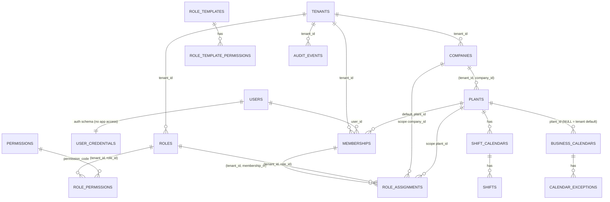

# 25 — B1 Multi-Tenancy & Security: Architecture Review

**Status:** ARCHITECTURE REVIEW v3 (2026-10-09). Owner approved the **direction** as the basis for final documentation review (D-053). **Implementation NOT authorized**: no code, migrations, authentication, tenant isolation, RBAC or RLS until explicit owner approval of B1 and of the decisions in §17.
**Basis (unchanged):** ADR-0001 (+ Amendment 1, D-053), ADR-0006, ADR-0007, ADR-0012, ADR-0013; docs 05, 17, 18, 24; doc 11 B1 slice (exit: T-ISO-01..05 green).
**Starting point:** B0 COMPLETED — PR #1 merged as `c19be09`, post-merge CI run 37942703992 green.
**Priority:** tenant isolation > authorization scope > authentication/session > audit > convenience.

## 0. Review log
| # | Version | Finding | Resolution |
|---|---|---|---|
| R-1 | v2 | `tenants` called "no RLS" and also given a policy | §5.3: RLS enabled **and forced**; SELECT policy for `eora_app`; INSERT/UPDATE only for `eora_provisioner` (no owner, no BYPASSRLS) |
| R-2 | v2 | after `set_config(…, true)` + commit the GUC is `''` (verified on PostgreSQL 18.6), so `current_setting(...)::uuid` errors on reused/pooled connections | all policies use `NULLIF(current_setting(…, true), '')::uuid` wrapped in `(SELECT …)`; ADR-0001 Amendment 1 + doc 17 aligned |
| R-3 | v2 | `memberships` self-select OR-ed with the tenant policy leaked a user's other-tenant memberships inside tenant context | self-select only when no tenant context |
| R-4 | v2 | Compose/CI use the superuser → RLS bypassed → false-positive tests | runtime + test groups B/C use `eora_app`; bootstrap asserts no `rolsuper`/`rolbypassrls` |
| R-5 | v3 | v2 proposed `DatabaseTransactions` for B/C tests: an outer test transaction keeps `set_config(…, true)` alive across requests of one test and hides transaction-boundary bugs | B/C tests run **without** an outer transaction; every test provisions unique tenants; the run starts from a clean schema created by group A (§11) |
| R-6 | v3 | `users` readable/writable as a whole by `eora_app` (v2 option a) — an SQL injection could dump every password hash | identity split: `users` profile (RLS + column grants) and `auth.user_credentials` with **no** `eora_app` grant, reachable only through four reviewed functions (§2.2, D-B1-03) |
| R-7 | v3 | provisioning used the owner role (implicit RLS exemption) | `eora_provisioner` (NOBYPASSRLS, not owner) creates the tenant row and then works under the new tenant's context with forced RLS (§2.4) |
| R-8 | v3 | Laravel loads the session user before any transaction: with RLS on `users` the lookup would return nothing | one request transaction sets `app.user_id` and `app.tenant_id` from the server session **before** authentication runs (§6) |

## 1. Tenant, company and plant data model
- `tenants` (platform root, no `tenant_id` column): `id uuid`, `code` unique, `name`, `status` (`PROVISIONING|ACTIVE|SUSPENDED|OFFBOARDING`), `timezone` (default `Asia/Jakarta`, D-044), `data_region`, timestamps.
- `companies`: `tenant_id`, `id`, `code`, `legal_name`, `status`; `UNIQUE (tenant_id, id)`, `UNIQUE (tenant_id, code)`.
- `plants`: `tenant_id`, `id`, `company_id` (composite FK), `code`, `name`, `timezone` (NULL = inherit), `status`; `UNIQUE (tenant_id, code)`.
- Business calendars (doc 11 B1; ADR-0012): `business_calendars` (`plant_id` NULL = tenant default, `timezone`, `production_day_starts_at`, `effective_from`), `calendar_exceptions`, `shift_calendars`, `shifts`; partial unique indexes for the NULL plant case.
- Warehouses, locations, work centers are **B2**; B1 scope types `TENANT`, `COMPANY`, `PLANT` (D-B1-02).
- Every tenant-owned table: PK `id uuid` (UUIDv7, D-B1-10), `tenant_id uuid NOT NULL`, `UNIQUE (tenant_id, id)`, composite FKs only, audit columns + `version`, `tenant_id`-leading indexes, RLS **enabled and forced** in the migration that creates it.

## 2. Identity, membership and provisioning
### 2.1 Membership flow
Global login (email + password) → **tenant picker** (transaction with `app.user_id` only) lists the caller's ACTIVE memberships → `POST /auth/tenant` binds the tenant in the server session (regenerate + audit) → plant chosen within scope. Tenant/plant never come from headers, URLs or client storage (DD-07). Every request re-validates membership + tenant status; permission cache key `membership_id + roles_version`.

### 2.2 Global identity — controlled access layer (final recommendation for D-B1-03)
| Object | Content | `eora_app` access |
|---|---|---|
| `users` (public schema) | `id`, `email` (citext unique), `name`, `status`, `locale`, `last_login_at`, timestamps — **no secrets** | RLS enabled + forced: `SELECT` where `id = ctx_user` **or** `id IN (SELECT user_id FROM memberships)` (memberships itself is tenant-filtered by its own RLS, so this means "members of the current tenant"); column grants: `SELECT (id, email, name, status, locale, last_login_at)`, `UPDATE (name, locale)`; **no INSERT/DELETE** |
| `auth.user_credentials` | `user_id`, `password_hash`, `password_changed_at`, `mfa_secret_enc`, `recovery_codes_hash`, `failed_attempts`, `locked_until` | **none** (schema `auth` has no `USAGE` for `eora_app`) |
| `auth.password_reset_tokens`, `auth.invitation_tokens` | token **hashes**, user/email, expiry, used_at | none |
| Functions in schema `auth_api` (owner `eora_auth_definer`, NOLOGIN, owns only the `auth` schema; `SECURITY DEFINER`, `SET search_path = ''`, `EXECUTE` granted to `eora_app` only) | `login_lookup(email) → (user_id, password_hash, status, locked_until)` — exactly one email, no wildcard; `record_login_result(user_id, success)`; `set_password(new_hash)` — only for `ctx_user`; `accept_invitation(token_hash, name, password_hash) → user_id` — valid unexpired token only; `issue_password_reset(email) → token` / `consume_password_reset(token_hash, new_hash)` | EXECUTE only |
- **Login:** app calls `login_lookup`; when no row is returned it still runs a dummy `password_verify` against a fixed hash (constant work), returns the same `401` message either way, then `record_login_result`. Rate limits per account + IP (D-B1-06).
- **Anti-enumeration:** invitation, reset and login answers are identical whether or not the email exists; no global user search endpoint; tenant user lists go through `memberships`.
- **SQL injection impact:** an injected query running as `eora_app` can read only profiles of the current tenant's members, cannot read any hash or MFA secret, cannot enumerate other tenants' users, and can call `login_lookup` only one exact email at a time (still rate-limited at the HTTP layer — a residual risk noted in §14).
- **Trade-offs:** more moving parts (one extra schema, one NOLOGIN definer role, six reviewed functions, function tests) versus a hard boundary around credentials. Rejected: (a) `users` fully granted (one injection = all hashes); (c) no RLS at all.

### 2.3 Memberships and the tenant table
| Table | RLS | Policies for `eora_app` |
|---|---|---|
| `memberships` | enable + force | P1 all commands: `tenant_id = ctx_tenant`; P2 SELECT: `ctx_tenant IS NULL AND user_id = ctx_user` (tenant picker) |
| `tenants` | enable + force | SELECT: `id = ctx_tenant` or (`ctx_tenant IS NULL` and `id IN (SELECT tenant_id FROM memberships WHERE user_id = ctx_user AND status = 'ACTIVE')`); no INSERT/UPDATE/DELETE grant |
`ctx_tenant` / `ctx_user` = `(SELECT NULLIF(current_setting('app.tenant_id' | 'app.user_id', true), '')::uuid)`. Policies are non-recursive (memberships policies never reference `tenants`).

### 2.4 Tenant provisioning without bypassing RLS
Role `eora_provisioner`: LOGIN, `NOBYPASSRLS`, not owner, member of `eora_app` (inherits its grants **and** its policies) plus: `INSERT, UPDATE (status)` on `tenants` through a policy `TO eora_provisioner WITH CHECK (true)` for INSERT and `USING (id = ctx_tenant)` for UPDATE; `EXECUTE` on `auth_api.provision_admin_user(email, name) → user_id` (creates the user + an invitation token, never a password). Used only by the provisioning command (D-B1-13).
One transaction, all under forced RLS:
1. `INSERT tenants` (status `PROVISIONING`, id generated by the command).
2. `set_config('app.tenant_id', new_id, true)`, `set_config('app.user_id', <system actor>, true)`.
3. Insert `companies`, `plants`, `business_calendars` default, `roles` + `role_permissions` (from the **approved** template set — content = D-B1-16 / O-007), first admin via `auth_api.provision_admin_user`, `memberships` (INVITED), `role_assignments` (tenant scope), `audit_events` (`tenant.provisioned`).
4. `UPDATE tenants SET status = 'ACTIVE'`; COMMIT. Any failure rolls back everything (no orphan tenant).
Re-running for an existing tenant `code` is a no-op that reports the existing tenant (idempotent by code).

## 3. Role and permission architecture
- Global: `permissions` (catalogue from code), `role_templates`, `role_template_permissions` — template **content** is O-007 (OPEN); only a minimal bootstrap administrator role is needed for provisioning (D-B1-16).
- Tenant: `roles`, `role_permissions`, `role_assignments` (`membership_id`, `role_id`, `scope_type`, `company_id`, `plant_id`, `valid_from`, `valid_until`, `granted_by`, `grant_reason`) with CHECK + composite FK per scope column (D-B1-02).
- Evaluation (doc 18 §5): session → active membership → permission in a currently valid assignment → scope → resource policy → RLS backstop; lists filter in SQL.
- Responses: `403 FORBIDDEN`; `403 SCOPE_FORBIDDEN`; foreign/out-of-scope id `404 NOT_FOUND` (`denyAsNotFound`, mapped since B0).
- No `Gate::before` shortcut; Platform Super Admin has no tenant path (impersonation = O-007).

## 4. Session, CSRF and cookie security (Sanctum, ADR-0006)
- Sanctum stateful SPA guard only; Redis session store; no personal access tokens in B1.
- `__Host-` session cookie (`Secure`, `HttpOnly`, `Path=/`, no `Domain`, `SameSite=Lax`); `XSRF-TOKEN` (`Secure`, `SameSite=Lax`, JS-readable). Local same origin via Next.js rewrites; Playwright verifies cookies on `http://localhost` (Chromium/Firefox accept `Secure` there).
- CSRF on every non-GET; `PreventRequestForgery` also checks `Origin`/`Sec-Fetch-Site`; 419 code per D-B1-08.
- Session id regenerated on login, tenant switch, plant switch, privilege change; logout invalidates server session + rotates CSRF token; password change ends other sessions; idle/absolute lifetime D-B1-05.
- Endpoints: `POST /auth/login`, `POST /auth/logout`, `GET /auth/me`, `POST /auth/tenant`, `POST /auth/plant`, invitation acceptance, password reset (D-B1-04).

## 5. PostgreSQL role separation and RLS
### 5.1 Roles (D-B1-01)
| Role | Login | Owns | Key privileges | Used by |
|---|---|---|---|---|
| bootstrap superuser | yes | — | creates roles, databases, extensions | provisioning script only (dev/CI); infra in production |
| `eora_owner` | yes | public-schema objects | DDL | migrations, group A tests |
| `eora_auth_definer` | **no** | schema `auth`, `auth_api` functions | — | owner of definer functions only |
| `eora_app` | yes | nothing | `NOSUPERUSER NOBYPASSRLS NOCREATEDB NOCREATEROLE`; DML per table as approved; `audit_events` INSERT+SELECT; catalogue SELECT; `EXECUTE` on `auth_api` (except `provision_admin_user`) | web, workers, groups B/C |
| `eora_provisioner` | yes | nothing | member of `eora_app` + tenant INSERT/status UPDATE + `provision_admin_user` | provisioning command, B/C test fixtures |
`REVOKE ALL ON SCHEMA public FROM PUBLIC`; default privileges by `eora_owner` grant nothing until a migration grants explicitly; no role is a member of `eora_owner` or `eora_auth_definer`.

### 5.2 Tenant-owned tables
```sql
ALTER TABLE plants ENABLE ROW LEVEL SECURITY;
ALTER TABLE plants FORCE ROW LEVEL SECURITY;
CREATE POLICY tenant_isolation ON plants
  USING      (tenant_id = (SELECT NULLIF(current_setting('app.tenant_id', true), '')::uuid))
  WITH CHECK (tenant_id = (SELECT NULLIF(current_setting('app.tenant_id', true), '')::uuid));
```
Unset or reset context → NULL → no row (fail closed). Malformed value → error (never widens).

### 5.3 Platform tables summary
`tenants`, `memberships` per §2.3; `users` per §2.2; `permissions`, `role_templates*` SELECT only; `security_events` INSERT only; `auth.*` no access.

### 5.4 Schema guard (group A)
Fails if: a `tenant_id` table lacks forced RLS + policy; `eora_app`/`eora_provisioner` own anything or have `rolsuper`/`rolbypassrls`; a `SECURITY DEFINER` function is outside the reviewed allowlist or lacks `SET search_path`; `eora_app` has any privilege on schema `auth`; `audit_events` is updatable/deletable by `eora_app`; actual grants differ from the approved grants matrix.

## 6. Request lifecycle and TenantTransaction
### 6.1 Middleware order (API group)
1. `AssignCorrelationId` (B0) → 2. cookies / `StartSession` (Redis, no DB) → 3. `PreventRequestForgery` (non-GET) → 4. `throttle` (Redis) → 5. **`TenantTransaction`** → 6. `auth:sanctum` → 7. `EnsureActiveMembership` → 8. `SubstituteBindings` (route-model binding **inside** the transaction so RLS applies; moved after 5 via middleware priority) → 9. controller → response fully built → COMMIT/ROLLBACK.
Steps 1–4 never touch PostgreSQL, so rejected, rate-limited or CSRF-failing requests hold no connection.

### 6.2 TenantTransaction contract
- Reads trusted ids from the **server session** (`login_web_*` user id, `active_tenant_id`, `active_plant_id`); `BEGIN` → `set_config('app.user_id', …, true)`, `set_config('app.tenant_id', …, true)` (omitted for picker/login routes) → `SET LOCAL statement_timeout`, `SET LOCAL lock_timeout` (D-B1-11) → next → COMMIT on 2xx/3xx, ROLLBACK otherwise.
- Authentication (step 6) then loads the user under RLS (`id = ctx_user`); `EnsureActiveMembership` verifies membership + tenant ACTIVE inside the same transaction; failure → rollback, session tenant cleared, 401/403.
- `GET` routes run `SET TRANSACTION READ ONLY` (enforces "GET never mutates"); sensitive-read audit rows are written by a short follow-up transaction after the read commits (D-B1-17).
- **Nested transactions:** only TenantTransaction (or the job middleware) opens the outer transaction; application code uses `DB::transaction()` which becomes a savepoint; architecture test bans `DB::beginTransaction/commit/rollBack` outside `App\Platform`; serialization/deadlock retry (`40001`, `40P01`) happens only at the outer level and only for idempotent commands.
- **External I/O:** forbidden inside the transaction (HTTP calls, mail, file storage writes, PDF, push). Domain events go to the outbox (same transaction); jobs dispatched with `afterCommit`; downloads/exports use signed URLs served by routes **excluded** from TenantTransaction after a short authorization transaction.
- Response serialization (API resources, pagination) completes before COMMIT; streamed responses are not allowed on transactional routes.
- Exception rendering (problem+json) runs after ROLLBACK and does not touch the database.

### 6.3 Login, logout, picker
`/auth/login`: no tenant context; uses `auth_api.login_lookup` + `record_login_result` in one short transaction; session regenerated. `/auth/logout`: session invalidated; `security_events` insert. Picker: transaction with `app.user_id` only.

### 6.4 Queue workers
`TenantJobMiddleware`: assert `DB::transactionLevel() === 0` (else rollback + reconnect + report), open the transaction with the job's `tenant_id`/actor, run, commit; `finally` rolls back anything left open. `TenantContext` is a `scoped` binding (flushed between jobs by `queue:work`; same for a future Octane). Tenant jobs without context throw before any query.

### 6.5 PgBouncer transaction pooling
All context is transaction-local; banned: `set_config(…, false)`, plain `SET app.*`, session advisory locks, `LISTEN`, temp tables, `DB::unprepared` outside migrations. Prepared statements per D-B1-09. Statements outside an explicit transaction are single autocommit statements (no context needed or allowed). Migrations and the provisioning command connect directly, not through the app pool.

## 7. Connection pooling security
See §6.5; pooler added to Compose and the CI docker job; T-ISO-03 proves no leakage; pool sized from cores (`(cores × 2) + 1` starting point, measured in doc 20 tests).

## 8. Audit trail
`audit_events` (tenant, append-only, same transaction, INSERT+SELECT only, UPDATE/DELETE trigger); `security_events` (platform); `access.not_found` on 404 for id routes; retention D-B1-12.

## 9. Migration dependency order (B1 only)
| # | Object | Depends on | RLS |
|---|---|---|---|
| 0 | roles (`eora_owner`, `eora_auth_definer`, `eora_app`, `eora_provisioner`), databases, schemas `auth`/`auth_api`, base privileges (provisioning script, D-B1-01) | cluster | — |
| 1 | `tenants` | 0 | forced (§2.3) |
| 2 | `users` (profile) | 0 | forced (§2.2) |
| 3 | `auth.user_credentials`, `auth.password_reset_tokens`, `auth.invitation_tokens` + `auth_api` functions | 2 | no app access |
| 4 | `permissions`, `role_templates`, `role_template_permissions` | 0 | none, read-only |
| 5 | `security_events` | 0 | none, insert-only |
| 6 | `companies` → 7 `plants` | 1 | forced |
| 8 | `memberships` | 1, 2, 7 | forced + picker |
| 9 | `roles`, `role_permissions` | 1, 4 | forced |
| 10 | `role_assignments` | 6, 7, 8, 9 | forced |
| 11 | `business_calendars`, `calendar_exceptions`, `shift_calendars`, `shifts` | 7 | forced |
| 12 | `audit_events` + trigger | 1 | forced |
| 13 | grants matrix + schema guard | all | — |



## 10. Rollback plan and destructive-command hardening
- Every migration reversible; group A runs migrate → rollback → migrate under `eora_owner`.
- No production deployment in B1; after the first pilot tenant: forward-fix only. RLS is never disabled as a rollback step. Role provisioning idempotent with a dev-only revoke script.
- Hardening: keep `TestDatabaseGuard`; add a test-host allowlist (`127.0.0.1`, `localhost`, `postgres`, CI service; override `EORA_TEST_DB_HOST_ALLOW`); `DB::prohibitDestructiveCommands($app->isProduction())`; runtime roles cannot DROP/TRUNCATE; owner credentials only in the migration job secret scope; production database names never end in `_test`. These are **code dependencies for B1** (not done in this documentation PR).

## 11. Test harness — three groups
| Group | Role | Harness | Never |
|---|---|---|---|
| **A — Schema/Migration** (`--group=schema`) | `eora_owner` (+ catalog reads) | starts from an empty `eora_test` schema each run: migrate → rollback → migrate; schema guard; grants matrix | runs as `eora_app` for DDL |
| **B — Runtime authorization** (`--group=authz`) | HTTP requests through the real middleware stack → `eora_app`; fixtures via the provisioning service → `eora_provisioner` | **no outer test transaction**; each test provisions its own uniquely-coded tenants; isolation between tests comes from tenancy itself | superuser, owner, `DatabaseTransactions`, `RefreshDatabase` |
| **C — Tenant isolation/RLS** (`--group=isolation`) | `eora_app` direct and through PgBouncer | raw SQL with explicit `BEGIN`/`set_config(…, true)`; parallel processes; no Eloquent scopes | superuser, owner, app-level filters |
Bootstrap of B and C: `SELECT current_user, rolsuper, rolbypassrls FROM pg_roles WHERE rolname = current_user` must return `eora_app` (or `eora_provisioner` for fixtures) with `false/false`; otherwise the run aborts. Group A runs first in CI; B and C run against the schema A left in place.

## 12. Security test matrix
| ID | Grp | Test | Expected |
|---|---|---|---|
| T-RLS-GUARD | A | §5.4 checks | pass |
| T-MIG-01 | A | migrate → rollback → migrate | identical schema hash |
| T-GRANT-01 | A | grants equal approved matrix | exact |
| T-AUTHDB-01 | A/C | `eora_app` selects from `auth.user_credentials` / calls `provision_admin_user` | permission denied |
| T-PROV-01 | C | provisioning connection role | `eora_provisioner`, not superuser, no BYPASSRLS, not owner |
| T-PROV-02 | C | provisioning creates tenant, company, plant, calendar, roles, admin user, membership, assignment, audit | all rows carry the new `tenant_id`; tenant ends `ACTIVE` |
| T-PROV-03 | C | inside provisioning context insert a row with another tenant's id | WITH CHECK violation |
| T-PROV-04 | C | failure injected after step 3 | full rollback, no tenant/user/membership left |
| T-PROV-05 | C | re-run with same tenant code | no duplicate rows; existing tenant reported |
| T-PROV-06 | B | invited admin accepts invitation, logs in | sees only the new tenant; no password ever set by the command |
| T-PROV-07 | C | `eora_app` inserts into `tenants` | denied |
| T-ISO-01 | B | tenant A user requests B ids on every B1 endpoint | 404, no data, `access.not_found` |
| T-ISO-02 | C | as `eora_app` + A context: select/update/delete B rows; insert with B `tenant_id`; composite FK to B parent | 0 rows / error / FK error |
| T-ISO-02b | C | no context; reset context (`''`); malformed context | 0 / 0 / error |
| T-ISO-03 | C | interleaved A/B through PgBouncer, parallel workers | zero cross reads; next transaction NULL context |
| T-ISO-04 | C | worker job B then A | A never sees B |
| T-ISO-05 | B | cache/permission keys | distinct per tenant+scope |
| T-MEM-01 | C | picker lists own memberships across tenants; inside tenant A only A | as stated |
| T-TEN-01 | C | `tenants` visibility with A context / picker | only A / only member tenants |
| T-USR-01 | C | `eora_app` with A context selects `users` | only A's members (+ self) |
| T-USR-02 | C | `eora_app` UPDATE `users.email`/`status` | permission denied (column grants) |
| T-USR-03 | B | login unknown vs known email with wrong password | same status, body, comparable timing |
| T-CTX-01 | B | request A then request B on the same PHP worker + pooled connection | B never sees A context |
| T-CTX-02 | B | exception mid-command | rollback; next request clean (`transactionLevel = 0`) |
| T-CTX-03 | B | GET route attempts a write | fails (READ ONLY) |
| T-CTX-04 | B | route-model binding of a B id while in A | 404 (binding inside transaction) |
| T-CTX-05 | B (arch) | `DB::beginTransaction/commit` outside `App\Platform`; `set_config(…, false)`; external client calls inside handlers | arch test fails |
| T-AUTH-01..05, T-SESS-01..04, T-CSRF-01..04, T-COOKIE-01..03, T-CORS-01, T-RBAC-01..04, T-ESC-01..05, T-CONC-01..03, T-RATE-01, T-AUD-01..03, T-PRIV-01 | B/C | as v2 (login/session/CSRF/cookie/CORS/RBAC/escalation/concurrency/rate/audit/platform) | as v2 |

## 13. Privilege-escalation prevention
Grantor ⊇ grantee (permissions and scope); SoD-06 self-elevation blocked until the approval engine thresholds (O-007) exist; `tenant_id`, `is_system`, `scope_*`, `status` never mass-assignable; tenant/plant only from session; regeneration on privilege change; permission cache keyed by `roles_version`; break-glass time-boxed + audited; no platform → tenant path; no role can `SET ROLE` to owner/definer; definer functions check `ctx_user` inside.

## 14. Risk register
| Risk | Today | Mitigation | Test |
|---|---|---|---|
| Cross-tenant leakage | low / critical | session context, composite FKs, forced RLS, 404 | T-ISO-01/02 |
| Unauthorized plant access | medium / high | SQL scope predicates + policies | T-RBAC-02 |
| Privilege escalation | medium / critical | §13 | T-ESC |
| RLS bypass (superuser/owner/BYPASSRLS) | **high until B1** / critical | role split, guards, bootstrap assertion | T-RLS-GUARD, T-PROV-01 |
| Pool context leakage | low / critical | transaction-local context, NULLIF, banned session state | T-ISO-03, T-CTX-01 |
| Credential exposure via SQL injection | medium / critical | `auth` schema without app access, definer API | T-AUTHDB-01, T-USR-02 |
| Login enumeration / brute force | medium / high | uniform responses, dummy verify, rate limits; residual: `login_lookup` per exact email | T-USR-03, T-RATE-01 |
| Definer-function misuse | low / high | allowlist, `search_path=''`, `ctx_user` checks, review | T-RLS-GUARD |
| Long-held transactions | medium / medium | no external I/O, read-only GETs, timeouts | T-CTX, D-B1-11 |
| False-positive tests | high today / high | groups A/B/C, no outer test transaction | bootstrap |
| Destructive command on production | low / critical | §10 | guard tests |

## 15. Acceptance criteria (B1 exit)
1. §9 objects exist; runtime + groups B/C use `eora_app`/`eora_provisioner`; T-RLS-GUARD, T-GRANT-01 green.
2. All §12 tests green on every PR (docker job includes PgBouncer).
3. Provision → invite → accept → login → tenant picker → plant switch → logout works same-origin in Playwright with cookie attributes asserted.
4. Migrate/rollback round-trip green; §10 hardening implemented.
5. OpenAPI documents all B1 endpoints incl. errors; typed client regenerated; no drift.
6. Docs updated (ADR-0001/0006 verification, docs 05, 17, 18, 24, register). B2 not started.

## 16. Delivery shape (after approval)
Branch `feat/b1-tenancy-security`; commits: roles/connections → tenancy tables + RLS + guards → identity split + auth API → TenantTransaction + pooler tests → session/CSRF → RBAC + escalation → provisioning → audit → calendars → docs. PR to `main`, no auto-merge.

## 17. Decision matrix
Proposals only — nothing below is final until the owner approves it. Numeric values are **recommended parameters with rationale**, not defaults.

### 17.1 Recommended for approval now (architecture, no business policy)
| ID | Decision | Recommendation | Security / operational / trade-off |
|---|---|---|---|
| D-B1-01 | DB roles + provisioning | `eora_owner`, `eora_auth_definer` (NOLOGIN), `eora_app`, `eora_provisioner`; dev/CI via idempotent script run by the bootstrap superuser; production by infra | removes RLS bypass and DDL from runtime / two extra credentials, one script / more config |
| D-B1-02 | Scope columns | typed nullable columns + CHECK + composite FKs; B2 adds warehouse/work center | DB-level cross-tenant guarantee / one migration per scope type / wider table |
| D-B1-03 | Global identity (revised) | controlled access layer §2.2: `users` profile with RLS + column grants; credentials in `auth` schema with no app access; six definer functions | injection cannot read hashes; anti-enumeration / function review + tests / more moving parts |
| D-B1-08 | Error codes | add `CSRF_TOKEN_MISMATCH` (419); use `SESSION_EXPIRED`, `SCOPE_FORBIDDEN` (doc 24) | additive contract change / frontend can auto-refresh CSRF |
| D-B1-09 | Pooler + prepared statements | PDO emulated prepares; pinned maintained PgBouncer image (≥ 2-week-old release rule) in Compose + CI | pooler-agnostic / one more service / small parse overhead |
| D-B1-10 | UUIDv7 | app generates (`Str::uuid7()`), PostgreSQL 18 `uuidv7()` as column default fallback | ids known before insert (idempotency, events) / none |
| D-B1-13 | Provisioning path | artisan command using `eora_provisioner` (§2.4); no UI, no self-signup | smallest surface / operator runs a command / none |
| D-B1-14 | Calendars | keep in B1 | needed by B3 periods and B5 / none |
| D-B1-15 | Test harness | groups A/B/C §11, no outer test transaction for B/C | real runtime role, real boundaries / longer bootstrap |
| D-B1-17 | Sensitive-read audit on READ ONLY GETs | follow-up short transaction after the read commits | keeps GET read-only / audit row could be lost if the follow-up fails → log + retry |

### 17.2 Requires owner decision (policy or values)
| ID | Decision | Recommended parameters (rationale) | Trade-off |
|---|---|---|---|
| D-B1-04 | Auth features | B1: login, logout, me, tenant/plant switch, invitation acceptance, password reset; **TOTP MFA for privileged roles in B1.1 before pilot** (ADR-0006) | earlier delivery vs privileged accounts protected by password + rate limit only until B1.1 |
| D-B1-05 | Session lifetime | office roles: idle 30 min, absolute 12 h; shop-floor shared devices: idle 15 min, absolute = shift length (8–12 h); tenant may shorten, not lengthen beyond platform max 24 h (balances hijack window against re-login friction on a shift) | shorter = safer, more logins on the floor |
| D-B1-06 | Rate limits (auth only now) | login 5/min per account + 20/min per IP with progressive delay (doc 05); raise per-IP to 60/min for allow-listed factory NAT ranges per tenant | strict limits can lock out a whole shift behind one NAT |
| D-B1-07 | Password policy | argon2id (m = 64 MiB, t = 3, p = 1 — above the OWASP minimum, fits API replicas with ≥ 512 MiB/worker), min length 12, no composition rules, offline breached-password list (no outbound call) | memory/CPU per login vs cracking resistance; offline list must be updated |
| D-B1-11 | Timeouts | `statement_timeout` 5 s reads, 10 s commands, 120 s jobs; `lock_timeout` 3 s (fail fast, retry at outer level); idle-in-transaction 30 s server-side | too low → spurious failures at peaks; tune with doc 20 load tests |
| D-B1-16 | Bootstrap administrator role (new) | one system role `TENANT_ADMIN` with only `core.users_roles` (VCP) and `core.audit` (V) so the first admin can onboard users; all other templates stay O-007 | needed to provision without inventing template content; touches O-007 boundary — owner must confirm |

### 17.3 Can be deferred safely
| ID | Decision | Why deferral is safe | Deadline |
|---|---|---|---|
| D-B1-12 | Audit retention/partitioning | V1 deletes nothing; partitioning only when volume measured (doc 20) | before pilot contract (legal retention period to be confirmed by the owner) |

**Still OPEN, not decided here:** O-007 (approval thresholds, role-template content beyond D-B1-16, support impersonation), O-012, O-013, O-015, O-021.

## 18. Code dependencies found during review (not implemented here)
| Dependency | Slice |
|---|---|
| App + tests stop using the superuser; Compose/CI provision roles | B1 |
| Middleware priority so `SubstituteBindings` runs inside `TenantTransaction` | B1 |
| `TestDatabaseGuard` host allowlist; `prohibitDestructiveCommands` in production | B1 |
| `CSRF_TOKEN_MISMATCH` mapping in `ProblemDetails` (D-B1-08) | B1 |
| PgBouncer service in Compose + CI docker job | B1 |
