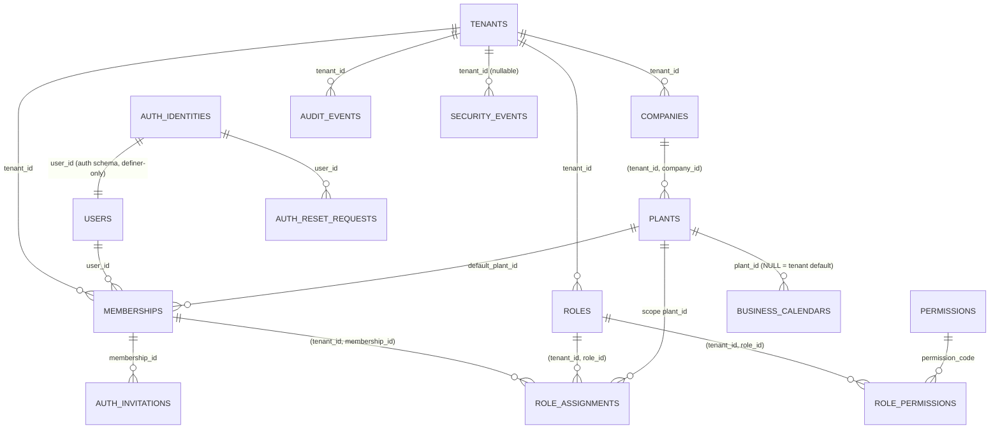

# 25 — B1 Multi-Tenancy & Security: Architecture Review

**Status:** ARCHITECTURE REVIEW v4 (2026-10-09). Owner approved the **direction** as the basis for final documentation review (D-053). **Implementation NOT authorized**: no code, migrations, authentication, tenant isolation, RBAC or RLS until explicit owner approval of B1 and of the decisions in §17.
**Basis (unchanged):** ADR-0001 (+ Amendment 1, D-053), ADR-0006, ADR-0007, ADR-0012, ADR-0013; docs 05, 17, 18, 24; doc 11 B1 slice (exit: T-ISO-01..05 green).
**Starting point:** B0 COMPLETED — PR #1 merged as `c19be09`, post-merge CI run 37942703992 green.
**Priority:** tenant isolation > authorization scope > authentication/session > audit > convenience.

## 0. Review log
| # | Version | Finding | Resolution |
|---|---|---|---|
| R-1 | v2 | `tenants` called "no RLS" and also given a policy | RLS enabled **and forced**; SELECT policy for `eora_app`; INSERT/status UPDATE only for `eora_provisioner` (§2.3) |
| R-2 | v2 | after `set_config(…, true)` + commit the GUC is `''` (verified on PostgreSQL 18.6) → `::uuid` errors on reused/pooled connections | all policies use `(SELECT NULLIF(current_setting(…, true), '')::uuid)`; ADR-0001 Amendment 1, doc 17 aligned |
| R-3 | v2 | memberships self-select OR-ed with the tenant policy leaked other-tenant memberships | self-select only without tenant context |
| R-4 | v2 | Compose/CI use the superuser → RLS bypassed → false-positive tests | runtime + groups B/C use non-superuser roles; bootstrap assertion |
| R-5 | v3 | outer test transaction hides boundary bugs | B/C tests without outer transaction; unique tenants per test |
| R-6 | v3 | `users` fully readable by `eora_app` | profile vs credentials split (§2.2) |
| R-7 | v3 | provisioning via owner | `eora_provisioner` under forced RLS (§2.5) |
| R-8 | v3 | session user loaded before any context | request transaction sets context from the server session before auth (§6) |
| **R-9** | v4 (Codex P1-01) | `auth_api.login_lookup` ran as a definer that owns only `auth`, but read email/status from `public.users`, which has **forced RLS requiring a context that login does not have** → zero rows/permission error → login impossible | login-relevant identity (normalized email, account status, credentials) moved into `auth.identities`; login reads **only** the `auth` schema; `public.users` keeps profile data and is never needed before login (§2.2) |
| **R-10** | v4 (Codex P1-02) | `provision_admin_user` stored only the invitation hash and returned `user_id`; external I/O is banned in the transaction → the raw secret reached nobody → first admin could never log in | provisioning only records the invitation **request** + outbox event; an after-commit **delivery worker** with its own role issues the secret, stores its hash and sends it; raw secret exists only in worker memory and the message to the owner of the address (§2.4) |
| **R-11** | v4 (Codex P1-03, **critical**) | `eora_app` had `EXECUTE` on `issue_password_reset` (returns the raw token) and `consume_password_reset` → any SQL injection as `eora_app` could mint and consume a reset token for a privileged email → account takeover | `eora_app` has **no** privilege on any auth function or table; token **issuance** is possible only for the delivery role (which cannot consume); **consumption** only for the web auth role (which cannot issue or read tokens); the web path can only *request* a reset (no token returned) (§2.3) |
| **R-12** | v4 (Codex P1-04) | denied-access audits were written in the request transaction, which is rolled back on every non-2xx → `access.not_found` lost, T-ISO-01 impossible | security events are buffered in memory and flushed **after** commit/rollback in an independent short transaction to an append-only `security_events` table, with log fallback (§8) |

## 1. Tenant, company and plant data model
- `tenants` (platform root, no `tenant_id` column): `id uuid`, `code` unique, `name`, `status` (`PROVISIONING|ACTIVE|SUSPENDED|OFFBOARDING`), `timezone` (default `Asia/Jakarta`, D-044), `data_region`, timestamps.
- `companies`, `plants` (composite FK to company), business calendars (`business_calendars` with `plant_id` NULL = tenant default, `calendar_exceptions`, `shift_calendars`, `shifts`; ADR-0012).
- Warehouses, locations, work centers are **B2**; B1 scope types `TENANT`, `COMPANY`, `PLANT` (D-B1-02).
- Every tenant-owned table: PK `id uuid` (UUIDv7, D-B1-10), `tenant_id uuid NOT NULL`, `UNIQUE (tenant_id, id)`, composite FKs only, audit columns + `version`, `tenant_id`-leading indexes, RLS **enabled and forced** in its creating migration.

## 2. Identity, credentials, invitation, reset, provisioning
### 2.1 Privilege domains (the boundary that contains SQL injection)
| Domain | DB role (connection) | Can touch | Cannot touch | Used by |
|---|---|---|---|---|
| Business | `eora_app` (`pgsql`) | public tenant tables under forced RLS; `users` profile per policy; `security_events` INSERT | **anything in `auth` / `auth_api`** | all business HTTP routes, workers |
| Web authentication | `eora_auth_web` (`pgsql_auth`) | `EXECUTE` on `auth_api.login_lookup`, `record_login_result`, `request_password_reset`, `consume_password_reset`, `consume_invitation`, `set_own_password`, `pending_activations`, `ensure_identity`, `record_security_event` | business tables; token issuance; any `auth` table directly | only `App\Platform\Auth` code on `/auth/*` routes and the invite command handler's identity step (arch test) |
| Secret delivery | `eora_auth_delivery` (`pgsql_delivery`) | `EXECUTE` on `auth_api.issue_invitation_secret`, `issue_reset_secret`, `mark_delivery_result` | consumption functions; business tables; any `auth` table directly | dedicated delivery worker (separate queue + process, own credentials) |
| Credential storage | `eora_auth_definer` (NOLOGIN) | owns `auth` schema tables and the `SECURITY DEFINER` functions | — (cannot log in) | — |
| Provisioning | `eora_provisioner` | member of `eora_app` + tenant insert + `users` profile insert + `auth_api.ensure_identity` | token issuance/consumption | provisioning command only |
A SQL injection in a business route runs as `eora_app` and **cannot reach the auth domain at all** — neither tables nor functions. A SQL injection in an auth route (small, reviewed, fixed-statement surface) can call only the web functions listed, none of which returns a usable secret. The delivery worker can issue secrets but cannot consume them and runs in its own process with its own credentials.

### 2.2 Global identity (D-B1-03, final)
| Object | Content | Access |
|---|---|---|
| `auth.identities` | `user_id`, `email_normalized` (citext unique), `status` (`ACTIVE|LOCKED|DISABLED`), `password_hash` (nullable until invitation accepted), `password_changed_at`, `failed_attempts`, `locked_until`, `mfa_secret_enc`, `recovery_codes_hash` | definer functions only |
| `public.users` (profile) | `id` (= `user_id`), `display_name`, `locale`, `email_display` (copy kept in sync **only** by definer functions), timestamps — no status, no secret | `eora_app`: forced RLS `id = ctx_user OR id IN (SELECT user_id FROM memberships)`; column grants `SELECT (id, display_name, locale, email_display)`, `UPDATE (display_name, locale)`; no INSERT/DELETE |
**Login (`POST /auth/login`, no context needed):** `auth_api.login_lookup(email text) RETURNS TABLE(user_id uuid, password_hash text, status text, locked_until timestamptz)` — `SECURITY DEFINER`, owner `eora_auth_definer`, `SET search_path = ''`, every reference schema-qualified (`auth.identities`, `pg_catalog.lower`), exact match on normalized email, `STABLE`, at most one row, no profile, no tenant data. The app (via `pgsql_auth`) verifies the hash with argon2id in PHP; if no row, it verifies against a fixed dummy hash (constant work) and returns the same `401 UNAUTHENTICATED` body; `record_login_result(user_id, success, ip_hash)` updates counters/lockout. Then session regeneration, and the tenant picker runs on `eora_app` with `ctx_user` only.
**Residual risk (accepted, documented):** a compromised auth route could call `login_lookup` for a *known* email and obtain that one hash for offline cracking. Mitigations: argon2id parameters (D-B1-07), no wildcard/listing, no dynamic SQL in auth code (arch test), MFA for privileged roles (D-B1-04), per-account lockout counters in `auth.identities` (enforced inside `record_login_result`, not only by HTTP rate limits).

### 2.3 Password reset (fix for R-11)
1. `POST /auth/password/forgot` → `auth_api.request_password_reset(email)` (web role): creates `auth.reset_requests` (`id`, `user_id` or NULL when unknown email, `status REQUESTED`, `requested_at`, `ip_hash`), enforces per-identity request throttling **inside the function** (e.g. ≤ 3 open requests/hour), returns **nothing**; the HTTP answer is identical for known and unknown emails. Hand-off to delivery (no `NOTIFY`, pooler-safe): the function inserts `auth.delivery_queue (kind RESET, request_id)`.
2. Delivery worker (`eora_auth_delivery`) polls `auth_api.next_delivery()` (`FOR UPDATE SKIP LOCKED` inside the definer), calls `issue_reset_secret(request_id)` → generates 256-bit random secret, stores **SHA-256 hash** + `expires_at`, returns the raw secret to the worker only, commits; then sends the email **outside** any transaction; then `mark_delivery_result(request_id, ok)`. On send failure: retry with backoff; each retry **rotates** the secret (old hash invalidated) so at most one secret is valid.
3. `POST /auth/password/reset` → `auth_api.consume_password_reset(secret text, new_hash text)` (web role): hashes the secret, `UPDATE … SET status = 'CONSUMED' WHERE hash = $1 AND status = 'SENT' AND expires_at > now() RETURNING user_id` (atomic single use), sets the new password hash, clears lockout, bumps `password_changed_at` (all sessions of the user invalidated by the app on next request), records the event. Returns only success/failure (uniform failure for invalid, expired, replayed).
4. Privileged accounts: when MFA is enrolled (B1.1), a reset does **not** remove MFA; the next login still requires the second factor. Without MFA (B1), a reset of an account holding privileged roles also notifies all tenant administrators of that tenant (post-commit, delivery worker) — D-B1-18.
Neither `eora_app` nor `eora_auth_web` can ever read a raw secret; the delivery role can read a raw secret only at issuance and cannot consume it.

### 2.4 Invitations and first administrator (fix for R-10)
- Provisioning or a tenant admin invites a user: in the tenant transaction (`eora_app`/`eora_provisioner`) → membership `INVITED` + outbox event `membership.invited (tenant_id, membership_id, user_id)`; the identity is ensured beforehand through `auth_api.ensure_identity(user_id_candidate, email)` — on the auth connection (`eora_auth_web` for a tenant admin's invite, `eora_provisioner` for provisioning); idempotent by email; it always returns a `user_id` (existing or new), creates no password and no membership, so calling it reveals nothing beyond what the caller already supplied. Abuse impact (SQL injection in that path): creation of password-less identities without memberships, removed by the cleanup job (§2.5).
- After commit, the outbox relay enqueues a delivery job; the delivery worker calls `auth_api.issue_invitation_secret(tenant_id, membership_id, user_id)` → stores hash + `expires_at` (recommended 72 h), returns the raw secret to the worker only → sends the invitation link **outside** any transaction → `mark_delivery_result`. Failure → retry with rotation; after N failures the invitation is `DELIVERY_FAILED` and visible to the inviter, who can resend.
- Acceptance (`POST /auth/invitations/accept`, web role): `auth_api.consume_invitation(secret, password_hash)` → atomic single use (`SENT` + not expired → `ACCEPTED`), sets the password hash if none, returns `(user_id, tenant_id, membership_id)`. The app then opens a tenant transaction on `eora_app` with that context and sets the membership `ACTIVE` under RLS. If that second step fails, `auth_api.pending_activations(user_id)` is checked at the next login and the activation is completed idempotently — no membership stays stuck.
- Membership activation policy (accept → ACTIVE immediately vs. admin confirmation) is D-B1-19; recommendation: ACTIVE on acceptance for invitations created by an admin.
- Operator fallback for the very first tenant administrator when no mail transport exists yet (dev/pilot setup): `eora:tenant:provision --deliver=console` makes the **delivery worker logic** print the one-time link to the operator's terminal (never to logs), audited as `invitation.delivered_console` — D-B1-18.

### 2.5 Tenant provisioning without bypassing RLS (corrected)
Order (three independent steps, each idempotent; no external I/O inside a transaction):
1. **Identity** (`pgsql_provisioner` → `auth_api.ensure_identity`): returns `user_id` for the admin email (new or existing).
2. **Tenant transaction** (`eora_provisioner`, forced RLS): `INSERT tenants (PROVISIONING)` → `set_config('app.tenant_id', new_id, true)` + system actor → `companies`, `plants`, default `business_calendars`, bootstrap roles (D-B1-16), `users` profile row if missing, `memberships (INVITED)`, `role_assignments (TENANT_ADMIN, tenant scope)`, `audit_events (tenant.provisioned)`, outbox `membership.invited` → `UPDATE tenants SET status = 'ACTIVE'` → COMMIT. Any error → full rollback (tenant, company, plant, membership, assignment all absent).
3. **Delivery** (after commit): §2.4.
Re-running with the same tenant code: step 2 detects the existing tenant and stops; step 3 can be re-triggered as "resend". An identity created in step 1 for a run whose step 2 then failed has no membership — it cannot log in to any tenant; a cleanup job removes identities without memberships and without credentials after 7 days (D-B1-18).

### 2.6 Memberships and tenants (unchanged from v3)
| Table | RLS | Policies for `eora_app` |
|---|---|---|
| `memberships` | enable + force | P1 all: `tenant_id = ctx_tenant`; P2 SELECT: `ctx_tenant IS NULL AND user_id = ctx_user` |
| `tenants` | enable + force | SELECT: `id = ctx_tenant` or (`ctx_tenant IS NULL` and member via `memberships`); INSERT/status UPDATE only `TO eora_provisioner` |
`ctx_tenant` / `ctx_user` = `(SELECT NULLIF(current_setting('app.tenant_id' | 'app.user_id', true), '')::uuid)`.

### 2.7 Definer-function rules
Owner `eora_auth_definer` (NOLOGIN, owns only `auth` objects); `SECURITY DEFINER` + `SET search_path = ''`; all identifiers schema-qualified incl. `pg_catalog`; `REVOKE ALL ON FUNCTION … FROM PUBLIC` then `GRANT EXECUTE` to exactly one role each (table in §2.1); no dynamic SQL; inputs length-checked; functions return no more than documented; every function covered by abuse-case tests (§12); allowlist enforced by the schema guard (§5.4).

## 3. Role and permission architecture
- Global: `permissions`, `role_templates`, `role_template_permissions` — template content is O-007 (OPEN); only the bootstrap administrator role is needed for provisioning (D-B1-16).
- Tenant: `roles`, `role_permissions`, `role_assignments` (scope columns + CHECK + composite FKs, `valid_from/valid_until`, `granted_by`, `grant_reason`).
- Evaluation (doc 18 §5); responses `403 FORBIDDEN`, `403 SCOPE_FORBIDDEN`, `404 NOT_FOUND` for foreign/out-of-scope ids. No `Gate::before` shortcut; Platform Super Admin has no tenant path (O-007).

## 4. Session, CSRF and cookie security (ADR-0006)
Sanctum stateful SPA; `__Host-` session cookie (`Secure`, `HttpOnly`, `Path=/`, no `Domain`, `SameSite=Lax`); `XSRF-TOKEN`; CSRF + `Origin` check on non-GET; session regenerated on login/tenant/plant/privilege change; logout invalidates server session; password change or reset invalidates all sessions of the user (session records carry `password_changed_at` checked per request); lifetimes D-B1-05. Endpoints: `/auth/login`, `/auth/logout`, `/auth/me`, `/auth/tenant`, `/auth/plant`, `/auth/password/forgot`, `/auth/password/reset`, `/auth/invitations/accept`.

## 5. PostgreSQL roles and RLS
### 5.1 Roles (D-B1-01)
| Role | Login | Owns | Notes |
|---|---|---|---|
| bootstrap superuser | yes | — | creates roles/DBs/extensions only (script in dev/CI, infra in prod) |
| `eora_owner` | yes | public schema objects | migrations, group A tests |
| `eora_auth_definer` | **no** | `auth` schema + `auth_api` functions | owner only |
| `eora_app` | yes | nothing | NOSUPERUSER, NOBYPASSRLS; no `auth`/`auth_api` privilege |
| `eora_auth_web` | yes | nothing | EXECUTE on web functions only; no table privilege |
| `eora_auth_delivery` | yes | nothing | EXECUTE on delivery functions only; separate process |
| `eora_provisioner` | yes | nothing | member of `eora_app` + tenant insert + `ensure_identity`; NOBYPASSRLS |
No role is a member of `eora_owner` or `eora_auth_definer`; `REVOKE ALL ON SCHEMA public, auth, auth_api FROM PUBLIC`.

### 5.2 Tenant-owned tables
```sql
ALTER TABLE plants ENABLE ROW LEVEL SECURITY;
ALTER TABLE plants FORCE ROW LEVEL SECURITY;
CREATE POLICY tenant_isolation ON plants
  USING      (tenant_id = (SELECT NULLIF(current_setting('app.tenant_id', true), '')::uuid))
  WITH CHECK (tenant_id = (SELECT NULLIF(current_setting('app.tenant_id', true), '')::uuid));
```

### 5.3 Platform tables
`tenants`, `memberships` §2.6; `users` §2.2; `permissions`, `role_templates*` SELECT; `security_events` §8; `auth.*` definer-only.

### 5.4 Schema guard (group A)
Fails if: a `tenant_id` table lacks forced RLS + policy; any LOGIN role owns objects or has `rolsuper`/`rolbypassrls`; a `SECURITY DEFINER` function is off the allowlist, lacks `search_path=''`, is owned by anyone but `eora_auth_definer`, or is executable by `PUBLIC` or by a role other than the one listed in §2.1; `eora_app` has any privilege on `auth`/`auth_api`; `security_events`/`audit_events` updatable or deletable by a runtime role; grants differ from the approved matrix.

## 6. Request lifecycle and TenantTransaction
### 6.1 Middleware order
1 `AssignCorrelationId` → 2 cookies/`StartSession` (Redis) → 3 `PreventRequestForgery` → 4 `throttle` (Redis) → 5 **`TenantTransaction`** (+ security-event flush in its `finally`, §8) → 6 `auth:sanctum` → 7 `EnsureActiveMembership` → 8 `SubstituteBindings` (inside the transaction via middleware priority) → 9 controller → response built → COMMIT/ROLLBACK → flush security events. Steps 1–4 never touch PostgreSQL. `/auth/*` routes use the auth connection instead of steps 5–8 (except picker/me on `eora_app`).

### 6.2 TenantTransaction contract
- Context from the **server session** (user id, active tenant/plant); `BEGIN` → `set_config('app.user_id'|'app.tenant_id', …, true)` → `SET LOCAL statement_timeout/lock_timeout` → next → COMMIT on 2xx/3xx, ROLLBACK otherwise → security-event flush (independent transaction).
- Exceptions inside the pipeline are converted to problem+json **inside** step 5 (Laravel converts per pipeline stage); the renderer **only buffers** security events in memory (no DB call), TenantTransaction then rolls back and flushes.
- GET → `READ ONLY`; sensitive-read audits via the post-commit flush path (D-B1-17 merged into §8).
- Nested: only TenantTransaction/job middleware opens the outer transaction; inner `DB::transaction()` = savepoint; arch test bans `beginTransaction/commit/rollBack` outside `App\Platform`; retry (`40001`, `40P01`) only at the outer level for idempotent commands.
- No external I/O inside (HTTP, mail, storage writes, PDF, push); outbox + `afterCommit` jobs; downloads via signed URLs on routes outside TenantTransaction after a short authorization transaction; no streamed responses on transactional routes.

### 6.3 Queue workers and pooling
`TenantJobMiddleware` asserts `DB::transactionLevel() === 0` (else rollback + reconnect + report), opens the transaction with the job's context, `finally` rollback; `TenantContext` is `scoped` (flushed between jobs). PgBouncer transaction mode; banned: `set_config(…, false)`, plain `SET app.*`, session advisory locks, `LISTEN`, temp tables, `DB::unprepared` outside migrations; prepared statements per D-B1-09. Auth and delivery connections use the same rules (no session state).

## 7. Connection pooling
Pooler in Compose + CI docker job; pool sizing from cores (`(cores × 2) + 1` start, measured in doc 20); migrations, provisioning and the delivery worker may connect directly.

## 8. Audit and durable security events (fix for R-12)
- **Business audit** (`audit_events`, tenant, append-only): written **inside** the command transaction — it must disappear when the business change rolls back.
- **Security events** (`security_events`, append-only): `id`, `occurred_at`, `tenant_id` (nullable), `user_id` (nullable), `membership_id`, `action` (`access.not_found`, `access.forbidden`, `access.scope_forbidden`, `auth.failed`, `auth.locked`, `auth.password_reset_requested`, `auth.password_reset_consumed`, `invitation.accepted`, `export.downloaded`, …), `resource`, `requested_id` (≤ 64 chars, validated charset), `route`, `http_status`, `correlation_id`, `ip_hash`, `user_agent_hash`, `email_hmac` (for auth events; HMAC with a server pepper, never the email), `detail_code`. **Never** request bodies, passwords, tokens, secrets, cookies or other tenants' data.
- **Path:** events are collected in a request-scoped in-memory buffer (renderer, policies, auth code) → after TenantTransaction commits **or rolls back**, a separate short transaction on `eora_app` sets the same context and inserts the buffered rows. Policy: forced RLS; `INSERT WITH CHECK (tenant_id IS NOT DISTINCT FROM ctx_tenant)`; `SELECT USING (tenant_id = ctx_tenant)` (tenant admins/auditors with `core.audit`); no UPDATE/DELETE grant + trigger. Events without tenant (auth) are written by the auth connection through `auth_api.record_security_event(...)` (insert only, validated fields).
- **Failure handling:** the event is first written synchronously to the JSON log (correlation id, no secrets); if the DB flush fails, the response is unchanged, a `security_event_flush_failed` metric increments and a retry job is queued with the event payload (Redis, `tenant_id` included); the business transaction is never reopened or altered. Residual: a process crash between response and flush loses the DB row but not the log line.
- `access.not_found` is recorded for every 404 on an id-addressed route (the app cannot distinguish "other tenant" from "absent"); probing shows up as a pattern (T-ISO-01).
- Retention/partitioning D-B1-12.

## 9. Migration dependency order (B1 only)
| # | Object | Depends on | RLS |
|---|---|---|---|
| 0 | roles (§5.1), databases, schemas `auth`/`auth_api`, base privileges (D-B1-01) | cluster | — |
| 1 | `tenants` | 0 | forced |
| 2 | `auth.identities`, `auth.reset_requests`, `auth.invitations`, `auth.delivery_queue` + `auth_api` functions | 0 | definer-only |
| 3 | `users` profile | 2 | forced |
| 4 | `permissions`, `role_templates`, `role_template_permissions` | 0 | read-only |
| 5 | `companies` → 6 `plants` | 1 | forced |
| 7 | `memberships` | 1, 3, 6 | forced + picker |
| 8 | `roles`, `role_permissions` | 1, 4 | forced |
| 9 | `role_assignments` | 5, 6, 7, 8 | forced |
| 10 | business calendars | 6 | forced |
| 11 | `audit_events` + trigger | 1 | forced |
| 12 | `security_events` + trigger | 1 | forced (insert/select policies §8) |
| 13 | outbox (minimal, for `membership.invited`) | 1 | forced |
| 14 | grants matrix + schema guard | all | — |



## 10. Rollback plan and destructive-command hardening
Every migration reversible; group A runs migrate → rollback → migrate as `eora_owner` (+ the definer objects via the bootstrap script). No production deployment in B1 → forward-fix only after the first pilot tenant. RLS never disabled as rollback. Hardening (B1 code dependencies): `TestDatabaseGuard` host allowlist (`EORA_TEST_DB_HOST_ALLOW` override); `DB::prohibitDestructiveCommands($app->isProduction())`; runtime roles cannot DROP/TRUNCATE; owner credentials only in the migration job secret scope; production DB names never end in `_test`.

## 11. Test harness — three groups
| Group | Role(s) | Harness |
|---|---|---|
| **A — Schema/Migration** | `eora_owner` + catalog reads | empty `eora_test` each run; migrate → rollback → migrate; schema guard; grants matrix; definer allowlist |
| **B — Runtime authorization** | HTTP → `eora_app`, `eora_auth_web`; fixtures via provisioning (`eora_provisioner`) and a test delivery worker (`eora_auth_delivery`) with a capturing mail transport | no outer test transaction; unique tenants per test |
| **C — Isolation/RLS/privilege** | `eora_app`, `eora_auth_web`, `eora_auth_delivery` **directly** (raw SQL, incl. through PgBouncer) | explicit `BEGIN`/`set_config`; parallel processes; abuse cases call functions directly |
Bootstrap of B and C: for every connection, `rolsuper = false AND rolbypassrls = false` and `current_user` is the expected role; otherwise abort. No RLS or privilege test runs as superuser or owner.

## 12. Security test matrix
| ID | Grp | Test | Expected |
|---|---|---|---|
| T-RLS-GUARD / T-MIG-01 / T-GRANT-01 | A | §5.4; round-trip; grants | pass |
| **Login & identity (P1-01)** | | | |
| T-LOGIN-01 | B | valid login with no prior context (fresh pooled connection) | 200, session regenerated |
| T-LOGIN-02 | B | unknown email vs wrong password vs locked vs disabled | identical status/body; timing within bound |
| T-LOGIN-03 | C | `eora_app` calls `auth_api.login_lookup` / selects `auth.identities` | permission denied |
| T-LOGIN-04 | C | `eora_auth_web` calls `login_lookup('%')`, `login_lookup('a@x.com'' OR 1=1 --')`, empty, 1 MB string | 0 rows / 0 rows / 0 rows / rejected (length) |
| T-LOGIN-05 | C | `eora_auth_web` selects `public.users`, `memberships`, `auth.identities` directly | permission denied |
| T-LOGIN-06 | C | `eora_app` with A context reads `users` | only A members + self; no email of non-members |
| T-LOGIN-07 | B | N failed logins on one account from many IPs | lockout enforced by `record_login_result` (DB), not only HTTP |
| **Invitation & first admin (P1-02)** | | | |
| T-INV-01 | B | provision → delivery worker → captured message contains link → accept → login | membership ACTIVE; admin sees only the new tenant |
| T-INV-02 | B | accept after expiry | uniform failure; membership stays INVITED |
| T-INV-03 | B | accept twice (replay) | second attempt fails; no second password set |
| T-INV-04 | B | random/garbled/other tenant's secret | uniform failure |
| T-INV-05 | B | mail transport fails 2×, then succeeds | retries rotate the secret; only the last secret works; status visible to inviter |
| T-INV-06 | C | failure injected inside the provisioning tenant transaction | no tenant/company/plant/membership/assignment/outbox rows; identity without membership cannot log in |
| T-INV-07 | C | `eora_app`/`eora_auth_web` call `issue_invitation_secret` or read `auth.invitations` | permission denied |
| T-INV-08 | B | acceptance succeeds but membership activation fails | next login completes activation via `pending_activations` |
| T-INV-09 | C | `eora_auth_web` calls `ensure_identity` twice for a new and twice for an existing email | same id per email; no password, no membership created; no way to tell new from existing |
| **Password reset (P1-03)** | | | |
| T-RST-01 | C | `eora_app` calls `request_password_reset`, `issue_reset_secret`, `consume_password_reset` | permission denied |
| T-RST-02 | C | `eora_auth_web` calls `issue_reset_secret` | permission denied |
| T-RST-03 | C | `eora_auth_web` calls `request_password_reset(<privileged email>)` | returns nothing; no secret obtainable through any web function |
| T-RST-04 | C | `eora_auth_delivery` calls `consume_password_reset` | permission denied |
| T-RST-05 | B | full flow with capturing mail transport | password changed; all sessions of the user invalidated; MFA (when enrolled) still required |
| T-RST-06 | B | replay consumed secret; expired secret; secret of rotated (older) delivery | uniform failure |
| T-RST-07 | B | forgot-password for unknown vs known email | identical response; no row with secret for unknown |
| T-RST-08 | A | no column in any table readable by `eora_app`/`eora_auth_web` contains a raw secret; logs of a full flow contain no secret | pass |
| T-RST-09 | B | reset of an account with privileged roles (no MFA) | tenant admins notified (D-B1-18) |
| **Durable security events (P1-04)** | | | |
| T-SEV-01 | B | tenant A user GETs a tenant B record id | 404 problem+json; `security_events` row `access.not_found` with A context, requested id, correlation id; no B data |
| T-SEV-02 | B | command that writes business data then fails with 403 | business rows and `audit_events` rolled back; `access.forbidden` security event present |
| T-SEV-03 | B | DB flush forced to fail | response unchanged; JSON log line present; retry job queued; metric incremented |
| T-SEV-04 | C | `eora_app` with A context inserts security event for tenant B; updates/deletes any event | WITH CHECK violation / permission denied |
| T-SEV-05 | B | auth failure for unknown email | event with `email_hmac`, no email, no password |
| **Isolation, context, session (unchanged from v3)** | | | |
| T-ISO-01..05, 02b; T-MEM-01; T-TEN-01; T-USR-02; T-CTX-01..05; T-PROV-01..07; T-AUTH/SESS/CSRF/COOKIE/CORS/RBAC/ESC/CONC/RATE/AUD/PRIV | B/C | as v3 (T-ISO-01 now asserts the `security_events` row of §8) | as v3 |

## 13. Privilege-escalation prevention
Grantor ⊇ grantee; SoD-06 self-elevation blocked until O-007 thresholds exist; protected columns never mass-assignable; tenant/plant only from session; regeneration on privilege change; `roles_version` cache keys; break-glass time-boxed; no platform → tenant path; runtime roles cannot `SET ROLE`; credential issuance and consumption held by different roles; definer functions with `search_path=''` and one grantee each.

## 14. Risk register
| Risk | Today | Mitigation | Test |
|---|---|---|---|
| Cross-tenant leakage | low / critical | session context, composite FKs, forced RLS, 404 | T-ISO-01/02 |
| Account takeover via SQL injection (reset/invitation) | **was critical (R-11)** → low | issuance and consumption split across roles; `eora_app` has no auth privilege; secrets only in delivery worker + recipient | T-RST-01..04, T-INV-07 |
| Login impossible / identity leakage | **was blocker (R-9)** → low | `auth.identities`, exact-match definer lookup, uniform answers | T-LOGIN-01..06 |
| Unusable first admin | **was blocker (R-10)** → low | after-commit delivery worker, console fallback, rotation | T-INV-01..08 |
| Lost denied-access audit | **was high (R-12)** → low | post-rollback flush + log + retry | T-SEV-01..05 |
| Hash exposure via compromised auth route | low / high | one exact email per call, argon2id, MFA, lockout | T-LOGIN-04/07 |
| Delivery worker compromise | low / high | separate process + credentials, cannot consume, rotation, short TTL | T-RST-04 |
| RLS bypass (superuser/owner) | high until B1 / critical | role split, guards, bootstrap assertion | T-RLS-GUARD |
| Pool context leakage | low / critical | transaction-local context, NULLIF | T-ISO-03, T-CTX-01 |
| False-positive tests | high today / high | groups A/B/C, direct-role abuse tests | bootstrap |
| Destructive command on production | low / critical | §10 | guard tests |

## 15. Acceptance criteria (B1 exit)
1. §9 objects exist; runtime, auth, delivery and test connections use their non-superuser roles; T-RLS-GUARD, T-GRANT-01 green.
2. All §12 tests green on every PR (docker job includes PgBouncer and a capturing mail transport).
3. Provision → invitation delivered → accept → login → tenant picker → plant switch → forgot/reset → logout works same-origin in Playwright, cookies asserted.
4. Migrate/rollback round-trip; §10 hardening implemented.
5. OpenAPI documents all B1 endpoints incl. errors; typed client regenerated; no drift.
6. Docs updated (ADR-0001/0006, docs 05, 17, 18, 24, register). B2 not started.

## 16. Recommended B1 implementation sequence (after approval; each step its own commit/PR section)
1. DB bootstrap script: roles (§5.1), schemas, grants; Compose/CI switch away from the superuser; group A harness + schema guard.
2. Tenancy tables (`tenants`, `companies`, `plants`, calendars) with forced RLS; group C isolation tests T-ISO-02/02b.
3. `TenantContext`, `TenantTransaction`, middleware priority, job middleware, PgBouncer in Compose/CI; T-ISO-03/04, T-CTX.
4. `security_events` + buffered post-transaction flush (needed by every later step's denials); T-SEV.
5. Identity: `auth` schema, definer functions, auth connection, login/logout/me/picker, session/CSRF/cookies; T-LOGIN, T-AUTH, T-SESS, T-CSRF, T-COOKIE.
6. Delivery worker + outbox minimal + invitation + password reset; T-INV, T-RST.
7. RBAC: roles, assignments, policies, escalation rules; T-RBAC, T-ESC.
8. Provisioning command (bootstrap admin role D-B1-16); T-PROV, Playwright end-to-end.
9. Business audit (`audit_events`), rate limits, OpenAPI, docs.

## 17. Final decision proposal
Nothing below is decided until the owner approves it. Numbers are recommendations with rationale.

### A. Mandatory before B1 implementation starts
| ID | Decision | Recommendation | Risk if postponed |
|---|---|---|---|
| D-B1-01 | DB roles | §5.1 (seven roles incl. auth web/delivery split) | B1 cannot start safely; tests stay false-positive |
| D-B1-02 | Scope columns | typed nullable columns + CHECK + composite FKs | role assignment schema undefined |
| D-B1-03 | Global identity | `auth.identities` + definer functions per §2.1/§2.2 | login and credential protection undefined |
| D-B1-04 | Auth feature set | B1: login, logout, me, picker, plant switch, invitations, password reset; **TOTP MFA for privileged roles in B1.1 before pilot** | without a fixed set, scope creep; MFA postponed = privileged accounts on password only until B1.1 |
| D-B1-08 | Error codes | add `CSRF_TOKEN_MISMATCH` (419); use `SESSION_EXPIRED`, `SCOPE_FORBIDDEN` | frontend cannot handle CSRF expiry cleanly |
| D-B1-09 | Pooler | PDO emulated prepares + pinned maintained PgBouncer image | T-ISO-03 cannot run |
| D-B1-10 | UUIDv7 | app-generated + DB default | inconsistent id strategy |
| D-B1-13 | Provisioning | artisan command, three idempotent steps §2.5 | no way to create a tenant |
| D-B1-14 | Calendars in B1 | yes | B3/B5 blocked later |
| D-B1-15 | Test harness | groups A/B/C §11 | false-positive isolation tests |
| D-B1-16 | Bootstrap admin role | `TENANT_ADMIN` = `core.users_roles` (VCP) + `core.audit` (V) only | first admin cannot onboard anyone; touches O-007 boundary — owner must confirm |
| D-B1-18 | Secret delivery path | separate delivery worker role/process; mail transport (dev: capturing/mailpit, prod: owner-chosen SMTP/API provider); console fallback for first admin; privileged-reset notification to tenant admins | invitations and resets cannot work; takeover protection incomplete |
| D-B1-19 | Membership activation | ACTIVE on acceptance of an admin-created invitation | onboarding flow undefined |
| D-B1-20 | Security-event durability | buffered post-transaction flush + log + retry job (§8) | denied-access audit lost (T-ISO-01 fails) |

### B. Operational parameters requiring approval
| ID | Parameter | Recommendation (rationale) | Trade-off |
|---|---|---|---|
| D-B1-05 | Session lifetime | office: idle 30 min, absolute 12 h; shared shop-floor devices: idle 15 min, absolute = shift (8–12 h); platform max 24 h | security vs re-login on the floor |
| D-B1-06 | Login limits | 5/min per account + 20/min per IP, progressive delay; 60/min per IP for allow-listed factory NAT; DB lockout after 10 failures for 15 min | shared NAT lockouts vs brute force |
| D-B1-07 | Password policy | argon2id m = 64 MiB, t = 3, p = 1; min length 12; offline breached-password list | memory per login vs cracking resistance |
| D-B1-11 | Timeouts | `statement_timeout` 5 s read / 10 s command / 120 s job; `lock_timeout` 3 s; `idle_in_transaction_session_timeout` 30 s | spurious failures at peaks vs runaway locks |
| D-B1-21 | Secret TTLs and throttles | invitation 72 h; reset 30 min; ≤ 3 open reset requests per identity per hour; delivery retries 5 with backoff, rotating secret | shorter = safer, more resends |
| D-B1-22 | Pepper/HMAC key for `email_hmac`, `ip_hash` | 256-bit key from the secrets manager, rotated yearly (old key kept for lookup) | rotation complexity vs correlation ability |

### C. Safe to defer
| ID | Decision | Why safe now | Risk if deferred too long | Deadline |
|---|---|---|---|---|
| D-B1-12 | Audit/security-event retention + partitioning | V1 deletes nothing | storage growth; contractual retention unknown | before pilot contract |
| D-B1-17 | (merged into D-B1-20) | — | — | — |
| MFA delivery (part of D-B1-04) | B1.1 | privileged accounts protected by password + lockout until then | account takeover by password compromise | before pilot |

**Still OPEN, not decided here:** O-007 (approval thresholds, role-template content beyond D-B1-16, support impersonation), O-012, O-013, O-015, O-021.

## 18. Code dependencies found during review (not implemented here)
| Dependency | Slice |
|---|---|
| App, tests, Compose, CI stop using the superuser; role bootstrap script | B1 |
| Second and third DB connections (`pgsql_auth`, `pgsql_delivery`), separate worker process for delivery | B1 |
| Middleware priority: `SubstituteBindings` inside `TenantTransaction`; post-transaction security-event flush | B1 |
| `TestDatabaseGuard` host allowlist; `prohibitDestructiveCommands` in production | B1 |
| `CSRF_TOKEN_MISMATCH` mapping in `ProblemDetails` | B1 |
| PgBouncer + capturing mail transport in Compose and CI | B1 |
