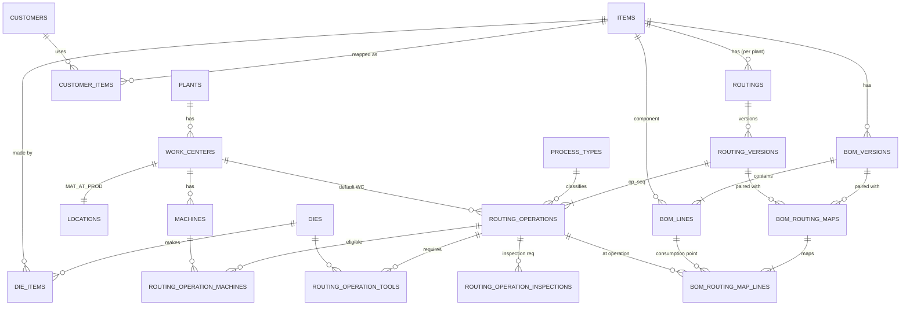

# 26 — B2 Manufacturing Master Data & Routing: Scope Addendum

**Status:** SCOPE REVIEW v5 (2026-10-09; owner: B2 — **planning only**, D-053) — analysis only. **B2 is not authorized**; no migrations, API or UI. Depends on B1 (doc 25), itself not authorized.
**v2 corrections (owner review):** a component may legitimately appear on several BOM lines / operations; the consumption point belongs to the **BOM line**, resolved per (BOM version, routing version) pair through an approved map — `op_seq` numbers carry no meaning across routings; double consumption is prevented by transaction rules, idempotency and actual source references, not by forbidding repeated components (§2.5, §3); O-003 options documented in §3A.
**v3 corrections (PR #2 review, owner-approved remediation):** consumption allocation model (`consumption_line_allocations`, owner-approved direction Option A — BR-OUT-01 unchanged) for several requirement lines served by one consume leg; posting uniqueness no longer attributed to BR-PER-04 (which governs production date/shift) — proposed separately as D-B2-12; inclusive `effective_to`; failed-import revalidation.
**v4 correction (PR #2 review, owner-approved):** an open-ended approved version can be closed only by the restricted APPROVED → SUPERSEDED lifecycle transition of §2.4a; no generic update of approved versions.
**v5 correction (PR #2 review):** the transition is authorized by an unforgeable privilege boundary — a `SECURITY DEFINER` lifecycle function owned by NOLOGIN `eora_lifecycle_definer`, checked by the trigger via `current_user` — never by a session flag or custom setting.
**Basis (unchanged):** doc 11 (B2: items, UOM, specs, BOM incl. gross qty per (O-026), routings, conversion profiles, SY/NW versions, customers, suppliers, work centers, locations; exit = master-data import templates), doc 17 §2/§6, ADR-0001, ADR-0002, ADR-0003, ADR-0004, ADR-0008, doc 02, doc 08, doc 15 (BR-PLN-01/06/07), doc 16 §1/§3, D-002 (no WIP), D-043 (supply classes), D-046 (MPS gates).
**Owner requirement (2026-10-09):** discrete manufacturing master data with many parts, several customers and part-specific multi-operation routings. The owner's figures (≈4 customers, ≈1,278 parts, routings such as OP-10 Blanking → OP-20 Bending → OP-30 Piercing) are **illustrations only**: the design sets **no maximum** on customers, parts, routings, versions or operations.

## 1. Lifecycle separation (what B2 owns and what it does not)
| # | Concern | Slice | Owner module | Data | Ledger effect |
|---|---|---|---|---|---|
| 1 | **Routing master definition** — how a part is made (operations, sequence, work centers, machines, tooling, standards, inspection points), versioned and approved | **B2** | Planning (engineering master) | `routings`, `routing_versions`, `routing_operations`, child tables | none |
| 2 | **Work Order routing snapshot** — the approved version frozen at WO release (BR-PLN-01) | B5 | Planning | `work_orders.routing_version_id`, `wo_operations` | none |
| 3 | **Actual operation execution** — runs per WO operation: machine, die, operator, shift, counts, downtime, measurements | B6 | Production | `production_runs` (+ `wo_operation_id`), `run_measurements`, `downtime_events` | via Production Posting only |
| 4 | **QC disposition** — inspection lots, release/hold/reject | B7 | Quality | `inspection_lots`, `qc_dispositions` | status movements (`PENDING_QC → QC_RELEASED/HOLD/REJECTED`) |
| 5 | **Inventory posting** — single append-only ledger | B3 engine, used by B6/B7 | Inventory (sole writer) | `inventory_documents`, `inventory_movements`, `stock_balances` | the only place stock changes |
B2 never creates stock, never posts, and never introduces a WIP module, menu or label (D-002). A routing operation is a *definition*; it holds no quantity.

## 2. B2 scope — entities (logical, tenant-owned unless noted)
All tables follow ADR-0001 (tenant_id, composite FKs, forced RLS with the NULLIF policy from doc 25 §5.2, `tenant_id`-leading indexes, audit columns, `version` for optimistic locking).

### 2.1 Organisation-physical master (B2 part of doc 17 §2 "Core")
| Entity | Key attributes | Rules |
|---|---|---|
| `warehouses` | plant, code, type | `UNIQUE (tenant_id, plant_id, code)` |
| `locations` | warehouse, code, `location_type` (ADR-0002 §3), `work_center_id` (for `MAT_AT_PROD`) | virtual locations seeded per plant |
| `work_centers` | plant, code, name, `work_center_type`, capacity basis (O-028 → D-046: `work_center_capacity`), `mat_at_prod_location_id` | one `MAT_AT_PROD` location per work center (doc 17 ERD) |
| `machines` | work center, code, name, status, stroke counter capable (ADR-0003 §4) | belongs to exactly one work center at a time |
| `dies` (tooling) | code, name, type (die/jig/fixture), status, cavities, stroke life, current strokes | tool life counters are master attributes; consumption of tool life is recorded by runs (B6) |
| `die_items` | die ↔ item (+ cavities / parts per stroke for that item) | many-to-many: one die can make several parts (family dies), one part may have alternative dies |

### 2.2 Part and customer master
| Entity | Key attributes | Rules |
|---|---|---|
| `items` (Part Master) | code, name, `item_type` (RAW, SEMI_FINISHED, FINISHED, SCRAP, CONSUMABLE — doc 17), base UOM, lot-controlled, `inspection_required` default, drawing number/revision, status (`ACTIVE`, `INACTIVE`, `OBSOLETE`) | `UNIQUE (tenant_id, code)`; code immutable once referenced by a posting; deactivate, never delete |
| `customers` | code, name, status | `UNIQUE (tenant_id, code)` |
| `customer_items` (Customer Part Mapping) | customer, item, customer part number, customer drawing revision, effective_from/to, status | `UNIQUE (tenant_id, customer_id, customer_part_no, effective_from)`; one customer part number maps to one item at a time (no overlapping effective ranges per customer part); an item may be supplied to several customers |
| `suppliers`, `uoms`, `uom_conversions` (item-specific, versioned), `material_specs` | as doc 17 §2 | — |

### 2.3 Manufacturing process catalogue
| Entity | Key attributes | Rules |
|---|---|---|
| `process_types` | code (e.g. BLANKING, BENDING, PIERCING, WELDING, CUTTING, STAMPING, INSPECTION), name, `category` (`TRANSFORMATION`, `INSPECTION`, `HANDLING`), default work-center type, status | **tenant-defined**, no hard-coded list; examples above are illustrations |

### 2.4 Routing header, version, operations
| Entity | Key attributes | Rules |
|---|---|---|
| `routings` | plant, item, routing code, `routing_kind` (`PRIMARY`, `ALTERNATE` — D-B2-04), status | `UNIQUE (tenant_id, plant_id, item_id, routing_code)`; at most one PRIMARY per item+plant |
| `routing_versions` | routing, `version_no`, status `DRAFT → SUBMITTED → APPROVED → SUPERSEDED / RETIRED` (+ `REJECTED → DRAFT`), `effective_from`, `effective_to`, `change_reason`, `prepared_by`, `approved_by`, `approved_at`, standard yield `SY` (per routing version — D-B2-02) | `UNIQUE (tenant_id, routing_id, version_no)`; **no overlapping effective ranges among APPROVED versions of a routing** (exclusion constraint on `daterange(effective_from, effective_to, '[]')` — **both bounds inclusive**: `effective_to` is the last valid day, NULL = open-ended; needs `btree_gist`, D-B2-08); APPROVED/SUPERSEDED versions are immutable (edits = new version) **except** the restricted supersession transition of §2.4a; preparer ≠ approver (proposed SoD-08, D-B2-06) |
| `routing_operations` | routing version, `op_seq` (integer, e.g. 10, 20, 30 — gaps allowed for later insertion; meaningful **only inside its routing version**), optional `step_key` (mapping hint, §2.5), process type, default work center, description, `std_setup_minutes`, `std_cycle_seconds` + `cycle_basis` (`PER_PIECE`, `PER_STROKE`, `PER_BATCH`) + `parts_per_cycle`, `inspection_required` (operation-level, overrides item default), `is_count_point` (operation reports quantities), `is_final_operation` (derived = max `op_seq`), `requires_tooling` | `UNIQUE (tenant_id, routing_version_id, op_seq)`; `op_seq > 0`; at least one operation per approved version; cycle/setup ≥ 0 decimals (`numeric`), never float |
| `routing_operation_machines` | operation, machine, `is_preferred`, optional cycle override | machine must belong to the operation's work center (or an allowed alternative work center); at most one preferred |
| `routing_operation_tools` | operation, die, required qty/cavities used | die must be linked to the item in `die_items` |
| `routing_operation_inspections` | operation, inspection plan reference / characteristic codes, sampling note | B2 stores the requirement only; inspection execution is B7 |

### 2.4a Routing version supersession (restricted lifecycle transition)
Approving v(n+1) of a routing is one service command, executed in **one transaction**:
1. `SELECT … FROM routings WHERE id = $routing FOR UPDATE` — serializes concurrent approvals/supersessions of the same routing.
2. Lock the candidate v(n+1) (`SUBMITTED`) and the currently approved version(s) whose range reaches `new.effective_from` (`FOR UPDATE`).
3. Validate: approver ≠ preparer (D-B2-06); `new.effective_from > old.effective_from` (the old version keeps at least one day); `new.effective_from ≥` approval date unless a retroactive policy is approved (**D-B2-14**, default: reject retroactive); no other approved version overlaps `[new.effective_from, new.effective_to]`.
4. For the old version only: `effective_to := new.effective_from − 1 day`, `status := 'SUPERSEDED'`, `superseded_by_version_id`, `superseded_at` (if the old version already ends before `new.effective_from`, only the status changes).
5. New version: `status := 'APPROVED'`, `approved_by`, `approved_at`.
6. Audit events for both versions (before/after hash); COMMIT. The inclusive exclusion constraint (`'[]'`) is checked at statement end and protects the result.
**Database guard:** a trigger on `routing_versions` rejects every UPDATE of an `APPROVED` or `SUPERSEDED` row except this transition: only `status` (`APPROVED → SUPERSEDED`), `effective_to` (from NULL or a later date to a date ≥ `effective_from`), `superseded_by_version_id`, `superseded_at` may change, and only when the statement runs **inside the lifecycle function**, proven by `current_user = 'eora_lifecycle_definer'`: the function `lifecycle_api.approve_routing_version(version_id)` is `SECURITY DEFINER`, owned by the NOLOGIN role `eora_lifecycle_definer`, `SET search_path = ''`, schema-qualified, `EXECUTE` granted to `eora_app` only. Runtime roles cannot become that role (no membership, no `SET ROLE`, NOLOGIN), so the condition cannot be forged; custom settings (`app.*` or any GUC) play **no** part in the authorization. Operations, standards, `effective_from` and machine/tool/inspection children of approved versions can never be updated — not even by the lifecycle function; there is no generic UPDATE path.
- **Inside the function:** routing lock (`FOR UPDATE`), version locks, maker-checker (approver ≠ preparer), effectivity and retroactivity checks (D-B2-14), the two updates, both audit rows — one transaction, all under the caller's tenant RLS (the definer has a tenant policy on `routing_versions`/`audit_events` equal to `eora_app`'s, so it never widens tenant scope).
- **Approver identity:** taken from the request's authenticated context (`ctx_user`, or `ctx_api.user_id()` if D-B1-24 is adopted); the function never accepts an approver id parameter. Residual (doc 25 R-17): without D-B1-24, injected SQL as `eora_app` could spoof `app.user_id` inside its own tenant — maker-checker then relies on the application layer; D-B1-24 closes this.
- The role is added to the schema-guard allowlist of definer owners (doc 25 §5.4).
**Traceability:** superseded versions remain readable; released WO snapshots (B5) keep their copied routing/standards and are unaffected; history of effective ranges stays non-overlapping.

### 2.5 BOM and its relationship to routing
- `bom_versions` (item, version, status, effective range, approval — same lifecycle as routing versions) and `bom_lines` (`line_no`, component item, `gross_qty_per` in material UOM (O-026), UOM, conversion profile ref, scrap/yield allowance applied once (BR-PLN-06), `line_purpose` free text, e.g. "M6 nut, bracket side").
- **Identities kept apart:**
  | Concept | Identity | Slice |
  |---|---|---|
  | BOM line | `(bom_version_id, line_no)` — one requirement definition | B2 |
  | Component | `component_item_id` — may appear on **several** BOM lines (e.g. the same nut welded at two different stations) | B2 |
  | Consumption point | the routing operation a BOM line is consumed at, **per (BOM version, routing version) pair** | B2 (definition) |
  | Planned material requirement | one row per (planned order / WO, BOM line) | B5 |
  | Actual consumption event | **one** consume leg per input lot per posting (BR-OUT-01, unchanged) referencing operation, run and lot, plus **allocation lines** distributing that leg's quantity to the WO material lines it served (`consumption_line_allocations`, §3) | B6 |
  | Duplicate posting | the same physical event posted twice | prevented by B3/B6 rules (§3) |
- **BOM–routing map (revised D-B2-01):** `bom_routing_maps` (`bom_version_id`, `routing_version_id`, status `DRAFT → APPROVED`, approved_by) + `bom_routing_map_lines` (`bom_line_id → routing_operation_id`). Every BOM line of the version maps to **exactly one** operation of that routing version; several BOM lines may map to the same operation; the same component on different lines may map to different operations.
- **No assumption about `op_seq`:** OP-20 in the primary routing and OP-20 in an alternate routing are unrelated; maps reference operations by id, never by number. An optional `routing_operations.step_key` (tenant-defined, e.g. `BLANK`, `WELD-NUT`) only **proposes** a mapping during import/editing; the approved map is what counts.
- **Compatibility:** a (BOM version, routing version) pair is usable at WO release (B5) only if an APPROVED map exists, both versions are effective on the release date, and the map covers every BOM line. Alternate routings need their own approved map. Revising either version requires a new map (old maps stay attached to old versions for traceability).

## 3. Preventing double material consumption (multi-operation routings)
Canonical rule ADR-0004: input material leaves stock **once**, in the consumption leg. With several BOM lines and operations this is enforced by **transaction rules, idempotency and actual source references** — not by forbidding a component from appearing twice:
1. **Planned:** MRP (B5) explodes **per BOM line**; requirements are keyed by `bom_line_id`, then summed per component for netting. Two lines of the same nut (2 pcs at OP-20, 2 pcs at OP-40) yield 4 pcs per part — once each, never twice.
2. **WO snapshot (B5):** release copies the BOM lines, the approved map and the routing operations into `wo_material_lines` (`wo_id`, `bom_line_id`, `wo_operation_id`, planned qty) and `wo_operations`; later master revisions never change a released WO.
3. **Actual (B6):** a consume leg references `wo_operation_id`, `production_run_id` and the input lot actually used; the run's work center must match the operation; material can only be consumed from `MAT_AT_PROD` stock that physically exists (BR-INV-04) — the same kilogram cannot be consumed twice. The link to requirements is made by **allocation lines** (3a), not by splitting the ledger leg.
3a. **`consumption_line_allocations`** (logical entity, B6; owner-approved direction "Option A", 2026-10-09): `tenant_id`, `id`, `inventory_document_id`, `movement_id` (the consume leg), `wo_material_line_id`, `qty` (positive, leg UOM), `uom_id`, `reverses_allocation_id` (nullable), audit columns. Composite FKs `(tenant_id, movement_id)` and `(tenant_id, wo_material_line_id)`; forced RLS like every tenant table.
    - one consume leg → one or more allocation lines; each allocation references exactly one WO material line of the **same WO and operation** as the leg's run;
    - Σ allocation qty = |leg qty| exactly (checked by the posting service before commit; a deferred constraint trigger re-checks at commit);
    - allocation UOM = leg UOM; when the WO material line is kept in another UOM, the conversion uses the item's versioned `uom_conversions` and is never stored as a second stock quantity;
    - allocations never change `stock_balances` and are not ledger movements (no second ledger); they are written **only** by `InventoryPostingService` in the same transaction as the movement (atomic, sole writer — BR-INV-01);
    - reversal: the reversal document's mirrored leg receives mirrored allocation lines (`reverses_allocation_id`), so Σ per WO material line returns to its prior value and conservation holds per leg;
    - duplicate posting stays rejected by the idempotency key (BR-INV-06) and the posting source controls (point 5); allocations cannot be added to an already posted leg (corrections = reversal + repost).
    **Example (owner):** BOM line 10 nut M6 × 2 and BOM line 20 nut M6 × 2, both consumed at the same operation from `LOT-001`: one consume leg `−4 pcs` on `LOT-001`; allocations line 10 = 2 pcs, line 20 = 2 pcs; Σ = 4; stock decreases once. If line 20 belongs to a different operation, that operation's own posting has its own leg and allocation — valid, because it is a different physical event.
4. **Idempotency (B3):** every posting command carries an idempotency key unique per tenant; replay returns the original document; same key + different payload → `409 IDEMPOTENCY_KEY_REUSED`.
5. **Source controls (B6):** one consume leg per input lot per posting (doc 04 posting invariants, BR-OUT-01); every posting carries its source reference (run, operation, production date and shift — time model of BR-PER-04) and an idempotency key (BR-INV-06). Whether "at most one regular Production Posting per run per shift" (a note in doc 16 §3) becomes an enforced uniqueness invariant is a **separate owner decision (D-B2-12)** — no canonical rule is added here.
6. **Later operations** of the same part report their counts and outputs for that operation (Option S or M, §3A) but do not re-consume the material of earlier lines.
7. **Planned ≠ actual:** consuming more or less than planned is a variance for reconciliation (doc 02, ADR-0005), not a validation error — physical measurement governs (ADR-0003).
8. **Option M chains** (semi-finished stage items) must be acyclic: an item may not transitively consume itself (validated at BOM approval).

## 3A. O-003 intermediate quantities — options (OPEN, owner decision before B5)
No WIP module, menu or label in either option (D-002).
| | **Option S — single item, operation count points** | **Option M — semi-finished item per stage** |
|---|---|---|
| Item master | one item per part; stages are routing operations | one SEMI_FINISHED item per stage (e.g. `PART-A-BLK`, `PART-A-BND`) + the FINISHED item; naming rule needed (O-003 part numbering) |
| BOM | one BOM: raw material + purchased components mapped to operations | one BOM per stage: previous stage item (+ components of that stage) |
| Ledger | raw material consumed at its mapped operation; **Good Output enters stock only at the final (or configured stock) operation**; intermediate counts are run facts, not stock | each stage posts Good Output of its semi-finished item to the next-process `MAT_AT_PROD` (ADR-0004 row "Good Output"); next stage consumes it |
| Traceability | lot genealogy RM lot → FG lot; intermediate stages visible as run records | full lot genealogy per stage; intermediate lots can be held, inspected, stored, transferred |
| Visibility of material between operations | operational (Control Tower from run data); not available stock | physical stock per stage (Material at Production / Semi-Finished Material) |
| Pros | fewer items and postings; simpler for short in-line routings | accurate when stages are separated in time/location, inspected, stored or sent out |
| Cons | no stock of half-made parts; buffers between lines invisible to inventory | more master data (items, BOMs, routings per stage), more postings, more lots |
| B5 impact | WO per FG part with all operations; capacity per operation | WO (or WO chain) per stage item; MRP explodes stage BOMs; planning of each stage |
| B6 impact | runs per WO operation; posting consumes at mapped ops, produces at final op | each stage run posts consume (previous stage item) + produce (stage item) |
| Variance (doc 02) | per WO across operations | per stage + rolled up via genealogy |
B2 supports both (per item if the owner wants a mix). **No policy is set here.**

## 4. Output, QC and FG statuses stay distinct (master data only sets flags)
| Concept | Where it lives | B2 contribution |
|---|---|---|
| Production Output (Good / NG / Scrap) | produce legs of `PRODUCTION_POSTING` (B6) → `PENDING_QC` if inspection required, else next-process `MAT_AT_PROD` / FG flow | `items.inspection_required`, `routing_operations.inspection_required`, `is_count_point` |
| QC Release | `QC_DISPOSITION` status movement `PENDING_QC → QC_RELEASED` (B7) | inspection requirement definitions |
| FG Receipt | `FG_RECEIPT` document `QC_AREA → FG_WAREHOUSE` (B7) | FG warehouse/locations |
| FG Available (Firm Available, D-043) | `UNRESTRICTED` FG on-hand minus active allocations (ledger + allocations) | none |
B2 never stores any of these quantities.

## 5. Excel bulk import (doc 08 pipeline)
- Templates (versioned, downloadable): Items; Customers; Customer Part Mapping; Process Types; Work Centers; Machines; Dies + Die-Item; Routings (one row per operation: item code, plant, routing code, version, op_seq, process type, work center, setup, cycle, cycle basis, parts per cycle, inspection flag, preferred machine, die); BOM (one row per line: item, version, line no, component, qty per, UOM, purpose); BOM–Routing Map (one row per BOM line: BOM version, routing code + version, operation step key or operation id; `step_key` only proposes, the approved map decides).
- Pipeline: upload → type/size/malware check → staging (`import_jobs`, `import_rows`) → mapping → row validation → **preview with error file** → commit in chunks of 500 (doc 09) → results + audit. Imported routings/BOMs land as **DRAFT** versions; making them effective requires the normal approval (no import bypass).
- Validation: duplicates within the file and against existing data (codes, `(routing, version, op_seq)`, customer part numbers per effective range); referential (item, process type, work center in the same plant, machine in that work center, die linked to item, UOM convertible); numeric ranges; effective-date overlap; every BOM line of a mapped pair maps to exactly one operation of that routing version (a component repeated on several lines is allowed); dependency order (items → work centers/machines/dies → routings → BOMs) with clear messages when a referenced code comes later in the same job.
- Idempotency: only **committed** jobs are deduplicated — re-uploading a file whose job (template, template version, file SHA-256, tenant) already **committed** returns that result. A rejected or failed job is **not** pinned: re-uploading the same file creates a new job (`retry_of_job_id` → previous job) revalidated against the **current** master data (e.g. after the missing work center was created). Every job, its row results and error file stay in history (no deletion), and each validation/commit run is audited. Upserts only for DRAFT data, never for approved versions.
- Partial-commit semantics (all-or-nothing vs valid-rows-only) per template — D-B2-07.
- Scale: the illustrative 1,278 parts × several operations is a few thousand rows — well within one chunked job; no hard limit is set.

## 6. Query, search, pagination (ADR-0008, doc 24)
QueryDefinitions for items, customer parts, routings (with operation count, current effective version), work centers, machines, dies. Server-side filter/sort/pagination (offset for master data per doc 24 §3.3), `q` search on code/name/customer part number (prefix + trigram — `pg_trgm`, D-B2-09), `tenant_id`-leading indexes, plant scope predicates, export through the same QueryDefinition.

## 7. Tenant isolation and audit
Every B2 table is tenant-owned (incl. `process_types`); composite FKs make a routing operation unable to reference another tenant's work center, machine, die or item; isolation suite T-ISO extended to B2 resources; `audit_events` for create/update/submit/approve/supersede/retire and every import commit; approved versions immutable at DB level (trigger or no UPDATE grant on approved rows via status check).

## 8. Logical ERD impact assessment (vs doc 17)
| Area | doc 17 today | Proposed change | Type |
|---|---|---|---|
| Routing header | `routing_versions/operations` only | add `routings` header (item+plant+routing code, primary/alternate) | addition |
| Process catalogue | absent | add `process_types` | addition |
| Operation resources | `machines`, `dies` standalone | add `routing_operation_machines`, `routing_operation_tools`, `die_items`, `routing_operation_inspections` | addition |
| Operation standards | `std_cycle_seconds` (D-046) | add `std_setup_minutes`, `cycle_basis`, `parts_per_cycle`, `inspection_required`, `is_count_point` | addition |
| Effective dating | `effective_from` | add `effective_to` + exclusion constraint for approved versions | addition |
| BOM ↔ routing | not linked | `bom_routing_maps` + `bom_routing_map_lines (bom_line → routing_operation)` per approved version pair; optional `routing_operations.step_key`; `bom_lines.line_no`, `line_purpose` | addition (D-B2-01 revised) |
| WO material lines | not modelled | B5 adds `wo_material_lines (wo, bom_line, wo_operation, planned qty)`; B6 adds `consumption_line_allocations (movement → wo_material_line, qty, uom)` (§3 point 3a); consume legs stay one per lot per posting | later slices (noted, not B2) |
| Customer parts | `customer_items (customer part ↔ item)` | add drawing revision, effective range, status | extension |
| Role scope | plant/warehouse/work center | B2 adds `warehouse_id`, `work_center_id` to `role_assignments` (doc 25 D-B1-02) | extension |
| WO snapshot | `wo_operations (wo, routing_operation, work_center, planned_qty, status)` | unchanged; B5 copies standards into the snapshot so later revisions never change a released WO | none in B2 |
No canonical business rule changes; additions are new optional structure pending approval.

## 9. Dependencies and risks
| Dependency | Why |
|---|---|
| B1 tenancy, RLS, RBAC, audit | every B2 table is tenant-owned; approvals need roles; imports need audit |
| Approval mechanism (O-007 thresholds OPEN) | routing/BOM approval; until thresholds exist, every version approval requires a second user (no default threshold invented) |
| Calendars (B1) | not needed for effective dates (plain dates) but for WO release later |
| O-003 (OPEN) | intermediate representation (Option S vs M) — B2 supports both; B5/B6 need the decision |
| O-026 | BOM gross qty per material UOM |
| D-046 / O-028 | `work_center_capacity`, `std_cycle_seconds` (warning-only capacity) |

| Risk | Impact | Mitigation |
|---|---|---|
| Double material consumption across operations | stock and variance wrong | §3: per-line requirements, source references, idempotency, run/shift uniqueness, non-negative balances; B6 posting tests |
| Wrong BOM–routing pairing (alternate routing, renumbered ops) | material consumed at a wrong operation | approved map per version pair, ids not `op_seq`, release blocked without map |
| Routing revised after WO release changes the WO | traceability and variance broken | immutable approved versions + B5 snapshot |
| Overlapping effective versions | ambiguous standard at release | exclusion constraint + approval check |
| Import creates inconsistent references | bad masters at scale | staging + referential validation + DRAFT-only landing |
| Machine moved to another work center invalidates eligibility | wrong scheduling hints | validation at approval; warnings on change; history via audit |
| Cross-tenant reference via import codes | leakage | codes resolved inside tenant context only; composite FKs |
| Search performance with many parts | slow grids | trigram/prefix indexes, keyset if lists grow, EXPLAIN gate |
| Scope creep into scheduling/APS | delay | B2 = definitions only; capacity stays warning-only (D-046) |

## 10. Acceptance test scenarios (B2, proposed numbering B2-AT)
| ID | Given / When / Then |
|---|---|
| B2-AT-01 | Given tenant T with customers C1..C4 (illustrative), when 1,278 items and their customer part mappings are imported, then all valid rows commit, duplicates and unknown references are listed per row, and no fixed maximum is enforced (test also runs with a larger synthetic set). |
| B2-AT-02 | Part A routing v1: OP-10 Blanking, OP-20 Bending, OP-30 Piercing; Part B: OP-10 Blanking, OP-20 Welding; Part C: OP-10 Cutting, OP-20 Stamping, OP-30 Welding, OP-40 Inspection — each saved, submitted and approved by a different user; operations returned in `op_seq` order. |
| B2-AT-03 | Duplicate `op_seq` 20 in one version → 422 `VALIDATION_FAILED` with field error; gaps (10, 20, 40) accepted. |
| B2-AT-04 | Operation references a work center of another plant, or a machine not in its work center → rejected. |
| B2-AT-05 | Tool requirement uses a die not linked to the item in `die_items` → rejected. |
| B2-AT-06 | Bounds inclusive (`'[]'`): v1 effective 2026-01-01 … 2026-06-30, v2 from 2026-06-30 → rejected (both valid on 30 June); v2 from 2026-07-01 → accepted, contiguous, exactly one approved version on every day (30 June → v1, 1 July → v2); v1 SUPERSEDED from 1 July. |
| B2-AT-07 | Editing operations, standards, `effective_from` or children of an APPROVED version → 409 (DB trigger also rejects a direct UPDATE); "revise" creates DRAFT v(n+1) copying operations. |
| B2-AT-20 | Open-ended v1 (`effective_to = NULL`, from 2026-01-01); v2 submitted from 2026-07-01 and approved by a second user → in one transaction v1 gets `effective_to = 2026-06-30` + `SUPERSEDED`, v2 `APPROVED`; audit rows for both; exclusion constraint satisfied. |
| B2-AT-21 | Two approvers approve v2 and v3 of the same routing concurrently | the routing lock serializes them; the second sees the state left by the first and either supersedes v2 correctly or is rejected — never two overlapping approved versions |
| B2-AT-22 | v2 with `effective_from` ≤ v1's `effective_from`, or retroactive (before the approval date) without an approved retroactive policy | rejected; v1 unchanged |
| B2-AT-23 | Direct UPDATE of v1's `effective_to`/`status` outside the lifecycle function (any role) | rejected by the trigger |
| B2-AT-25 | As `eora_app`: `SET app.routing_lifecycle = 'on'` (or any custom GUC), then UPDATE an approved version's `status`/`effective_to` | rejected — the trigger checks `current_user`, not settings |
| B2-AT-26 | As `eora_app`: `SET ROLE eora_lifecycle_definer` | denied (not a member) |
| B2-AT-27 | Preparer of v2 calls `lifecycle_api.approve_routing_version(v2)` | rejected (maker-checker); nothing changed; no audit row |
| B2-AT-28 | Lifecycle function asked to change operations or standards of an approved version | impossible (no such code path; trigger rejects even for the definer) |
| B2-AT-24 | (Hook for B5) WO released on v1 before v2's approval | WO snapshot unchanged after supersession; new WOs from 2026-07-01 use v2 |
| B2-AT-08 | Preparer approves own version → 403 (proposed SoD-08). |
| B2-AT-09 | Part A has BOM v3 and two routings: PRIMARY v2 (OP-10 Blanking, OP-20 Bending, OP-30 Piercing) and ALTERNATE v1 (OP-10 Laser cutting, OP-30 Bending, OP-50 Piercing). The sheet-material line maps to PRIMARY OP-10 and to ALTERNATE OP-10 (laser), a clip line maps to PRIMARY OP-30 and to ALTERNATE OP-50. Both maps approved → each pair is valid although `op_seq` numbers differ. A map that leaves a BOM line unmapped, maps one line to two operations, or points to an operation of another routing version → approval blocked with a clear message. Selecting (BOM v3, ALTERNATE v1) without an approved map → flagged as not releasable (enforced at WO release, B5). |
| B2-AT-10 | Part B BOM: line 10 nut M6 × 2 ("bracket side") mapped to OP-20 Welding, line 20 nut M6 × 2 ("flange side") mapped to OP-40 Welding → **accepted** (same component, different lines and operations); requirement per part = 4 nuts from two lines, never 8. Hook for B5/B6: the OP-20 posting has one consume leg for the nut lot, allocated wholly to line 10; the OP-40 posting has its own leg allocated to line 20 (different physical events — valid); replaying a posting command (same idempotency key) returns the original document with no extra consumption; consuming more nuts than issued to the work center is impossible (balance ≥ 0). Two lines with the same component **and** the same operation are accepted with a duplicate-line warning that requires `line_purpose`; in a posting they share **one** consume leg per lot with one allocation per line (B2-AT-17). Option M chain where SF-2 consumes SF-1 and SF-1 consumes SF-2 → rejected (cycle). |
| B2-AT-11 | Tenant A user requests tenant B routing/item/work center by id or code → 404, `access.not_found` audited; import in tenant A referencing tenant B codes → "unknown reference". |
| B2-AT-12 | Routing list: `q=blank` finds parts whose routing has a Blanking operation; filter by plant/work center/status; sort by item code; page 3 of size 50 consistent with total; export uses the same scope. |
| B2-AT-13 | Re-uploading the same routing file returns the previous job result; no duplicate versions. |
| B2-AT-14 | Every create/submit/approve/supersede/import commit writes one audit row with actor, correlation id and before/after hash. |
| B2-AT-15 | (Hook for B5) After WO release on routing v1, approving v2 does not change the WO snapshot. |
| B2-AT-16 | (Hook for B6/B7) A three-operation part posts raw-material consumption once; Good Output, QC Release, FG Receipt and FG Available remain separate quantities. |
| B2-AT-17 | (Hook for B6) Owner example: lines 10 and 20 (nut M6 × 2 each) at the same operation, `LOT-001`: one leg `−4 pcs`, allocations 2 + 2 → accepted; 2 + 1 (Σ ≠ 4) → rejected; an allocation in kg against a pcs leg → rejected; allocation to a WO material line of another WO/operation → rejected; a second leg for `LOT-001` in the same posting → rejected (BR-OUT-01); another tenant's WO material line → FK/RLS violation; reversal produces `+4 pcs` with mirrored allocations and restores line totals; stock balance changes once (−4), never twice. |
| B2-AT-18 | Routing import fails because work center `WC-WELD-2` does not exist; the work center is created; the **same file** is uploaded again → new job linked by `retry_of_job_id`, revalidated against current data, commits; the failed job and its error file remain in history; a third upload returns the committed result (no duplicate versions). |
| B2-AT-19 | (Hook for B8) Line-level reconciliation: planned qty per WO material line vs Σ allocations per line reported for information; doc 02 indicators and case logic per component/lot/scope unchanged. |

## 11. Decision matrix (B2) — proposals, none final until approved
### 11.1 Recommended for approval now
| ID | Decision | Recommendation | Trade-off |
|---|---|---|---|
| D-B2-05 | Routing scope | per item + plant (plants differ in machines and work centers) | one routing per plant to maintain |
| D-B2-08 | Effective-date overlap | DB exclusion constraint (`btree_gist`) + friendly service message | needs extension on every environment |
| D-B2-09 | Search | `pg_trgm` GIN on code/name/customer part number + B-tree prefix on code | index size / write cost |
| D-B2-10 | Cycle-time basis | `cycle_basis` (`PER_PIECE`, `PER_STROKE`, `PER_BATCH`) + `parts_per_cycle` | one more field to import |

### 11.2 Requires owner decision
| ID | Decision | Options | Recommendation (rationale) |
|---|---|---|---|
| D-B2-01 *(revised)* | Consumption point model | (a) approved BOM–routing map per version pair; (b) BOM line bound to one routing version's `op_seq`; (c) operation-level material lists in the routing | (a): supports alternate routings and renumbered operations, allows repeated components, keeps BOM and routing independently versioned; cost = one more approval artefact per pair |
| D-B2-02 | Standard yield level | per routing version vs per operation (+ combination rule) | per routing version (doc 02 PvS formula today); per-operation yields need a rule change → would be a new decision |
| D-B2-04 | Alternate routings in V1 | primary only vs primary + alternates | allow alternates, choose at WO release (B5) — needs (a) above |
| D-B2-06 | Routing/BOM/map approval | maker ≠ checker (proposed SoD-08); approver role | maker ≠ checker; approver role from doc 18 once O-007 decided; until then any second user with the approve permission |
| D-B2-07 | Import partial commit | all-or-nothing vs valid rows only, per template | all-or-nothing for routings, BOMs, maps (consistency); valid-rows-only for items, customers, customer parts (volume) |

### 11.3 Can be deferred safely
| ID | Decision | Why safe | Needed by |
|---|---|---|---|
| D-B2-03 | O-003 Option S / M | B2 supports both; no posting in B2 | before B5 design |
| D-B2-11 | Outside processing (subcontract operations) | not in V1 scope today | V2 or explicit owner request |

### 11.4 Recorded direction and new proposal (v3)
| ID | Item | Status |
|---|---|---|
| D-B2-13 | Consumption allocation model (`consumption_line_allocations`, §3 point 3a) — Option A, BR-OUT-01 unchanged | **owner-approved design direction (2026-10-09)**; logical design only; B6 implementation needs separate approval |
| D-B2-14 | Retroactive routing effectivity (v(n+1) effective before its approval date) | **requires owner decision**; recommendation: not allowed in V1 (prevents silent change of standards for already-planned dates); corrections via a new version from today |
| D-B2-12 | Posting source uniqueness: "at most one regular Production Posting per (run, shift)" as an enforced invariant (today a state-machine note in doc 16 §3) vs idempotency key + source reference only | **requires owner decision**; recommendation: unique key `(tenant_id, run_id, production_date, shift_id)` for regular postings, corrections/reversals exempt — a **new** canonical rule, therefore not added automatically |
OPEN items untouched: O-003 (input to D-B2-03), O-007, O-012, O-013, O-015, O-021.
