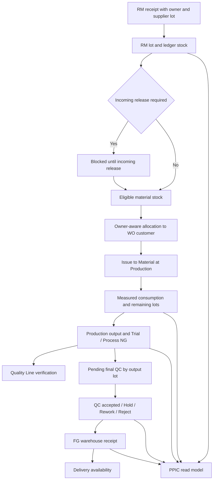

# 35 — Material ownership and PPIC monitoring design review

Date 2026-11-18. Owner requested the web workflow and design after confirming customer-owned and company-owned material. Product requirements below follow that discussion. The interactive review is `design/mockups/05-material-monitoring.html`. It uses explicit simulated data and in-memory state. Refreshing the page restores its seed data.

## Agreed product scope

- Each DPM, SJM, AMI and SUP customer may supply its own material. The company may purchase material for any eligible customer. Material ownership, supplier/sender and production customer are distinct fields.
- Each incoming RM lot has one owner. Customer-owned stock normally serves that customer's work orders. Company stock may serve any customer with the approved material specification. Customer-owned cross-customer usage needs an explicitly approved process before it is available.
- RM numbers follow `RM-{ownerCode}-{DDMMYY}-{sequence}`. FG numbers follow `FG-{productionCustomerCode}-{DDMMYY}-{sequence}`. The RM date is its receipt date. The FG date is its production business date. Later QC and FG receipt preserve the original output lot. Historical numbers remain readable.
- PPIC columns, in order, are Customer, Part Name, Part No., Spec Material, IN RM, OUT ke Produksi, Terpakai, Good, NG, Miss. Detail includes owner, all input/output lots, WO, production date, shift, recorded quantities and responsible actors.
- Production records NG trial and process NG. Quality Line verifies the same entries and records defects. Quality Final classifies output from the production lot. Reclassifying Good to NG preserves accounted physical quantity.
- Carry-over includes unused RM, semi-finished items awaiting processing, finished output awaiting QC and QC-accepted output awaiting FG receipt. Their balances, dates and lots remain distinguishable.

## Gap and contradiction register

| Status | Finding from the owning source | Consequence / required change |
| --- | --- | --- |
| DECIDED | Customer-owned and company-owned material both exist for all four customers. | Owner must be represented in stock identity and enforced during issue, conversion, transfer, reversal and planning. |
| GAP | `2026_10_30_002200_create_inventory_ledger_tables.php` restricts both movement and balance `ownership` to `OWN`. | A report-only owner label cannot implement customer ownership safely. Add a migration, owner FKs, grants, RLS and ledger guards in the implementation slice. |
| GAP | `LotNumbers.php` increments per item and month using the legacy lot format. | Daily owner/customer number sequences need an atomic namespace independent of item, preserving retries and old lots. |
| GAP | WO customer is currently derived through an optional delivery schedule line. MRP plans can aggregate demand from several customers. | Define explicit customer attribution for an unpegged WO and shared semi-finished output before assigning customer FG numbers or using restricted stock in netting. |
| GAP | Production already has measured consumption, NG rework/reject and lot genealogy. Quality already performs dispositions against the output lot. | Add trial/process provenance and Quality Line verification by referencing original records. Never count a verification as another output. |
| PROPOSED | The same RM receipt can serve multiple customer/part rows. | Keep the requested IN RM column as a link to unique source receipts, and show receipt quantities once in the RM view. This is a deliberate display choice in the preview. |
| PROPOSED | A WO can consume several lots, potentially with different owners. | Preserve per-input quantities and reconcile the owner of output, scrap and NG before production implementation. The preview groups a mixed-owner WO once under its owner combination. Per-owner filters currently select whole WOs, not an attributed share of output. |
| PROPOSED | Good in this report is production-reported non-NG output after later QC NG dispositions. | Display Pending QC, accepted-not-received, Hold and FG receipt explicitly in detail. This figure is unsuitable for delivery availability. |
| PROPOSED | Availability material is the share of open WOs whose complete material requirement can be allocated. | Allocation must consider owner eligibility and existing allocations across all customers before applying display filters. The preview uses stable due-date order, customer-owned stock first, and company stock second. |
| OPEN | Company code for company-owned lot prefixes has not been supplied. | `KMI` is an explicit example in the preview. Production must read the configured company code. |
| OPEN | Mixed-owner transformations, cross-customer exception authority, and shared FG/SF output require precise rules. | Resolve during implementation scope review. Do not infer a customer from a material specification or guess who owns output. |
| DEFERRED | Daily counter concurrency, printed barcode labels, historical ownership backfill, trial-entry API, report paging/export and owner-aware MRP are backend work. | Implement after design/slice review with real transactions and required tests. Prototype actions are simulations. |

## Design directions for review

All directions retain Modern Corporate Blue, Inter, Lucide and the existing dual-sidebar shell. Quantity cells preserve their units. The data-dense table scrolls inside its container on phones. PWA bottom navigation opens monitoring, material stock, WO readiness and simulated input.

1. **Tabel PPIC**, recommended. The owner's exact column order is the main view. Clicking a part, Good, NG or Miss opens a detail panel with per-WO lot lineage and calculation. It is the quickest monthly overview. Receipts shared by several parts require the RM detail to see quantities.
2. **Per pemilik** groups the same table by the owner of consumed lots. It supports customer asset accountability. A mixed-owner WO is kept as a single combined group until output attribution is resolved.
3. **Riwayat lot** presents one production lot per row with source lots, date, shift and WO. It suits floor traceability and carry-over review. Comparing monthly part totals takes the main table.

The HTML preview reuses `eora-tokens.css`, `eora-ui.css`, `eora-shell.js` and the central prototype navigation. Its custom code is isolated to this review page. The production React implementation must use EoraDataTable, EoraFilterBar and existing form/query contracts, with server pagination and filtering.

## Flow and module ownership

Materials owns receipt/issue and supplier provenance. Production owns measurements and output. Quality owns inspections and disposition. Warehouse owns FG receipt. Planning owns demand, owner-aware availability and the read-only monitoring view. All physical changes use the authoritative posting service. Outbox events invalidate report projections. Users never edit dashboard totals.

## Reconciliation and timing

For a completed sheet production cohort with a validated snapshot conversion, `theoretical = consumedSheets × standardPcsPerSheet`. `miss = theoretical − reportedProductionGood − productionNG`. After Final QC, `currentGood = reportedProductionGood − finalQCNG`, and `currentNG = productionNG + finalQCNG`. Therefore `currentGood + currentNG` and Miss remain unchanged by that QC classification.

Trial NG is a subset of production NG, and Quality Line verification references the same qty. Rework needs lifecycle-aware accounting to prevent duplicated output. Pending/Hold/accepted/received/shipped balances must continue to reconcile. Missing conversion produces Not calculable. Negative variance remains signed, pending reconciliation. Miss never changes physical RM stock automatically and is never an automatic finding of physical loss.

A report must reconcile a production cohort through its later QC outcomes. Separate the reporting period's event activity from the current state of its selected production lots. RM receipts, issues and consumption retain their actual event dates. Prior-period lot balances remain usable in later production. Every calculation records its conversion/formula version and as-of time. The preview fixes its sample dates to October/November 2026 and makes no historical as-of claim.

Plate Grip requires one sheet consumption and two outputs from D-132. Apply conversion and variance per side without adding the input twice. Beam Inner shared blanks follow D-131. Never aggregate kg, sheets and pcs into one physical total.

## Proposed implementation contract

- Represent owner kind and owning customer/company on lots and stock identity with composite tenant FKs. Preserve ownership through splits, returns, transformation, QC, shipment and reversal. Extend balance keys and conservation checks consistently. Existing rows need an explicit company-owned historical mapping.
- Add owner/customer daily lot counters. Allocate numbers atomically within the posting transaction and keep idempotency replay stable. A sequence must stay unique across items within its owner/customer namespace.
- Receive requests add owner selection and use active customer/company master codes. Output requests use the approved WO customer attribution. Capture actual plant/business date and actor rather than reading display labels.
- Attach NG source, defect, verifier and original production reference to audited quality records. Quantity corrections use the approved reversal/adjustment flow. Quality verification retains maker/checker separation where the existing rule requires it.
- Material Monitoring queries return scoped part summaries, unique RM receipts, current lot states and per-WO details. Include denominator/numerator and basis in availability responses. Missing owner/customer/conversion data is explicit.
- Extend MRP inputs and requirement pegging per customer before using restricted material. Shared company stock is allocated once globally, with filters applied to the resulting view. WO readiness is a material-only indicator and does not certify machine/QC/date feasibility.
- Regenerate OpenAPI and typed client alongside backend changes. Reports use existing query/export scope and permissions.

## RBAC proposal

| Role | Writes | Reads |
| --- | --- | --- |
| Materials / receiving | Receipt owner, RM issue and return under existing scoped permissions | Eligible stock, source lot and WO |
| Production | Actual consumption, remaining material, output, trial/process NG | Released WO, assigned material and lot history |
| Quality Line | Defect/verification referencing production records | Assigned line/lot and recorded NG |
| Quality Final | Existing lot dispositions | Output pending QC and inspection history |
| FG Warehouse | Existing FG receipt | QC-accepted balance and output lot |
| PPIC | Existing planning actions | Monitoring, ownership availability and traceability |

Exact new permission grants and role mapping require the implementation slice. Reuse existing rights where semantics match. Tenant/plant/company scope is enforced by the server and RLS.

## Acceptance for implementation

1. Receive identical material for DPM, SJM and the company. Each owner has an independent stock position and automatic lot number. Supplier identity remains separate.
2. Issue company material to a compatible SUP WO. Refuse DPM-owned stock for SUP unless an explicitly approved exception exists. Direct SQL must enforce the same policy.
3. Two customer WOs cannot consume the same available company stock twice during concurrent allocation or posting. Retry produces the same document and lot.
4. Thirty fully consumed sheets at 20 pcs/sheet with 580 Good and zero NG shows 20 provisional Miss. With one whole sheet remaining and 580 Good, Miss is zero.
5. With 580 production Good and 10 production NG, initial Miss is 10. Reclassify eight of the 580 as Final QC NG. Current Good is 572, total NG is 18 and Miss remains 10. Quality Line verification does not add qty.
6. Trace a later output to multiple input lots, including prior-month RM. Carry-over already finished awaits QC/FG receipt on the original output lot. New output uses its own production-date lot.
7. Plate Grip sheet input appears once for paired RH/LH results. Separate side Good/NG and the approved conversion remain visible.
8. Missing conversion, zero availability denominator, no records, errors, no permission, reversal and mixed-owner exceptions have explicit states.
9. Prove tenant/plant scope, audit, idempotency, reversal and owner conservation in integration tests. Run applicable repository migration/security checks and browser/a11y checks before enabling operational use.

## Review deliverable and next slice

The preview covers the three layouts, monthly/customer/owner search filters, exact requested table headers, unique RM receipt detail, production lot lineage, NG source breakdown, QC states, owner-aware readiness and simulated receipt/issue/production/QC. All state is temporary and visibly marked as simulated.

The next implementation slice is ownership in the ledger, receipt/lot numbering and issue enforcement, followed by scoped report queries and production/quality provenance. The repository's AGENTS.md and CLAUDE.md require owner selection of the mockup and review of material accounting/conversion policy before operational implementation. Owner approval of the product need is recorded separately from that design/slice gate.

Skills read and applied were Caveman for concise analysis and Frontend Design for deliberate table/detail layouts. The approved EORA palette, typography and shell take precedence over skill defaults. Code discovery started with Codebase Memory graph tools and continued with current owning source files for schema literals and unindexed changes.

## 2026-11-18 — first ownership implementation slice

D-135 resolves mixed-owner production for the first slice: separate material owners per production posting/output lot; no cross-customer exceptions. The owner authorized continuation after the Daily Recovery release. See [doc 37](37-MATERIAL-OWNERSHIP-SCOPE.md) for the concrete scope and the temporary aggregate-planning integration boundary. The monthly monitoring and owner-aware allocation proposals above remain later work; the preview is still simulated.
