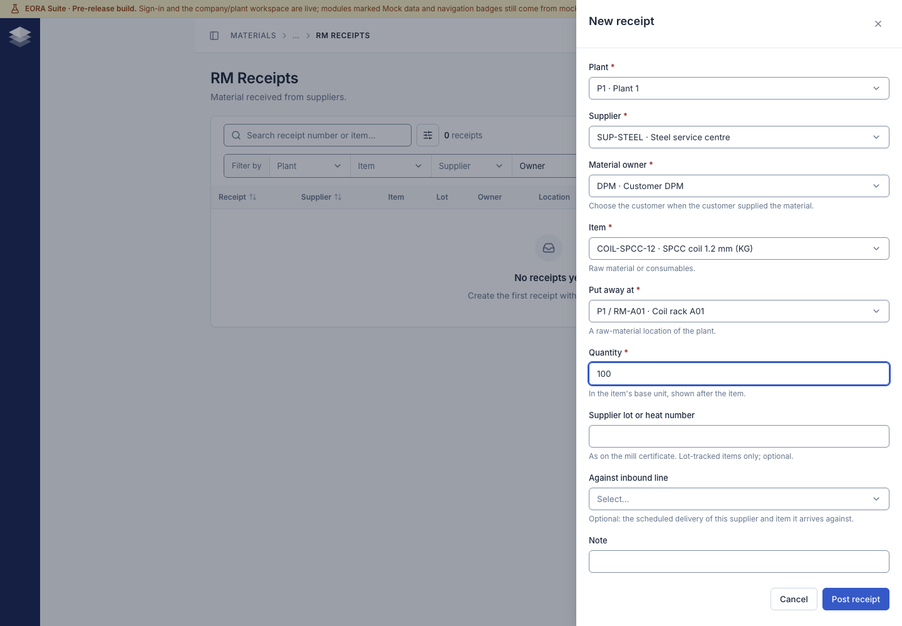

# Material ownership foundation — validation, 2026-11-19

Scope: D-135, doc 37, ADR-0020. Branch: `codex/material-ownership`. This is a local review build; the application database and locally served release have not been migrated to this branch.

## Verified results

| Check | Result |
| --- | --- |
| Focused ownership, ledger SQL guards and API contracts | 14 passed, 4,117 assertions |
| New ownership journeys | Customer receipt/day counters across items, idempotent retry, split, wrong/unassigned WO rejection, one-owner production, QC, FG receipt, material return, restricted delivery proposal/allocation/pick/shipment, runtime direct-SQL refusal, cross-tenant rejection and receipt reversal |
| Migration round trip | `migrate:refresh --database=pgsql_owner --force` passed as the non-superuser migration owner, against `eora_test` only |
| PHPStan | Passed |
| TypeScript | Passed |
| Frontend unit tests | 130 passed |
| Targeted browser regression | 11 passed; receipt/owner selection, WO customer attribution, stock and incoming release |
| Responsive/accessibility | Axe checks passed for receipt form at 1920, 1440, 1024, 768, 390 and 375 px; no document overflow |
| Web build | Passed with Next.js 16.4.6 |
| Lint | Passed |
| Complete API suite through PgBouncer | 493 passed, 20,000 assertions; tenant/pool isolation included |
| Complete browser suite | 243 passed on isolated port 3101 |
| Final ownership regression | 3 passed, 213 assertions; inactive customer split/production included |
| Rollback with customer history | Refused with SQLSTATE 23514; customer lots, ownership columns and migration record preserved |

## Review image

Synthetic browser fixtures only. This is not a receipt or stock position from the factory.

## Release boundaries

- Customer-owned material requires lot tracking; company-owned items retain the existing no-lot option.
- Customer-owned scrap requires a lot-controlled scrap item.
- One posting has one owner; mixed owners and cross-customer exceptions are unavailable.
- New aggregate MPS/MRP/Daily Recovery calculations refuse while a plant holds customer-owned physical balances. Owner-aware pegging remains a separate slice. Saved history and manual customer-specific WOs remain available. Operational deployment must account for this boundary.
- Monthly PPIC monitoring/NG provenance and factory UAT are not completed by this foundation.
- Rollback must not erase customer assets or history. Use a compatible forward rollback after customer assets exist. Refresh pooled prepared plans during an approved schema rollout.

## Build maintenance

The previous Next.js 16.4.3 build completed compilation but stopped at its security check. Next.js, the shared feature package's development version, and eslint-config-next are aligned to 16.4.6 with the repository-pinned pnpm 12.10.1. [Official 16.4.5 security release](https://github.com/vercel/next.js/releases/tag/v16.4.5) and [16.4.6 backport release](https://github.com/vercel/next.js/releases/tag/v16.4.6).

A dependency audit also reported Zod, Undici and minimatch advisories in the existing dependency tree. Those are outside this ownership slice and have not been independently assessed for reachable exploit paths or remediated here. Passing the build is not a complete security-audit result.

## Test environment observations

The first broad run was interrupted when the local Docker services stopped, and was not counted as completed. A fresh-schema change also exposed stale prepared plans in the shared test pool; focused tests were rerun directly against PostgreSQL after schema setup. Runtime role privileges were not broadened. All schema resets used the dedicated test database; user Excel edits and operational records were not imported or reset.

The receipt browser fixture now mocks optional customer/inbound pickers and filter masters. Shared mocked browser tests fence unmatched API requests with an explicit 503 test response and report the missing fixture, preventing accidental access to the running local API. Real-stack tests continue to use the base Playwright test without this fence. Unmocked requests had reached the real API, whose correct 401 response expired the synthetic test session. Product authentication was not weakened to make tests pass.

## Review follow-up checks

The MPS calculation guard was moved out of the general input reader, so reading a saved draft remains possible. The ownership integration now creates an MPS before customer receipt, proves its detail stays readable afterward, and proves recalculation is refused. MRP run/release guards are explicit at their write boundaries. The updated ownership/API-contract checks passed (7 tests, 3,996 assertions).

The first broad API completion found one outdated trace test assumption (RM and output used to share the same per-item lot number) and one context-latency failure while the broad browser suite competed for CPU. The trace check now proves both unique-number resolution and explicit lot resolution. Both files passed together afterward (7 tests, 702 assertions); the latency limit was not relaxed.

The full browser pass found two test-environment assumptions: a hardcoded port in the off-site redirect assertion and an unmocked plant lookup in the found-stock fixture. The redirect still asserts the exact configured origin. The affected auth/adjustment/receipt/WO suite then passed (23 tests). A shared EORA_TEST_WEB_PORT override replaces the temporary configuration for independent verification builds.

The final complete API run passed through PgBouncer after the trace correction, without relaxing the latency threshold. Backend suites must run sequentially against this shared test database: an overlapping focused attempt conflicted with the invitation mail queue; its sequential ownership rerun passed. The final complete browser run passed after isolating mocked requests.

## Guidance reviewed

Read: Caveman at `/Users/ekadanararrasyid/.codex/plugins/cache/caveman/caveman/4.1.0/skills/caveman/SKILL.md`; Frontend Design at `/Users/ekadanararrasyid/.codex/plugins/cache/claude-plugins-official/frontend-design/1.1.1/skills/frontend-design/SKILL.md`; EORA Design Constitution and Component Standards. Applied concise analysis, the existing table/form components, explicit ownership labels, responsive checks and accessible controls. Owner-approved Inter, Modern Corporate Blue and the existing shell take precedence over generic aesthetic suggestions. No additional skills were required.
